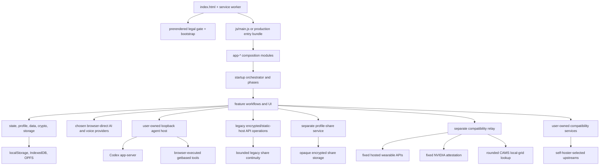

# getbased architecture

This is the human-maintained architecture contract for the getbased codebase.
Use it to decide where a module belongs, which direction dependencies should
flow, and which system boundaries a change must preserve. The generated
[`MODULE_MAP.md`](MODULE_MAP.md) is the file-level companion: it inventories
every first-party runtime module and its direct imports.

Public feature and deployment documentation remains in the separate
[`getbased-docs`](https://github.com/elkimek/getbased-docs) repository. This
file covers code ownership and dependency rules that must change with the app.

## Update contract

- Add, remove, rename, or change imports in `js/`, `api/`, `lib/`, or
  `dev-server.ts`: run
  `npm run architecture:build` and commit the generated map.
- Change a module's responsibility, a major data flow, an entry point, or an
  allowed dependency direction: update this file and the architecture rules.
- Move public behavior or a user-facing contract: update the relevant page in
  `getbased-docs` as well.
- Never hand-edit `MODULE_MAP.md`. CI regenerates it and fails if it is stale.

## TypeScript source contract

Canonical `.ts` and `.mts` modules compile with TypeScript 7 to ignored `.js`
and `.mjs` siblings at existing runtime URLs. Run `npm run typescript:build`
after source edits. `npm ci` runs it through `prepare`; the `dev-server`, `test`,
`production:build` and `production:check` npm commands also compile first.
Source inventories prefer the canonical TypeScript file. Project-owned assets in
`vendor/components.json` participate in source-completeness checks; external vendor
bundles remain third-party inputs. The same ownership manifest includes executable
project-owned vendor modules in coverage and affected-test planning. CodeQL excludes
external bundles precisely so owned vendor sources remain scanned. Runtime coverage
uses emitted JavaScript offsets consistently across Node and browsers.

Compiler tooling uses the TypeScript 7 native SDK.
[`scripts/native-typescript-ast.ts`](scripts/native-typescript-ast.ts) owns scoped
parsing sessions: consumers inspect real SDK nodes synchronously and return plain
data, then release the snapshot and compiler process. Production and test
semantic checks use separate strict projects for their actual browser, worker and
Node environments. The default editor, app and server projects use the native
NodeNext resolution, checked index access, exact optional-property types and
erasable/verbatim module rules too. All native projects retain their compiler safety flags. Source-completeness
checks use the fixed inventory in
[`scripts/typescript-migration-baseline.json`](scripts/typescript-migration-baseline.json).

## Presentation and lifecycle contract

`body-measurement-model.ts` owns method-specific waist/hip/SAD field identities
and validated portable-mirror projection. `wearables-manual.ts` owns their paired
numeric writes and deletion clocks through the existing encrypted manual-reading
path. Overview tiles read this projection without pooling methods into a wearable
baseline. The lazy body-measurement loader guards profile, route and modal
ownership; its Svelte editor preserves drafts and compares only matching methods.
Waist-to-height ratio is a display projection from canonical centimetre waist
values and the current profile height; it does not rewrite measurement history.
`body-measurement-cycle.ts` projects optional date-specific cycle context and
rolling estimated comparison windows for this editor and the Cycle overview.
Forecast dates never create observed periods, change raw measurements or infer
an adjustment to fat mass.

Svelte components own first-party markup. Pure presentation modules project
readonly data; feature controllers retain calculations, provider requests,
storage, navigation and delegated actions. Projections preserve observable getter,
coercion, default and fault order at public boundaries. Ordinary parents compose typed children,
including the finite Dashboard and Lens widget unions. Do not coordinate children
through serialized HTML, compiler markers, string slots or private frame parsers.

Public synchronous HTML facades serialize those same owners at native insertion
boundaries. Explicit legacy renderer injection APIs remain compatibility boundaries,
not a path for untrusted data or ordinary application composition. Sanitized Markdown,
fixed SVG/catalog content and self-contained printable documents have separately
reviewed content boundaries. [The DOM sink audit](scripts/dom-sink-audit.mts) owns
its exact current policy; new sinks require explicit review, not a count refresh.

Shared components serve both the native-compatible entry and the static Kit route.
Hydrate matching snapshots once, preserve retained controls and live child hosts,
and dispose the old owner before replacing its DOM. Each native component uses
lifecycle functions from its own emitted bundle; Kit shares one Svelte runtime.
The synchronous browser serializer needs no rendering backend. Its build rejects
static Node dependencies; Svelte's unused asynchronous renderer import must not
become a browser dependency.

Every async view action captures its profile/data, root and request identity before
awaiting work. Recheck the relevant provider, credential, thread, selection or draft
before dispatch, publication and persistence. Retired controls cannot start new work
or update replacement views. Accepted domain writes can finish for their original
owner after closure; they must not publish into a new owner's UI or adopt unrelated
unsaved fields. Domain transactions, locks and explicit field baselines decide
commit/rollback, not component mount lifetime.

Keep credentials and private metadata in dedicated live-field/service ports,
not general display snapshots or action attributes. Existing explicit Sync recovery
and profile-share reveal/copy serializers retain their narrow sensitive display
contracts; see [credential presentation boundaries](engineering/presentation-ownership.md#credentials-identities-and-payment-operations).
Those owner views must not become diagnostic or analytics snapshots. Disposal
scrubs retained fields. Preserve current
input values, native reset defaults, selection, composition, focused-node identity,
keyboard activation, focus traps and scroll locks during refreshes. Release listeners,
subscriptions, timers, observers, pointer capture and object URLs with their owner.
Delayed initial focus must yield to an explicit newer focus target or modal.

See [presentation ownership](engineering/presentation-ownership.md) for feature
entry points, sensitive workflows and lazy-loading boundaries. The generated map
remains the complete module/import inventory.

Optional features expose lightweight configuration and loaded-owner ports before
loading their UI. The EMF interpretation port retains synchronous close/abort and
focus cleanup; late streams and completions must match their request, profile,
data and actual overlay/body owner. Closing a cold feature does not load it.

Biology definitions and state-aware synchronous calculations live in
[`biology-score-compute.ts`](js/biology-score-compute.ts); Dashboard projection and
shared persisted review contracts do not import its page/AI controller. The public
`biology-scores` facade reexports the same bindings. Biology navigation waits for
its cached page module and shared styles, rejecting retired route/profile/root
requests. Startup completes synchronous chrome setup, then waits for the current
first-party navigation before declaring `data-app-ready`. A replacement route or
Dashboard breakpoint supersedes a pending load; an abandoned import cannot block
its ready replacement. Navigation started during later bootstrap is drained before
readiness too. The public route return values and injected startup callbacks keep
their original contracts. A contained route failure may finish with a usable retry
alert; an unhandled current-route rejection prevents readiness.

The production route runtime prepares one Dashboard composition and controls
instance on first use. Empty Welcome and marker pin operations stay synchronous;
populated Dashboard, Lens and Light routes await the resident composition before
reading preferences or projecting content. Public `views.ts` keeps its original
synchronous injected factory and re-exports the same route/action functions from
`views-runtime.ts`. Prepared widget controls, including picker projection and
rendering, keep their synchronous path. Each visible-widget render owns a fresh
Biology projection scope. It may reuse a successful calculation only across adjacent
Biology widgets with eligible inputs and unchanged owners; any other feature
projection retires the scope before running. Standalone projections keep their
per-call behavior. A segment captures one coherent score snapshot, including
live Light rollups, rather than rereading those rollups for each adjacent score.
No score result survives a render.
Biology AI presentation may share the material fingerprint within one synchronous
state read of a freshly computed score. Summary and answer reconciliation keep
separate reads around DOM replacement and focus callbacks; public state and
request-key functions retain their original per-call behavior.
The [scope tests](tests/dashboard-biology-render-scope.test.ts) and
[registry tests](tests/dashboard-render-projector.test.ts) cover this boundary.

Dashboard and Lens nutrition summaries import the typed `NutritionDashboard`
component directly. The lightweight `nutrition-widget-runtime` owns their shared
projection, native serialization, refresh and editor-residency port. The full
`NutritionPresentation` collection and editor controller load at an actual editor,
history, target or drink action. Cold actions retain their request, source control,
profile/data, route, focus and modal ownership through the complete opener; each
opener also checks its own mounted owner after storage or draft restoration. Warm
controls remain with the full controller's single resident delegate set.

The eagerly registered `nutrition-summary-runtime` owns serialized sync hydration
and awaits the lazy encrypted store before initial route readiness. Context and
profile refresh share that same operation; loading summary state does not require
the editor. Keep initialization, reconciliation, retries and accepted writes in
their existing storage owners.

The encrypted meal store delegates ordered row reads to `nutrition-store-reads`.
It uses bounded reverse batch reads only when the browser supports them and the
limit is a primitive positive integer within IndexedDB's count range; other limits
and browsers retain the cursor path. A list for a nonempty primitive-string profile
ID shares one fresh lazy device-key read for that invocation. Each selected envelope
is still validated and decrypted, with no cross-call key cache.

Imported-profile storage shares the exact WHOOP literal-token predicate with its
optional transformer. Values outside that existing eligibility boundary retain
their original bytes without loading the transformer; eligible values keep the
same device protection, passphrase encryption, durable migration and error path.

## Styling source contract

Tailwind 4 utilities and semantic recipes are the authored presentation source.
Components and typed class catalogs use scoped, prefixed utilities without global
Preflight. Theme variables remain authoritative for typography, colors and radii;
owner specificity and original cascade positions preserve shared/theme overrides.
Use the owning compiler rather than adding global overrides or `!important`.

[`scripts/build-styles.mts`](scripts/build-styles.mts) coordinates stylesheet owners.
[`scripts/native-recipe-styles.mts`](scripts/native-recipe-styles.mts) validates
ordered declarations, values and priorities before restoring them at their original
selectors, media/container/supports ancestry and cascade positions. Preserve foreign
styles, duplicate receiver order, comments and runtime URLs. Native CSS remains
appropriate for tokens, keyframe/pseudo-element grammar, vendor integration and
explicit self-contained print/report outputs; it must not become a second ordinary
component styling source.

LightSetup uses readable per-hook `gb-ls-<hook>` recipes, where `gb-ls` means
getbased LightSetup. Its complete Tailwind declaration catalog is build-only in
[`scripts/style-recipes/light-setup.mts`](scripts/style-recipes/light-setup.mts);
the runtime helper retains semantic hooks and its existing input behavior. The
LightSetup compiler replaces only qualified atomic selector tokens, preserving
exact owner/state selectors, specificity, cascade and all non-selector bytes.
A complete inverse and pinned native HTML/CSS contracts guard this single owner;
do not broaden it into a global class registry or a second styling language.

Static inline presentation is authored as named Tailwind recipes registered in
[`scripts/inline-style-map-owners.mts`](scripts/inline-style-map-owners.mts).
The TypeScript build validates these before compiling application sources and emits
immutable typed maps. Components and necessary native property setters consume
exact declaration bodies or validated singleton values, preserving inline cascade,
setter order and unrelated styles. Measured geometry, placement and visibility
state remain explicit controller ports; do not reintroduce fixed style strings.
Registered map outputs are excluded from authored-source fingerprints while their
recipe inputs remain included. Runtime map modules retain explicit worker assets.

The root foundation and optional-theme recipes compile to `styles.css` and
`themes-extra.css`. Startup-layout and shared-theme-mode recipes generate only
the two owned inline style snapshots in `index.html`, validating their unique
head/font/theme anchors and preserving all other document bytes. Keep their
first-paint order and legal/AppShell boundaries intact.

Run `npm run typescript:build` after authored changes. `styles:check` and
`svelte:check` verify reproducible emissions. TypeScript 7 remains the app compiler
and component diagnostics engine; `tooling/svelte` isolates the checker's supporting
TypeScript 6 peer. Native component artifacts retain source maps and stable public
URLs; static Kit compiles authored components directly. Architecture and test readers
include both component script blocks. Coverage counts authored components once,
separates positively mapped framework functions, fails on missing maps and retains
unmapped functions in the first-party denominator and diagnostics.

## Static SvelteKit distribution

`scripts/build-sveltekit.mts` assembles the default self-contained static
production distribution with SvelteKit 3 and `adapter-static`. `production:build`
writes `dist/`; `production:check` validates a disposable distribution. Vercel
publishes that same output. `tooling/svelte` isolates Kit's TypeScript 6 peer;
application sources still compile with TypeScript 7. The native compatibility
builder remains available for existing module, coverage and budget contracts.

The Kit route prerenders and hydrates shared authored components. Native
compatibility entrypoints use deterministic snapshots from those same owners,
then hydrate their matching nodes before installing feature delegates. Route and
native owners must not hydrate the same subtree twice or replace retained controls.
Populated Dashboard routes load their selected Desktop or Mobile renderer and
hydration owner together. Empty Welcome and mobile navigation remain synchronous.
Cold navigation awaits that renderer; resident rendering keeps its synchronous
path. A request ticket, profile/data identity, route revision, connected main
container and viewport protect publication and delayed work. An owned loading or
retry view never replaces persisted data.
Dashboard Biology widgets import their three typed presentation leaves directly.
The public overview and summary dispatchers retain their complete page renderers
without making those unused page branches part of Dashboard startup.
`ChatShell.svelte` and `ChatComposer.svelte` share the initial Chat structure and
composer; `js/kit/routes/app/+layout.svelte` starts existing services after mount.

Kit runs in embedded mode: navigation delegation attaches to `#kit-root`, the
parent of its route body. Native forms and links outside that mount retain their
document handlers and event cancellation order. Kit still manages navigation
and browser history inside its route.
The Vite graph compiles authored
components directly and shares one Svelte runtime with Kit. Native CSS,
worker and computed vendor URLs keep their original module-relative meaning.
Kit discovers only canonical `.ts` route modules, excluding emitted siblings.

Native compatibility and Kit client builds reuse five self-contained encrypted
provider SDKs at their existing vendor URLs. The build qualifies their complete
bytes, locked provenance and lack of additional module or worker dependencies,
then verifies every copied SDK and its full app-shell cache entry. Those bytes
remain included in cache-size measurements. Kit SSR and prerender retain their
normal module resolution.
The native optimized browser build selects production conditional exports, while
standalone development and Kit SSR keep their own resolution settings.

Shared Lens configuration, ordering, chrome and delegates live in
`js/lens-page-shell-core.ts`. First-party typed pages import that core directly;
the public `js/lens-page-shell.ts` facade retains synchronous compatibility
rendering over the same state. An unused compatibility renderer does not make
its full feature presentation part of startup.

Sync Diagnose configuration and clipboard actions stay available without loading
the modal presentation. First use loads its implementation with an explicit retry
URL; pending opens retire when their route, profile, main container or modal owner
changes. The sync engine keeps its existing lifecycle.

Automatic context assessments and Agent Access acquire the shared lab-context
builder only after their existing eligibility checks. Lightweight settings and
configuration consumers import their owning leaves; the public builder remains
synchronous. Its canonical and retry facades retain their own public function
identities while delegating to one shared private assembly module. Caller option
getters and date defaults are evaluated at the public boundary; cache and runtime
callback ownership remain shared. Injected callbacks retain their synchronous path. Cold preparation
rechecks profile, data, provider and callback ownership. Context assessments also
recheck fingerprints and demo consent after context assembly; Agent Access checks
its credentials and Sync scope again before encryption and transmission.

Native retry chunks share a physical body only after two build passes prove
identical code, exports and dependencies without module-relative URL inspection.
Import rewrites happen before content hashing. The exact hashed native
`?lazy-retry=1` transport keeps a separate ESM namespace; the worker serves it
from the requesting build's cache only after validating an install-generated
body proof. Missing or corrupt proof falls back to the original network request
without caching a query copy. Network responses cannot supply trusted proof
headers. Other query strings and qualified production raw module URLs retain
their behavior. Development-only emitted modules outside the declared bootstrap
and worker dependency closure are not a static-distribution module API.

Stable feature and root theme stylesheets follow the requesting document's reported
build cache. The waiting worker requires direct build replies from every live
document before early activation and checks the client census again. An unknown
legacy document leaves the update waiting until the old app windows close; it must
never be assigned a build from cache capability or a response timeout. Pages reply
to the requesting waiting worker as well as their current controller.
Update banners retain a visible, bounded pending state and bind automatic reload
intent to the exact requested worker. Deferral, timeout, messaging failure or worker
replacement restores an actionable status instead of silently hiding the update.
Page exit clears pending reload intent; a delayed replacement cannot reuse it.
Returning from the back/forward cache restores an eligible waiting offer or an
installed version's manual Reload action without polling or reusing automatic
consent; a deliberate Later dismissal remains effective.

Known cached app navigations record the resulting document's build before startup
styles load. Unproven network navigation responses cannot be promoted into the
owned version cache; missing owned app-alias documents fail closed in fingerprinted
production rather than mixing a new document with old version metadata. After a
worker restart, a bounded shared request recovers ownership.
Only an exact successful stylesheet in that build's existing cache is eligible,
including the exact lazy-retry request; unresolved ownership with retained builds
or an unavailable owned stylesheet returns an uncached error instead of another
build's CSS. Hashed modules, font/SQLite aliases and live requests retain their
separate routing rules.

The two Evolu vendor trees retain their public SQLite module and worker URLs.
Builds qualify four complete, byte-identical payload pairs against pinned hashes
and locked provenance before sharing their current-build cache entries. Fresh
responses preserve each requested module or worker's URL base for relative WASM
and proxy requests. Other Evolu assets and runtime identities stay distinct.

The static assembler externalizes Kit's classic bootstrap to satisfy the existing
CSP without permitting inline executable scripts. It copies only declared public
assets, retains `/`, `/index.html`, `/app` and `/app/`, and uses the existing
manifest identity, root service worker, update consent and storage services.
Kit worker registration and version polling are disabled. Live documents identify
their build to the worker so previous immutable modules remain available until
old tabs reload or close; unknown legacy documents retain their caches safely.
No rendering server is part of the output. See [static Kit build and acceptance](engineering/static-sveltekit.md).

## Runtime topology

getbased is a static browser application. Local development loads
`js/main.js` and its native ES-module graph directly. Hosted deployments serve
the optimized static SvelteKit distribution, with hashed framework modules and
lazy feature chunks. Official Vercel
functions are limited to encrypted operations and public deployment metadata.
An independently deployed Node compatibility relay owns the explicit
plaintext-operation allowlist. AI and voice provider payloads use
browser-direct routes.



The browser remains the authority for stored health data. AI, voice, and custom
provider payloads go directly from the browser to the selected provider; the
getbased-operated proxy rejects arbitrary authenticated or body-bearing
forwarding. Its compatibility allowlist contains only the Oura, Withings,
Polar, and legacy Fitbit requests used by the app, the exact NVIDIA NRAS GPU
attestation endpoint, a privacy-rounded CAMS lookup pinned to the Company-run
service, credential-free public-page reads explicitly marked by
the client, and dedicated configuration/environment helpers. The separate
compatibility relay can read allowed plaintext credentials and provider
responses while relaying them, but does not intentionally log or persist those
payloads. The static Vercel host does not receive these requests. Encrypted
share/sync envelopes remain opaque to the operator. WHOOP,
Ultrahuman, and Google Health are self-host-only and use the deployment owner's
OAuth application. Confidential token exchange and refresh use its same-origin
proxy; WHOOP and Google Health resource requests also transit it, while
Ultrahuman resource data is fetched browser-direct. No client path falls back
to getbased infrastructure. WHOOP and Google Health raw rows are protected by
non-exportable device keys and omitted from portable raw-data backups. WHOOP-
specific profile metadata and derived values use the same device-only boundary
independently of optional profile passphrase protection.

The hosted CAMS operation is the only plaintext location route. The browser
rounds to 0.1° and the compatibility relay repeats that rounding before an
authenticated POST to the fixed `/v1/uv` service. That service performs an
in-memory lookup against its scheduled configured CAMS grid without per-request
Open-Meteo enrichment or coordinate caching. If it fails or returns sparse
fields, the browser contacts Open-Meteo directly with the rounded coordinates.
Self-hosted deployments do not inherit the Company upstream: they must set
`UVDATA_UPSTREAM`. Local development selects the fixed Company service only
when its operator explicitly supplies both that exact URL and
`UVDATA_BEARER`.

## Enforced source boundaries

The architecture checker currently enforces these coarse runtime boundaries:

| Source group | Owns | May import |
| --- | --- | --- |
| `js/` browser | Native browser application | `js/` browser modules |
| `api/` hosted API | Hosted request handlers shared by deployment entry points | `api/` and `lib/` |
| `lib/` server-shared | Node-only policy and transport | `lib/` |
| `server/compat-proxy-server.js` compatibility server | Standalone Node compatibility-relay entry point | `api/` |
| `server/profile-share-server.js` standalone server | Operator-deployed profile-share entry point | `lib/` |
| `dev-server.js` local-server | Local development entry point | `lib/` |
| `service-worker*.ts` | Classic bootstrap, ordered offline manifest and cache-routing runtime; emitted at existing `.js` URLs | service-worker scripts |

Relative ESM imports and classic-worker `importScripts()` dependencies are
tracked. Data files and explicitly vendored browser libraries are recorded as
repository dependencies but remain outside the executable cycle graph.
Tests and tooling may import production modules; production modules must not
import tests or tooling.

The exact rules live in [`scripts/architecture-rules.json`](scripts/architecture-rules.json)
and are enforced by `npm run architecture:check` in local and CI validation.

## Target dependency direction inside `js/`

The desired internal direction is:

```text
entry and composition
        ↓
UI and workflow orchestration
        ↓
feature/domain services
        ↓
foundation, storage adapters, and pure utilities
```

- **Entry and composition** wires the app together and may have broad fan-out.
  It should not contain feature logic.
- **UI and workflows** render, collect user intent, and coordinate services.
  They should receive browser-shell callbacks through explicit configuration
  seams rather than creating reverse imports from lower layers.
- **Feature/domain services** own health calculations, provider contracts,
  normalization, and feature-specific persistence rules.
- **Foundation and adapters** own shared state primitives, encryption,
  serialization, storage access, and dependency-free helpers. They must not
  depend on feature UI.
- `*-runtime.js`, `*-hooks.js`, and configuration functions are dependency
  inversion seams. Keep them narrow; do not turn them into alternate global
  service locators.

This fine-grained direction guides further coupling cleanup,
but the runtime graph no longer contains strongly connected components. Both
cycle ceilings are fixed at zero, so the checker rejects any new cyclic
dependency.

## Module ownership map

| Area | Typical modules | Responsibility |
| --- | --- | --- |
| Boot and shell | `main.js`, `app-*`, `startup-*`, `nav*`, `views-router*` | Startup ordering, route selection, and shell wiring |
| Foundation | `state.js`, `profile*`, `data*`, `crypto.js`, `blob-storage.js` | Active state, durable profile data, encryption, migration, and storage |
| Labs and genome | `schema*`, `adapters.js`, `marker-*`, `dna*`, `biology-score*` | Marker normalization, reference data, genetics, and deterministic scoring |
| Body | `wearables-*`, `wearable-*`, `cycle*`, `supplements*`, `supplement-*` | Device adapters, local raw rows, synced summaries, cycle context, and period-based therapy/product evidence |
| Light and environment | `light-*`, `sun-*`, `emf*` | Light measurements, spectral/session models, environment and EMF context |
| AI, voice, knowledge, and agents | `api-*`, `provider-*`, `chat-*`, `voice-*`, `lens-*`, `agent-tool-*`, `pii.js` | Provider routing, prompt/context workflows, STT/TTS, RAG, portable agent-tool contracts, transport, and PII controls |
| Sync and Agent Access | `sync-*` | Encrypted CRDT payloads, deltas, relay health, configured/paused identity lifecycle, restore preflight, and agent context |
| Import/export | `pdf-import*`, `import-*`, `export*`, `backup*` | File classification, review/commit, portable report-data snapshots, PDF/agent projections, backups, and restoration |
| Presentation | `dashboard-*`, `context-card-*`, `settings*`, `modal-*` | Views, editing surfaces, settings, accessibility, and interaction lifecycle |
| Hosted and local server runtime | `api/*`, `lib/*`, `dev-server.js` | Server-side validation, proxy transport, sharing, and repository operations |

Names express ownership, not permission to bypass the dependency direction.
When a module spans two rows, split orchestration from domain logic or inject
the higher-layer behavior through a narrow runtime seam.

## State, storage, and privacy boundaries

- `state.js` is shared in-memory session state. Do not treat it as durable
  storage or add feature callbacks to it.
- Lab marker values and ranges remain in their schema-canonical units at rest.
  `unit-profiles.js` resolves the International, Australia/New Zealand, and US
  display projections over the complete schema; conversion happens only in
  active view data and user input is converted back before persistence. See
  [the unit-profile implementation](js/unit-profiles.ts) and its
  [regression tests](tests/unit-profiles.test.ts).
- Profile writes flow through profile/data persistence helpers so migrations,
  encryption, change history, and sync hooks remain consistent.
- Secrets and sensitive rows use the existing encryption and IndexedDB paths.
  Do not introduce plaintext fallbacks for OAuth tokens, AI keys, wallet
  proofs, genetics, or health records.
- Raw vendor wearable and cycle stores remain device-local. Explicit user-entered
  weight, blood pressure and pulse use the encrypted `manualBodyReadings` Sync
  map, keyed by metric and date; source histories from vendors or file imports
  are excluded. The local Reading store remains the display source of truth,
  reconciled from this narrow map with deletion intent and guarded profile writes.
  Row writes reread canonical deletion/field clocks inside their manual write
  boundary. Portable manual restores drain prior profile-load wearable work
  before copying fields, then materialize rows and refresh only manual-owned
  projections before publishing their still-current import shell.
- Supplement and medication status is derived from dated periods. Product-label
  facts, a user's regimen, inactive materials, and source quality evidence stay
  separate; AI consumers use the bounded projections in `supplement-context.js`.
- A configured Sync identity may be active or paused. Pause preserves the owner,
  planner state, and dirty edits; disconnect/reset is the explicit cleanup path.
  Restored backups must publish their marked profiles before inbound tombstones
  can apply.
- Network calls use the existing provider, URL-safety, PII, same-origin, and
  proxy-policy boundaries. New direct fetch paths require an explicit review.
- Agent tools expose semantic projections through an explicit catalog. They do
  not grant raw DOM, storage, credential, arbitrary JavaScript, or shell access;
  data mutations require narrow draft/commit tools and explicit approval.
- UI modules render escaped/sanitized values and use the shared modal and
  delegated-action patterns; architecture cleanup must not weaken XSS or
  accessibility guards.

## Adding or changing a module

1. Choose the ownership row above and keep the filename feature-oriented.
2. Import down the target dependency direction. If that is impossible, add a
   narrow injected callback/runtime seam instead of a reverse dependency.
3. Run `npm run architecture:build` after changing the graph.
4. Inspect the `MODULE_MAP.md` diff. A new cycle or source-boundary violation
   is a design failure, not a baseline-update task.
5. Add focused behavior tests, run `npm run architecture:check`, and run the
   normal test suite.
6. Update this file only when responsibilities, boundaries, or major flows
   changed; routine file inventory changes belong only in the generated map.

## Architecture tooling and debt ratchet

- `npm run architecture:build` regenerates `MODULE_MAP.md`.
- `npm run architecture:check` verifies the generated file, resolves every
  relative ESM import, enforces source boundaries, and rejects cycle growth.
- [`scripts/architecture-cycle-baseline.json`](scripts/architecture-cycle-baseline.json)
  fixes both cycle ceilings at zero. Never raise either ceiling merely to pass
  CI; a new cycle is a design failure.

## Cold-load performance budget

`npm run performance:check` measures a fresh mobile returning-user load of
`/app` with the browser cache and service workers disabled. The committed
ceilings in [`scripts/cold-load-budget.json`](scripts/cold-load-budget.json)
cover same-origin application request count, compressed transfer bytes, and
decoded bytes. Runtime `/api/*` calls and cross-origin services are excluded so
the measurement tracks the shipped app graph rather than network availability.
This guard targets the native-compatible development graph. Profile the static
distribution separately with `sveltekit-startup-performance.spec.ts`, as described
in [CONTRIBUTING.md](CONTRIBUTING.md); startup and complete worker precaching
are distinct measurements.

The mandatory Terms/Privacy gate is prerendered at the start of `index.html`.
`legal-consent-bootstrap.js` validates current acceptance and makes a required
gate interactive before the main application graph arrives. Development and
the static Kit distribution load that bootstrap as a standalone classic script
under the deployed CSP. The native compatibility production builder inlines the
same checked source into its HTML. `legal-consent.js` retains application integration and
fallback path after startup. Both paths dispatch the same
`legal-consent-accepted` event so changelog, analytics, backup, and deep-link
destinations remain ordered behind acceptance.

The browser check runs in the normal Chromium suite and therefore in CI. Lower
the ceilings as route and feature lazy loading removes startup resources; do
not raise them to absorb an unexplained regression.
