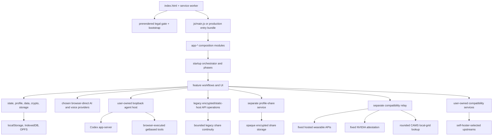

# getbased architecture

This is the human-maintained architecture contract for the getbased codebase.
Use it to decide where a module belongs, which direction dependencies should
flow, and which system boundaries a change must preserve. The generated
[`MODULE_MAP.md`](MODULE_MAP.md) is the file-level companion: it inventories
every first-party runtime module and its direct imports.

Public feature and deployment documentation remains in the separate
[`getbased-docs`](https://github.com/elkimek/getbased-docs) repository. This
file covers code ownership and dependency rules that must change with the app.

## Update contract

- Add, remove, rename, or change imports in `js/`, `api/`, `lib/`, or
  `dev-server.ts`: run
  `npm run architecture:build` and commit the generated map.
- Change a module's responsibility, a major data flow, an entry point, or an
  allowed dependency direction: update this file and the architecture rules.
- Move public behavior or a user-facing contract: update the relevant page in
  `getbased-docs` as well.
- Never hand-edit `MODULE_MAP.md`. CI regenerates it and fails if it is stale.

## TypeScript source contract

Canonical `.ts` and `.mts` modules compile with TypeScript 7 to ignored `.js`
and `.mjs` siblings at existing runtime URLs. Run `npm run typescript:build`
after source edits. `npm ci` runs it through `prepare`; the `dev-server`, `test`,
`production:build` and `production:check` npm commands also compile first.
Source inventories prefer the canonical TypeScript file. Project-owned assets in
`vendor/components.json` participate in source-completeness checks; external vendor
bundles remain third-party inputs. The same ownership manifest includes executable
project-owned vendor modules in coverage and affected-test planning. CodeQL excludes
external bundles precisely so owned vendor sources remain scanned. Runtime coverage
uses emitted JavaScript offsets consistently across Node and browsers.

Compiler tooling uses the TypeScript 7 native SDK.
[`scripts/native-typescript-ast.ts`](scripts/native-typescript-ast.ts) owns scoped
parsing sessions: consumers inspect real SDK nodes synchronously and return plain
data, then release the snapshot and compiler process. Production and test
semantic checks use separate strict projects for their actual browser, worker and
Node environments. The default editor, app and server projects use the native
NodeNext resolution, checked index access, exact optional-property types and
erasable/verbatim module rules too. All native projects retain their compiler safety flags. Source-completeness
checks use the fixed inventory in
[`scripts/typescript-migration-baseline.json`](scripts/typescript-migration-baseline.json).

## Presentation and lifecycle contract

Foreground modals and the Sync popover cancel optional Dashboard Chat startup,
including a request still awaiting module or presentation loading; explicit Chat
actions retain their normal behavior.
Optional empty-Dashboard Chat startup owns its reservation by render generation
and profile. Failed loads or a narrower viewport release it; completion from a
retired render cannot clear a newer reservation.
Lazy Chat open/toggle requests retain their initiating profile through module
loading. Panel opening checks that profile and its open intent after each
asynchronous load, so a deleted profile's pending request cannot initialize a
conversation on its temporary sync fallback or another selected profile.
An interrupted visible opening closes only while it still owns the latest open
intent, leaving a newer opening intact.

`body-measurement-model.ts` owns method-specific waist/hip/SAD field identities
and validated portable-mirror projection. `wearables-manual.ts` owns their paired
numeric writes and deletion clocks through the existing encrypted manual-reading
path. Overview tiles read this projection without pooling methods into a wearable
baseline. The lazy body-measurement loader guards profile, route and modal
ownership; its Svelte editor preserves drafts and compares only matching methods.
Waist-to-height ratio is a display projection from canonical centimetre waist
values and the current profile height; it does not rewrite measurement history.
`body-measurement-cycle.ts` projects optional date-specific cycle context and
rolling estimated comparison windows for this editor and the Cycle overview.
Forecast dates never create observed periods, change raw measurements or infer
an adjustment to fat mass.

`lab-panel-identity.ts` owns stable identities for separate same-day lab panels
and their versioned date-row transport. Canonical profile data keeps individual
panels; the delta planner emits one date carrier with an ordinary top panel and
additional panels in `labPanelBundle`. The pull adapter expands that carrier
before publishing canonical data. Blob reconciliation merges named panels and
their marker clocks independently; legacy date-unique rows retain their additive
merge. Different filenames alone do not establish different collections.
Profile migrations assign deterministic IDs to old split-day panels and retain
those IDs through later corrections. Locked profile rebasing uses those IDs,
while exact reviewed date expectations still reject stale lab snapshots. Date
projections and date-wide notes are not specimen-specific record selectors.

`lab-sample-cycle.ts` validates explicit cycle day/phase/detail commands for one
sample. These commands share the sample transaction and first-original provenance
with other collection edits. They never create periods or infer a phase from a
day or forecast. A reported phase/detail becomes recorded; a day-only correction
preserves the existing phase source. Clearing a phase clears its detail/source
with merge-stable nulls and allows ordinary profile predictions again. The sample
editor uses the same owner. Exact chat reads/reviews require Insight disclosure
for these fields in addition to lab-source access; ordinary local editing remains
available independently. Version 1 pending sample reviews require a fresh read
before applying against the expanded version 2 collection snapshot.

`lab-panel-deletions.ts` owns monotonic removal and restore clocks per panel and
date, independently of whole-date tombstones. Its registered keyed sync surface
retains removal history when a peer omits a key; an explicit restore advances the
restore clock. Both row arrival orders apply this history before exposing panels.
`lab-panel-mutations.ts` selects one sample and owns panel-local original values;
date-wide legacy originals are used only when their ownership is unambiguous.
An explicit null original prevents a stale date map from reviving a cleared
original after Revert or replacement of a report.
`lab-report-samples.ts` resolves report ownership by stable sample identity and
source ancestry. Re-review retains that collection, including after a sample
date move; source removal and replacement restore only evidence belonging to the
same collection. A new report on an occupied date requires an explicit existing
sample or separate-collection choice in the ordinary import review. Extracted
content and restored draft fields cannot grant an internal re-review target.
`lab-report-store.ts` stages report changes against the captured profile baseline
and checks affected lab/source/provenance/diagnostic fields and deletion history
inside the locked commit. Failed or revoked writes publish no staged values;
unrelated local edits survive adoption of a successful durable result. Report
reference ranges use the captured profile sex and refuse a late owner change.
`lab-marker-mutations.ts` applies pure value/remove/revert commands and preserves
source links, aliases and dependent marker behavior. `lab-marker-record-store.ts`
commits these through the captured profile's locked date, deletion-state and map
expectations. Numeric marker-detail actions use that owner and publish accepted
values only after persistence. Ambiguous date-only writes require a sample choice.

`lab-display-core.ts` projects and changes display labels and category placement
without re-keying marker evidence. `lab-display-store.ts` owns durable native
commits with profile/editor leases and locked definition, label and placement
expectations. Native rename/placement editors and provider-neutral chat reviews
use that owner. Saved base category labels and `contextGroup` retain source
identity independently of editable names; adding a marker after a category rename
keeps those identities. Placement restoration preserves unrelated future metadata.
The chat adapter refreshes only its still-owned surface after persistence.

`lab-ordering-core.ts` owns portable presentation moves by stable item/anchor IDs.
Concurrent moves merge deterministically; explicit reset/restoration creates a new
generation so a stale peer cannot revive a superseded order. Unknown metadata is
preserved, or conflicting/unsupported edits fail before persistence.
`lab-ordering-native.ts` derives finite marker, specialty-category and sidebar
group scopes from native definitions and placements. `lab-ordering-store.ts`
guards their durable writes with profile/editor leases, exact scope expectations
and registry dependencies. Its snapshots exclude observations and source files.
Ordering saves invalidate presentation data and schedule sync without publishing
a clinical-context change.
`lab-ordering-view.ts` projects moves after calculations and each chart's default
sort; unmodified items keep their relative order. `lab-ordering-sidebar.ts` moves
existing whole static sidebar nodes, retaining group pairs, collapse controls and
delegates. Portable exports and native restore/sync paths preserve ordering intent.
`lab-ordering-delta.ts` merges per-row ordering carriers by semantic generation
and operation identity, repairs regressed/tombstoned carriers, and respects the
existing decompression budget. A missing scope never authorizes a transport delete.
Single-move Undo adds a monotonic operation cancellation to the same generation,
so later-arriving peer moves survive and a stale peer cannot revive the undone
move. Whole-scope reset/restoration still creates a new generation.
Legacy ordering review/receipt modules retain bounded native-owner safety checks,
but ordering is excluded from chat discovery, preparation and execution. Saved
historical cards are read-only; they cannot apply or undo ordering changes.
`record-revision.ts` shares the existing stable digest without storage/UI imports.
`lab-overlay-preferences.ts` owns the three durable profile chart-layer switches,
shared by native Layers controls and chat. Multi-switch writes share a Web Lock,
roll back failed storage before publishing cached modes, and preserve health data.
`lab-overlay-controls.ts` binds permitted metadata snapshots to transient reviews;
its policy module retains lab/insight/supplement disclosure and the native female
cycle constraint without inspecting record availability. Execution uses the same
native preference owner; private receipts authenticate completion and guarded Undo
after reload. Pending reviews expire. Undo touches only reviewed switches and is
attempted once; source withdrawal filters cards and later model metadata. Neither
proof nor repaint failure can turn a durable preference save into a failed write.
`context-preference-state.ts` projects source/group flags and native lookback
windows without reading health content or data availability. The registry accepts
explicit profile/data reads while retaining its existing active-profile defaults.
Context Hub owns source/group/window changes, autosaves and retry drafts.
Disclosure controls remain in the native UI. Chat cannot capture a new disclosure
lease, apply a saved review or undo an imported historical control. Native changes
preserve health records, source restrictions and Agent Access secrets and publish
through the existing context-update path. Past shared messages are retained.
`lab-display-import.ts` owns database-restore display metadata merging.

Svelte components own first-party markup. Pure presentation modules project
readonly data; feature controllers retain calculations, provider requests,
storage, navigation and delegated actions. Projections preserve observable getter,
coercion, default and fault order at public boundaries. Ordinary parents compose typed children,
including the finite Dashboard and Lens widget unions. Do not coordinate children
through serialized HTML, compiler markers, string slots or private frame parsers.

Public synchronous HTML facades serialize those same owners at native insertion
boundaries. Explicit legacy renderer injection APIs remain compatibility boundaries,
not a path for untrusted data or ordinary application composition. Sanitized Markdown,
fixed SVG/catalog content and self-contained printable documents have separately
reviewed content boundaries. [The DOM sink audit](scripts/dom-sink-audit.mts) owns
its exact current policy; new sinks require explicit review, not a count refresh.

Shared components serve both the native-compatible entry and the static Kit route.
Hydrate matching snapshots once, preserve retained controls and live child hosts,
and dispose the old owner before replacing its DOM. Each native component uses
lifecycle functions from its own emitted bundle; Kit shares one Svelte runtime.
The synchronous browser serializer needs no rendering backend. Its build rejects
static Node dependencies; Svelte's unused asynchronous renderer import must not
become a browser dependency.

Protection controllers load their passphrase, encryption and backup presentations
on first use. A passphrase owner exists synchronously while its component loads;
settings loads capture the profile, connected host and snapshot revision. Late
loads cannot mount retired views, and folder updates received during a backup
load stay with the current snapshot. Backup owners retain summary rows before
mounting and across retries, independently of the encryption presentation.
Loading failures expose a retry control
using a fixed module alias. Preparation helpers are explicit readiness boundaries
for callers that need the mounted view; secrets remain in the dialog owner.

Every async view action captures its profile/data, root and request identity before
awaiting work. Recheck the relevant provider, credential, thread, selection or draft
before dispatch, publication and persistence. Retired controls cannot start new work
or update replacement views. Accepted domain writes can finish for their original
owner after closure; they must not publish into a new owner's UI or adopt unrelated
unsaved fields. Domain transactions, locks and explicit field baselines decide
commit/rollback, not component mount lifetime. A save adopting into a replacement
object for the same profile uses that object's own read baseline, so stale loaded
values cannot undo the committed edit and newer unsaved fields remain intact.

Browser-wide Knowledge Base preferences use `knowledge-settings.ts` and its
pure proposal projection. The shared `lens-config-store.ts` queue/Web Lock orders
native and reviewed preference commits with raw-source expectations; it preserves
private connection fields and blocks open native drafts. A committed IndexedDB
receipt fences the synchronous configuration mirror across processes; Web Locks
alone cannot make that mirror fresh. Native, restore and sync writes use the same
acknowledged owner. Source reads and final inventory disclosure refresh the receipt,
so a delayed Storage event cannot disclose a peer-disabled Knowledge Base.
`knowledge-inventory.ts`
reads existing OPFS handles and verifies native corpus generations within explicit
size budgets. It never initializes the worker or creates, migrates or repairs a
corpus. Library mutations share the native registry owner; document mutations
and connection setup keep their dedicated workflows.
The native local client recovers its serial queue after rejected requests and
retires failed workers before reinitializing storage for existing handles. Registry
writes preserve opaque fields. An acknowledged recovery copy can accept a change
when the primary write fails only if a fresh read matches the complete intended
registry. An unconfirmed write blocks further mutations, retires the worker and
requires authoritative reload; the failed mutation is never replayed automatically.
OPFS byte helpers complete short transfers and reject zero progress before flush.
Unavailable registry reads fail explicitly; a lock or storage error is never
treated as an absent store to initialize over existing data.
Dedicated local workers serialize library and corpus operations with the same
origin-wide Web Lock and reload saved registry state after acquiring it. Ordinary
refreshes do not repair storage or recover removed directories; explicit native
initialization retains migration and repair. Abort and ingest acknowledgement
messages bypass the lock so an importer can stop or finish while it owns storage.
Cancellation received while waiting for another tab remains effective.
`lens-local-library-session.ts` offers a short-lived management client using
`init_metadata`: it can initialize native storage, but never loads an embedding
model and cannot run document/search operations. It requires Web Locks and must
not serve read-only tool inventory or proposal preparation. Reviewed library
commands use this client with initialization disabled. Reviewed content imports also
use an uninitialized session; their explicit command can load an approved model. `knowledge-library-source.ts`
proves bounded registry/corpus bytes without writes; `knowledge-library-proposals.ts`
projects the public review. `knowledge-library-commit.ts` rechecks that exact source
under the native storage lock and requests a parent authorization immediately before
the first write. The parent checks fresh configuration, profile identity, disclosure
and native drafts without reacquiring the storage lock. Creation with activation
and removal with a final replacement are single registry commits. Private bounded
command receipts allow positive read-only confirmation after a lost reply; absence
does not authorize replay. The chat card's Check saved change action never retries
a mutation or releases its durable claim.
`knowledge-library-records.ts` owns browser review/commit and clean-view refresh;
notifications contain invalidation only. `knowledge-library-query.ts` identifies
the actual saved active corpus. Local search/cache generations include that source,
and workers check the expected library/revision before embedding initialization.
`knowledge-document-model.ts` defines stable library-scoped document identities and
public review facts. `knowledge-document-source.ts` validates complete native corpus
generations without exposing text/vectors. The document records owner reuses the
same browser scope/configuration/draft gates. The Worker document commit owner
renames indexed sources or deindexes exact document/vector rows through the existing
manifest-last snapshot writer, without loading an embedder or changing the registry.
Native replacement imports retain document identity and opaque metadata. Bounded
private manifest receipts support read-only confirmation after a lost result; no
receipt means unconfirmed. These changes retain native recovery generations, source
files and backups and do not establish complete erasure. Shared Worker authorization
and dispatch order library/document commands under the existing origin-wide lock.
`knowledge-file-selection.ts` owns local chosen-content staging, while the pure
`knowledge-file-descriptor.ts` validates its metadata contract. Descriptors bind
source names, original-byte hashes, extracted-text hashes and excerpt counts;
source text remains in page memory and cannot be read through a changed descriptor
or retired owner. Abort/discard releases that input. Reload requires source
reselection rather than persisting private selected-file contents in chat storage.
Selection and retained-content limits are independent of embedding/model startup.
`knowledge-file-review.ts` acquires files only from the user's native picker action,
then publishes a separate metadata review. `knowledge-file-inputs.ts` retires source
leases on owner changes, discard or completion; `knowledge-file-preview.ts` mounts
the read-only paged Svelte preview and removes its text when that owner retires.
Knowledge Base management is native UI only. Model catalogs expose document
search, without inventory or import resources. Historical management proposals
cannot execute or re-advertise actions in chat. The following internal transaction
owners retain their typed storage/recovery contracts independently of chat.

`knowledge-import-model.ts` projects pasted-text and chosen-file imports into a
selected library, including explicit replacement identity, model download and
shared-browser effects. Its source adapter reads metadata only. The retained internal
preparation contract binds pasted text to the initiating source message. A file-choice request
contains no source token; only the native picker can produce a selected-file review.
Extracted file bodies are absent from model requests and saved chat history. The
browser sends them directly to the Worker on Apply, which verifies their exact
names, hashes, lengths and chunk counts against the reviewed descriptor. The import commit owner
reuses `buildLocalIngestTransaction` and the native manifest-last snapshot writer,
with a scope grant before model loading and immediately before any persistent
corpus action. Failed/cancelled planning leaves the saved generation untouched;
replacement retains document identity and opaque metadata. Transient import jobs
own progress/Stop controls. Before the saving boundary Stop terminates the dedicated
Worker; accepted saves finish and use bounded private receipts for read-only
confirmation. The browser records owner retires revoked jobs and refreshes clean
native views/caches. Batch imports commit one complete generation and validate the
actual planned file sizes before opening writable handles, under the existing
source-read limits. Chosen ZIP archives still require the dedicated native importer;
these internal owners do not erase originals or reconstruct source documents from search excerpts.
Tool-capable chat routes request document retrieval through the semantic search
tool, including saved multi-query rewriting and Stop signals. Successful searches
provide the response's source citations. Personal gateways without local tools,
discussion and Current Focus retain their baseline retrieval paths. The native
settings panel still initializes its full embedding client when opening local stats.
Deleting the final library commits a fresh library identity. Failure to erase the
old directory cannot make it the replacement's corpus; physical cleanup failure
is returned separately and reported by the native UI.

`hermes-agent-isolation.ts` owns the private Hermes ACP managed policy and
bounded startup verification. The host preserves the native login source while
excluding built-in execution/file tools, ambient MCP servers, optional plugins
and external memory from the local chat process. A fresh random policy marker
prevents an unchanged user preference from passing verification when the CLI
ignores the process policy. Verification failure leaves the adapter unavailable;
existing administrator policies are never replaced. The policy lives beneath
the host's private temporary workspace and is removed with that owner. Personal
gateway routes keep their separately selected native behavior. This is a
verified CLI tool-configuration boundary, not an OS filesystem sandbox.

Interactive local agent chat requires the application-context capability. Current
enabled context and filtered proposal status/actions travel as a bounded JSON
applicationContext field, separately from static instructions and original user
text. Codex turns receive it as a current input item; ACP and Claude-style turns
receive the same labeled private application data even on resumed sessions. The
host rejects malformed or oversized snapshots instead of truncating their newest
decisions. Browser tool evidence still uses only the original user message. Direct
API providers retain fresh per-request system context; personal gateways retain
their existing baseline-only route without local proposal state.

Custom persona storage serializes native, import and sync writes per profile,
using a shared Web Lock where available. Native deletion requires that lock and captures a private
single-use review lease over the exact encrypted collection and deletion history.
It prepares both encrypted values before its guarded commit, verifies persistence,
and compensates only its own exact stored bytes on failure. A private IndexedDB
journal, protected by the active encryption mode, and a local presence fence precede either record write; a durable
commit marker distinguishes completed changes from interrupted ones. Reopening
restores unconfirmed writes and retains committed changes, without overwriting
newer replacements. Persona loaders, sync collection, full backups and encryption
migrations resolve recovery before reading or transforming the pair. Sync, JSON
export and full-backup collection hold the same native lock across their persona snapshot.
Journal transitions and cleanup use a conditional IndexedDB transaction so a
replaced recovery owner cannot be overwritten between a read and its write.
Profile cleanup removes the journal backend and its local fence. An unproved recovery
reports an uncertain outcome and preserves unrelated replacements. Unreadable,
locked or unfamiliar collections cannot become empty deletion baselines; other
personas and unknown retained fields survive. This storage command does not itself
declare a chat action or accept a persona agreement on the user's behalf.
Inbound sync and portable chat imports use `mergeCustomPersonalitiesFromReplica`
to recover, strictly read and merge the latest pair under that native Web Lock.
They publish both records through the same durable journal, rather than replacing
a collection derived from an earlier sync snapshot. A native edit or deletion
completed during collection survives; portable imports check their only-if-unset
policy inside the lock. Replica merges preserve opaque record fields, including
extension fields omitted by an older client, use stable
key ordering to break equal timestamp ties, and reject invalid identities or a
union above the 50-definition/200-deletion bounds instead of truncating data.
Portable imports still normalize familiar display fields. Unchanged ciphertext
is retained, verified pair commits update the optional cache, and write failures
use the journal's exact ownership checks and recovery outcome. After a proved
no-own-write conflict with a newly observed pair, import may re-evaluate its
only-if-unset policy once under the same lock and protection identity. This
handles late cross-process storage delivery; quota failures with restored bytes,
uncertain outcomes and protection changes cannot authorize that retry. These guarantees
apply to this sync/import owner; full raw-backup restore also needs coordination
with its global protection transition before it can use a current-key journal.
Delayed Dashboard Chat onboarding retains its originating profile and data object.
A timer from a retired context cannot supersede an explicit Chat open in a new
profile or consume a newer Dashboard's reservation, even when both views are empty.
Native persona creation and editing use private, revocable single-record leases.
The exact target fingerprint and deletion state reject unseen edits or removed
personas, while a fresh collection read preserves unrelated records and opaque
fields. Existing icons and agreements remain unchanged unless native editing
supplies replacements. Saves preserve newer unsaved inputs and renew the same
record's lease; uncertain outcomes disable another Save. Optional continuation or
sync notification failures cannot negate a verified durable save. Native agreement
acceptance is rechecked at the commit boundary. The shared recovery journal retains
absent, unchanged keys without creating empty deletion history.
Retired data ownership blocks persistence while the visible editor still retains
its unsaved draft; dismissing that draft requires explicit native discard approval.
Persona management is manual-only. The chat action catalog, read interface and
navigation schema expose no persona listing, selection, creation, editing or
deletion. Retired entry points reject cached requests without opening native UI.
Historical persona controls remain read-only and cannot apply or undo changes.

Native persona selection uses `chat-personality-selection.ts` to capture a private
selection lease over the current profile, conversation, data and history owners.
The native picker commits only after that owner and its saved selection remain
current and streaming has ended. It prepares encrypted conversation metadata,
checks the persona directory and protection identity, then publishes the index and
selection preference before changing the visible state. Failure restores only its
own exact stored bytes; a foreign replacement produces an unconfirmed outcome.
Persona revisions and metadata clocks advance monotonically, including Undo, so
an old request cannot become valid after switching away and back. Guarded native
Undo restores only the previous selection metadata and preference, retaining
message provenance and later changes to other conversation fields.
Sync merges versioned persona fields independently of general thread metadata and
message clocks. A later rename from an older replica cannot reverse that choice
or revive labels removed by Undo. Persona revision ties use a deterministic
selection projection; legacy-only records retain their prior conflict policy.
AI prompt reads use only an exact selected, usable custom persona. Unknown,
deleted, builtin and unresolved legacy IDs cannot substitute an unrelated private
prompt through the compatibility helper. Selection notifications use the chat
metadata save hook; they do not claim that the custom-persona catalog changed.
`chat-thread-index-storage.ts` serializes native, sync and portable-import index
writers with the same profile Web Lock where available; native persona selection
requires it. Accepted native loads and writes acknowledge
the exact stored generation; foreign publication retires the native view's write
authority until a reload. A repeated read of the already owned saved generation
retains current conversation objects and pending native edits, including an owned
new conversation awaiting its first save. Legacy migration still runs for a
restored flat chat when no local conversation draft exists. Native saves queued
behind a current local publication
serialize the current owned array, preserving a completed persona switch. Strict
command, sync and import reads preserve unknown records and fields; unreadable
indexes cannot become empty replacement baselines. Chat tools cannot prepare a persona lease or execute the native selection owner.

`shared/chat-control-policy.ts` limits chat app controls independently of native
UI capabilities. Discovery and both API/CLI schemas expose profile selection,
units/alternate units/range display, chart layers, comparison/correlation/history
views, and configured assistant model/connection/reasoning selection. Ordinary
settings navigation is a handoff only. Layout, clock format, AI pause/search
preferences, meal-model routing, disclosure settings and persona management stay
in the native UI. Runtime and native execution reject stale or invented excluded
commands; historical cards cannot Apply or Undo them. Native owners keep their
manual controls and existing storage safeguards.

Settings → AI owns the browser-wide, UI-only Chat controls permission in
`chat-control-settings.ts`. It defaults on for existing installations. Disabling
it leaves ordinary chat and enabled baseline context available, removes the
API/CLI tool catalog and revokes in-flight tool and commit authorization. Each
change rotates a persistent epoch; review IDs bind to that epoch, so re-enabling
cannot revive older pending proposals. Native manual editors remain independent.
Companion plain-chat capability and signed session permissions prevent resuming
a CLI session with the opposite tool mode. Only the Settings UI can re-enable it.

Interactive chat tools may propose context updates when a user shares a new
fact. Local Companion and direct-provider chat share the semantic tool catalog,
browser bindings, proposal controls, and approval boundary. `agent-context-fields.ts` derives field identities and choices from the
lifestyle form model. `agent-context-records.ts` validates individual Health Goal,
personal-condition, family-history and period operations against their domain
contracts; accepted record edits retain metadata and ordinary array identities
and deletion tombstones. All nine Insight cards, the separate Cycle editor and
Interpretive Lens participate in this boundary. The Environment read identifies
whether EMF context uses self-reported quick choices, saved assessments or needs
review. Quick choices are editable only before assessments exist; existing custom
choices remain selectable. Room-specific reports use the assessment resources.
Both native Environment saves and chat quick-choice Apply check the complete EMF
container inside the canonical transaction, so a newly added assessment cannot
leave a save writing hidden quick answers. Context tools retain their profile/root
owner; a clean open lifestyle form refreshes from accepted chat changes and gets
a fresh save session. An unsaved or busy form blocks Apply without discarding its
draft. Period-start observations retain
explicit unknown end-date/flow states; summaries exclude unknown durations and
flow rather than converting a start to a completed one-day period. Browser
bindings issue per-turn card snapshots; proposals
contain only named field changes, the observed baseline, supporting user words,
and a reason. The model cannot apply them. Prepared-review claims are checked against actual
turn-local drafts or app-control records. An unbacked affirmative claim gets at
most one corrective attempt on the same provider and permission lease, within
the existing tool bounds. Direct-provider correction uses the validated structured
tool protocol, preserving earlier receipts without replaying them; repeated claims become an explicit no-proposal result.
Common quoted/code forms are excluded from claim detection; raw prose never executes.
The common runtime emits bounded tool-activity events around actual execution.
Chat and discussion live views display these steps; persisted history retains only
public tool/card identifiers and terminal status, never arguments or outputs.
Running steps restore as interrupted. Older replies without activity metadata
remain unknown; new empty traces explicitly mean no app tools were used.
Existing chat proposal controls own
Apply/Discard and durable duplicate-apply claims. `agent-drafts.ts` revalidates
field choices and the captured profile, then commits through the existing locked
context-field expectation and records context history. Stale cards fail without
overwriting newer answers. Review status and available actions reach the next local
or direct chat turn. A discarded card stays inactive; an explicitly renewed request
needs a fresh source read and a new proposal, preserving the earlier decision.
The ordinary Goals editor also changes saved priorities through its guarded
session. It retains the goal's sync identity and extension metadata, records
context history only after an accepted change, and rejects stale list baselines.
Conversation save/load retires older pending context proposals whose fields
overlap a newer proposal for the same profile and card. Retired proposals have
no Apply action; this changes review metadata only, never health data.
`agent-control-contract.ts` declares finite non-secret app actions separately from health-data drafts. `app-control-session.ts` grants read/prepare access only to an accepted interactive turn; discussion rounds, feature jobs and remote gateways have no execution authority. Preparing a display preference never writes it. Native review buttons use `app-control-commands.ts`, durable claims and `display-preferences.ts` to compare scoped baselines under shared browser/profile Web Locks. Native Display controls use the same preference owner. Units, alternate units and ranges are profile scoped. Browser-wide clock format is configured in native Display settings. Canonical measurements remain unchanged. Interrupted or unknown stored control states are inactive. Undo requires a private native receipt and matching current values, so conversation imports cannot fabricate execution proof. Review/receipt state reaches both direct and local agent chat.

`assistant-selection.ts` owns model and reasoning changes shared by the native chat-header picker and reviewed app controls. It validates exact advertised choices, model-specific effort and confirmed photo support, and refuses a write during an active reply. Public review records contain only model/effort effects; opaque in-memory connection leases retain private recipient ownership without serializing credentials. Apply and Undo use the current lease, scoped selection keys and native preference services. Restored pending connection reviews expire; saved selections remain, but their old Undo authority is not restored. A new reviewed change is required after reload. `chat-send.ts` starts a new CLI backend session when the selected model differs from its recorded session model, sending the retained transcript and preserving earlier message attribution.

`assistant-connections.ts` lists saved providers and targets on the paired Companion without exposing credentials, endpoint objects or health content. Explicit model reads can address another connection without changing the active route or overwriting its CLI catalog. CLI preflight and the sender share agentChatRequiredCapabilities, so a host missing chat, tool, context or required image transport cannot be published as the next route. Connection reviews bind both recipients in private leases, validate exact models and photo capability, retain native destination approval, then publish scoped settings under the assistant-selection lock. Apply and guarded Undo use the same native receipt/claim boundary; reloaded reviews expire. API catalogs are cached metadata, not a live availability guarantee. CLI metadata checks use the paired host and never adopt discovery credentials. Setup, sign-in and credential entry remain native. The sender resumes a backend session only for a matching adapter, target and model, and starts a fresh session after an intervening API reply.

`assistant-connection-readiness.ts` checks native saved recipients through bounded, cancellable model-list GETs, without publishing caches or selecting defaults. It rejects HTTP, missing-model, non-chat, malformed, oversized, redirected and stale-owner responses before connection publication; it never probes an inference, lifecycle, account or payment endpoint. Metadata acceptance is not proof a future inference will succeed. Trusted editions may expose `captureConnectionControls` with an opaque account/recipient ownership predicate and a cancellable readiness check. `app-extension-connection-control.ts` binds that capability to the exact extension owner, aborts retired checks and never serializes credentials or account identity. Configured managed connections can then use the same reviewed model/route commands and guarded Undo. Editions without the capability retain a native Settings handoff. Private leases compare owner references and model-policy scalars, and model catalogs recheck enforced allowlists.

`app-navigation-contract.ts` declares finite semantic destinations and parameter combinations for every chat transport. The shell registers `app-navigation-loader.ts`; chat reaches its cycle-safe `app-navigation-runtime.ts` port rather than importing native feature compositions. The lazy `app-native-navigation.ts` delegates to the actual Settings tabs, category routes, context editors, nutrition forms/history, light device/session/assessment controls, EMF editor and Knowledge Base. Opens bind the profile, thread, root, history and current surface across asynchronous preparation, reject an existing dialog or message editor, and report opening separately from saving. Exact record opens fail when the record is absent; they never fall back to creating a new record. Native Save/Cancel and permission/credential controls remain human owned. Device-session navigation skips preset hydration so opening cannot silently rewrite device data.

`lab-view-controls.ts` prepares the native category/charts/styles before changing a lab range or category layout. Native range buttons and chat share `setDateRange`; native view tabs and chat share `setCategoryViewMode`. Both preferences retain their native session scope, preserve canonical records and use the actual navigation outcome in the receipt. Marker-history tool reads default to the selected native range, return honest empty ranges and scoped latest values, and allow explicit dates to override the view filter. Search remains a disclosure-filtered inventory of recorded markers; changing a timeline does not remove a record or its discoverability.

`comparison-view-controls.ts` exposes permitted recorded collection dates through `labs.comparison`. A process-private, single-use snapshot binds the profile, chat, root, history, current date selection, available dates and source disclosure. `getbased_navigate` can select either side or swap the pair only against that snapshot. Chat validates exact dates before the shared session owner in `compare-date-selection.ts` publishes the pair; native selectors retain their public input contracts. The native Compare renderer and calculations remain authoritative. Receipts distinguish the committed session selection from a confirmed table and withhold dates after disclosure or ownership changes. No comparison command saves records or settings. Same-day specimens remain separate records; the native table uses its existing date-level projection.

`correlation-view-state.ts` projects permission-filtered marker/treatment choices and native presets, and resolves only declared workspace fields. `correlation-view-controls.ts` binds single-use snapshots to the originating profile, chat, root, history, workspace footprint and relevant data/disclosure signature. Explicit `getbased_navigate` commands configure selections, presets, ranges, tabs, grouping, layout, active pairs, visible series, ingredients, analysis disclosure and the timeline inspector. They save native workspace preferences directly; health records and treatment periods are unchanged. The existing native renderer and calculation owners remain authoritative; tool metadata returns no numeric results or source files. `correlation-timeline-bounds.ts` shares the native inspector bounds without replacing the date calculation.

`correlation-workspace-store.ts` serializes native saves and chat commands under the same per-profile queue and Web Lock. Commands compare exact durable and in-memory expectations, preserve unfamiliar preference shapes, verify writes and rollback, and publish only to the still-current owner after persistence. New writes invalidate an older pending restore. Optional repaint failure cannot turn a confirmed save into a false failure. Private, process-local Undo requires a fresh snapshot and the exact current footprint, permissions and relevant data; it expires on reload and cannot be fabricated by imported conversations. Navigation carries active-turn cancellation through both direct and CLI adapters. A profile switch after persistence retains a redacted confirmed-save receipt rather than claiming that nothing happened.

`history-view-controls.ts` exposes metadata-only `history.views` discovery and explicit native history commands. Nutrition range/tab and wearable detail range are browser defaults. Dashboard widget visibility is a separate native Customize workflow; legacy strip keys do not grant a history command. Exact permitted metric IDs select the existing wearable detail renderer; history ranges do not expand assistant context. Nutrition opens load the full native feature and stylesheet before preference writes, retaining delegated controls. `history-view-preferences.ts` shares validated, serialized writes between chat and actual native UI handlers, compares touched raw keys, verifies writes/compensation and preserves unrelated preferences. Private Undo restores only its saved raw fields, including prior absence or unfamiliar values, against fresh ownership and disclosure. Saved preferences and confirmed presentation remain separate receipt outcomes. Clinical records are never written by these commands.

`readonly-history-surfaces.ts` records authority only from first-party history constructors. An owned read-only history may update in place; manual measurement forms, protected suspended meal editors, other dialogs and arbitrary lookalikes cannot grant that authority. Closing or replacing the surface retires pending navigation. `history-native-controls.ts` guards the actual wearable range-button path. Wearable detail reads use their captured state profile rather than the cross-tab active-profile storage key. Legacy synchronous facade setters retain their return contracts; actual native UI uses the shared asynchronous preference owner.

`dashboard-preference-store.ts` stages the native profile-scoped widget layout, biometric selection and Quick Marker pin keys under one Web Lock. Synchronous native semantic bodies read their staged values; verified writes and compensation precede presentation effects. It compares only touched keys, preserves unrelated newer settings, reports an uncertain rollback explicitly and withholds effects from a retired profile. A presentation failure does not erase a confirmed save. `dashboard-native-commands.ts` guards native buttons, drag/drop, lens actions and pin wiring against view/profile/modal retirement before persistence. Publication permits its own repaint while retaining profile/root ownership checks. Existing synchronous factory helpers keep their compatibility contracts; production delegates use the guarded path. Quick Marker normalization, identity and four-pin behavior remain in the independent native algorithm, with storage and presentation adapters around it. Visible marker edits block native pin changes; the hidden notes editor does not.

`dashboard-control-runtime.ts` receives the resident Dashboard's private preparation port. Chat does not construct another feature owner or navigate merely to read settings. `dashboard-control-state.ts` projects permitted native marker and metric eligibility into identifiers and labels, withholding measurements and disabled sources. `dashboard-presentation-model.ts` plans incremental widget, tile and pin changes while retaining unmentioned and undisclosed saved identities. Unrecognized formats require native controls; a fifth pin never evicts an existing one implicitly. `dashboard-presentation-controls.ts` binds single-use chat snapshots and private field-scoped Undo to profile, conversation, root, disclosure, eligibility and native owner. Commands use the shared staged preference store and repaint only after confirmed persistence. Desktop widget layout and the native mobile composition remain distinct. No clinical records, source permissions or account connections are written.

`assistant-preferences.ts` owns the browser-wide AI pause and app web-search flags. Native Settings, the chat chrome toggle and native resume share its validation and Web Lock. It preserves unrelated preferences, compensates partial writes and publishes presentation only after durable success. Pause blocks new chat/feature calls; native AI settings can resume them. Historical chat preference cards cannot apply or undo these flags. Resume does not grant processing approval. Search enablement requires current native support and does not control CLI search. Native preference helpers are asynchronous; callers await persistence before reading the saved result.

`assistant-connection-configuration.ts` reads private connection identities for native command leases. These identities never enter prompts, saved reviews or receipts. The assistant-selection facade retains its existing public helpers while sharing this lower-layer read with feature-route commands.

`nutrition-ai-route-store.ts` owns verified writes to the browser-wide meal-model preference under one Web Lock. It compares the captured raw preference, preserves exact previous values on failed writes, reports unproved rollback explicitly and publishes only after acknowledgement. `nutrition-ai-route-commands.ts` validates exact current vision choices, checks private destination configuration and managed-connection ownership before and inside the write boundary, and binds commands to the originating profile, conversation, data root and native selector. Settings and the meal editor use that owner; legacy synchronous setters keep their compatibility contract. Selecting a route does not start inference or grant processing approval.

An explicit meal route is independent of the chat provider and model. An unavailable or unfamiliar saved route never silently falls back to a different recipient. Explicit CLI choices retain their agent and execution target; changed or unbound identities require a fresh native selection. Automatic mode deliberately follows a capable chat assistant or the configured feature fallback. Native pickers expose configured vision choices and retain unavailable saved values for explicit recovery. Metadata reads and route settings do not contain photos, health records or credentials.

`nutrition-analysis-request.ts` binds each photo analysis to its profile, data root, selected route and private connection configuration before preparing images. It retires the request when that owner or recipient changes and supplies cancellation to API requests, Companion discovery, image uploads and inference. CLI execution captures the agent, target and Companion endpoint; discovery may renew credentials privately on that same endpoint without changing chat settings. Approval and every later transfer boundary recheck ownership. Completed results are checked again before returning a review, and request disposal cancels unfinished parallel transfers. These request proofs are transient and never become meal data, prompts or receipts.

Meal-photo/label model routing remains in the native AI settings and meal editor.
The native preference owner retains exact destination validation, shared locks
and accurate persistence outcomes. Chat neither discovers nor saves this route;
opening AI settings carries no route-change authority.

`native-command-locks.ts` keeps native lock callbacks fulfilled with owned command outcomes and rethrows expected failures to their JavaScript callers. Display commands, assistant selection and durable proposal claims share this boundary, so handled storage/ownership failures do not become unhandled browser errors. App-control buttons also require an owned native message-action view; arbitrary matching attributes outside that view do not grant approval.

The durable proposal-claim journal uses the encrypted IndexedDB key/value path
inside its Web Lock. Cross-tab duplicate protection must read a committed journal,
not a renderer's asynchronously replicated localStorage snapshot. Legacy journals
migrate through the normal storage wrapper; profile deletion removes both copies.
Companion status/discovery and the development inventory advertise the shared
tool-contract version. Context-enabled local chat requires that contract before
dispatch. Discovery preserves a capable development host when the installed host
has an older catalog, and the authenticated handshake rechecks the version before
publishing credentials. General tool support alone does not establish structured
context support; missing tools must not be replaced with generic note proposals.

`chat-tool-loop.ts` owns bounded native or structured-content tool rounds for
interactive API chat, separately from background AI analysis and prose-only
continuation. `ai-tool-protocol.ts` validates call identities, bounded JSON
arguments and fragmented streaming calls. Tool-only responses are valid; truncated
arguments cannot execute. An explicit native-tool incompatibility may select the
validated structured-content protocol on the same provider and model. Venice E2EE
uses that protocol inside encrypted message content. Tool results never require
an unencrypted fallback. `direct-chat-tools.ts` binds each turn to its accepted
profile, conversation, model and recipient, and returns ordinary pending drafts;
it never applies them. Explicit opening profile-update/review commands start with a structured first-tool contract rather than optional native calling. A missing actual review permits one bounded corrective attempt; fabricated card prose is not retained as evidence. Empty review outcomes are reported from local receipts, while genuine clarification after a read remains visible. Normal and discussion senders publish the same draft and
context receipts for direct and local-agent routes. Tool registrations own their schema, dependency binding and activity label; API and CLI discovery use the actual injected turn capabilities. Discussion turns omit interactive app-review tools when no owning session exists. The Companion resumes Codex only for the same native tool scope; changed or evicted scopes start a fresh backend session with visible history replay. Shared tool instructions live
in `shared/chat-tool-instructions.ts`. Direct API chat supplies them once; the trusted Companion supplies the single CLI base policy, while browser CLI instructions carry persona and per-turn context boundaries. Retired persona controls remain historical data without deferred sender execution; review receipts for all draft kinds obey
their domain disclosure toggle. Native-compatible local requests budget tool
schemas and transcripts and bypass text-only native fallback serializers.

Keep credentials and private metadata in dedicated live-field/service ports,
not general display snapshots or action attributes. Existing explicit Sync recovery
and profile-share reveal/copy serializers retain their narrow sensitive display
contracts; see [credential presentation boundaries](engineering/presentation-ownership.md#credentials-identities-and-payment-operations).
`shared/chat-control-policy.ts` also separates current chat data reads and writes
from the complete native/historical resource identities in `agent-data-contract.ts`.
The frozen public catalogs exclude range/marker/category administration, Knowledge
Base settings/library/document administration and whole-genome deletion. Report
metadata remains readable, with no write operations; whole-sample removal is native
UI only. Schemas, runtime, browser preparation and saved Apply enforce this scope.
Historical payloads remain decodable and retained, while `nativeOnly` review views
cannot apply, check, refresh or claim a saved result. Excluded payloads are withheld
from model context. Native owners and their manual controls retain their full
validation, confirmation, provenance, concurrency and recovery contracts.

Semantic record tools use `agent-data-contract.ts` for bounded proposals and
`agent-data-bindings.ts` for per-turn read snapshots. `agent-health-data-model.ts`
and `supplement-record-commands.ts` project the same normalized change for review and
Apply. Native-only management projections remain in the separate
`agent-data-model.ts` facade and cannot enter the chat dependency graph. Dated
notes and therapy records use the ordinary sync identities and
array/tombstone helpers. Accepted record edits carry per-record expectations into
the locked profile save: unrelated peer rows merge, changed targets and occupied
replacement identities conflict. Nutrition targets and profile notes retain their
existing setting/text expectations. Therapy operations retain dated periods;
label metadata does not become a guessed dose or daily schedule. The shared tool
contract is negotiated for all local interactive turns, independently of enabled
disclosure sources. Record proposal outcomes persist through normal chat storage
and supersession is scoped to the same resource and record identity.

Profile detail proposals use `profile-record-commands.ts` to normalize their
review, including explicit height conversion to stored centimetres. They commit
through the profile metadata owner, independently of imported health records.
`profile-list-store.ts` serializes every metadata read/merge/write with a shared
Web Lock and rereads durable encrypted storage; reviewed writes compare the
expected fields before committing. Unknown metadata and peer profiles survive.
Avatars and profile lifecycle are separate application workflows.

Genetics proposals use `genetics-proposals.ts` for bounded public records and
frozen effects. Lazy `genetics-records.ts` reads durable genetics without
adopting or migrating it, checks exact catalog identities, and hashes private
source dependencies without exposing raw DNA, filenames or report history.
Broad genetics model context also omits stored source labels, which may contain
private filenames; ordinary UI and local evidence retain them.
`geneticVariants` requires the full SNP-inventory disclosure source; priority
findings alone do not authorize exact calls. `maternalHaplogroup` uses the genome
summary source. An enabled summary permits reviewed dependent APOE effects;
revocation withholds pending feedback. Catalog-backed strand/repeat resolution
and summary recomputation live in pure `genetics-mutations.ts`, shared with the
ordinary SNP and maternal editors. APOE resolution uses normalized catalog
calls when present. Manual corrections preserve prior calls and source evidence;
maternal removal explicitly clears maternal evidence/history while retaining
SNP calls and original files. `genetics-record-store.ts` compares captured
genetics inside the profile write lock and publishes only after durable success.
Manual native SNP/maternal actions use that same staged store, including after
catalog loading. Individual SNP removal clears that call and its local source
history. `genetics-snp-lifecycle.ts` owns monotonic per-rsID removal/restore clocks
in `geneticsSnpTombstones`, independently of the genetics metadata scalar. New
assignments advance beyond observed call/source/removal clocks. Explicit reported
updates can restore a removed identity; old raw/report imports cannot restore it
implicitly. Blob and row merges retain those clocks, filter removed or older
generation calls, preserve fresh assignments and reconcile deterministic summaries
through `genetics-summary.ts`. Delta planning receives the same captured lifecycle
state and only emits a SNP transport delete for a known semantic removal. Empty
or partial call maps remain insufficient evidence for deletion. Carrier history
cannot be erased by an absent map or a transport tombstone. Native raw imports
exclude explicitly removed calls in preview, retain maternal history and check
genetics/removal expectations inside the locked commit. Pending DNA reviews also
capture their source state, so intervening genetics changes require a fresh review.
`light-env-mutations.ts` owns pure room/screen commands, canonical option lists,
validation and the room-removal cascade. Both the ordinary editor and
`lightRooms`/`lightScreens` chat resources use it. Room removal unlinks saved
screens, advances their freshness, and retains measurements with a historical
room snapshot. `light-env-record-store.ts` serializes captured profile intents,
stages writes and checks environment, measurement and deletion-state expectations
inside canonical persistence before adopting visible values. Editor callbacks
recheck their captured profile/root after dialogs and saves.
`light-env-records.ts` exposes whitelisted records and private source digests;
`light-env-proposals.ts` freezes their normalized changes and wider effects for
approval. These resources require Light & Sun disclosure independently of Insight
cards. Chat creation preserves unreported hours and filter status as unknown;
native picker presets retain their explicit default workflow. Day overrides are
local-date observations. Light context and analysis cache identities distinguish
unknown timing/filter values from explicit zero/false, and model requests use
known acquisition classes rather than arbitrary stored source labels.

`sun-session-proposals.ts` owns session command vocabulary and readable
reviews; `sun-session-commands.ts` normalizes explicitly reported fields through
`sun-session-mutations.ts`. Unknown inputs in newly reported sessions remain
unknown and prevent estimates until the required model inputs are recorded.
`sun-session-records.ts` provides whitelisted exact reads, private source revisions
and frozen effects for the `sunSessions` resource. Saved GPS and private source/
analysis history remain local; location selection can deliberately use current
app coordinates, clear the location or record explicitly supplied coordinates.
Input corrections retain prior records, timed segments, calculations and
interpretation privately. Recalculation uses the native weather/spectrum owner
only after durable approval and never pairs changed inputs with a stale estimate.
Reviewed timer starts and active pause/resume/stop, body coverage, sunscreen and side changes
reuse the native store commands. `sun-session-lifecycle.ts` shares pure transition
rules with their frozen review; dynamic timer boundaries are explicitly measured
when Apply is processed. Prior input history and timed slices survive each action.
`sun-live-runtime-setup.ts` supplies the native rate/slice wiring when chat is used
before the Light facade loads. Controls join a current weather request, while
changed inputs and retired requests can start a replacement. Unmeasured intervals
retain their own inputs and model settings for native replay; unavailable weather
cannot turn unknown exposure into zero dose or final-input whole-session estimates.
Create snapshots expose bounded start prerequisites without coordinates. A start
requires confirmed Fitzpatrick type, a specific chosen location and reported
uncovered regions/preset; it uses the shared native record constructor and queue.
Start/end/duration are timer-owned, and the start boundary is measured at Apply.
Unreported inputs stay unknown and block live and replay estimates. A known eye
mode tracks the interval without an invented tint. Reported-input markers persist
on unmeasured intervals so replay cannot adopt later facts for an earlier unknown
interval. Full live totals remain unavailable while any interval is uncalculated.
Native start dialogs retain profile/setup/location ownership through approval and
storage. Older receipts still render; stale pending baselines need a fresh read.

`sun-session-record-store.ts` serializes short writes while weather requests remain
outside the queue. Native lifecycle commands and reviewed chat commits share
`commitSunDataWrite` in the existing `sun-setup-store.ts` URL; its setup alias stays
stable. Captured fields and authorization are checked inside canonical persistence.
Empty first-save profiles are distinguished from stale empty roots; missing saved
state cannot overwrite an existing session collection. Publication preserves row
identity and unrelated drafts. A computed result accepted while newer local inputs
appear cannot become those inputs' live estimate. Native live slices and timer/DOM
changes publish only after durable acceptance. Periodic ticker slices use the same
queue and wait for outstanding writes. Existing source/request/owner/generation
and shared-recovery guards remain. `sun-body-regions.ts` is the pure region catalog;
the original picker and facade continue to re-export the same values. The native
eye/lens catalogs also live in the pure session model with stable facade exports.
Other active inputs and advanced setup commands have separate remaining workflows;
completed-record edits do not silently stop active sessions.

`sun-setup-proposals.ts` owns the bounded Light setup vocabulary and public
review projection. `sun-setup-mutations.ts` preserves private prior setup evidence
and applies explicitly reported fields, including individual unknown/answered
habits. Partial changes do not complete onboarding or create a full survey score.
`sun-setup-store.ts` stages native and chat writes, checks captured fields inside
the canonical lock and publishes only accepted payloads. Native setup retains its
original accepted profile ownership after modal retirement. `sun-setup-records.ts`
provides whitelisted exact reads, private source revisions and frozen effects.
The `sunSetup` singleton uses independent Light & Sun disclosure; changing skin
type also requires Insight disclosure and reviews the mirrored context-card field.
Safety-default changes require stopping active Sun sessions; recorded session
inputs and calculations remain intact. Prior interpretation is retained privately
and cleared from the current setup after a reported correction. Precise location,
advanced overrides and live Sun actions have separate owners and are not arbitrary
setup patch fields.

`light-measurement-mutations.ts` owns portable current-reading replacement,
source-history retention and immutable environment checkpoints. Native tools and
`lightMeasurements`/`lightAudits` approvals share the Light queue and canonical
staging owner through `light-measurement-store.ts` and the lazy exact-record owner.
Legacy latest-per-room/tool compaction publishes only after storage succeeds;
its display projection can show the latest row while a failed migration retains
the original data. New readings retain replaced source inputs privately. A camera
walkthrough saves its bulk evidence, new rooms and bound relative readings in one
transaction; failure leaves the captured walkthrough available for retry.
Camera facades and checkpoint prompt/delete callbacks retain their source owner.
Successful-save hooks run only after durable acceptance. Frozen audit evidence is
independent of later live reading corrections/removal, and remains visible when
the last live room is removed. Audit metadata corrections retain previous labels,
notes/dates and interpretation without rewriting the frozen environment.
`light-measurement-fields.ts`/`light-measurement-proposals.ts` provide bounded pure
vocabulary and effect reviews. Exact reads whitelist source facts, use private
full-source revisions, and freeze replacement counts/records, snapshot contents
and history/removal effects before the locked commit. Explicit units, actual
timestamps, acquisition identity and unknown confidence are preserved. Camera
estimates cannot be promoted to meter entries; confidence, calibration and derived
sensor fields are not model patches. Interpretation/cache identities include
reported notes and timing, and reported ratios do not imply camera exposure facts.
Chosen camera/import/reanalysis workflows retain their dedicated owners.

`light-device-mutations.ts` owns device specifications, device-session inputs,
retained source snapshots and recomputation through `light-device-session-engine`.
Native device mutations and the `lightDevices`/`lightDeviceSessions` chat resources
share it. Completed-session corrections retain prior inputs and calculations;
modeled device corrections update linked completed sessions, while active timers
block specification edits/removal. Device-only history is removed with its library
record; recorded session snapshots/history survive that removal. Catalog/file
selection and live-timer controls retain their dedicated entry points.
`light-device-fields.ts` and `light-device-proposals.ts` keep bounded schemas and
pure effect reviews out of the lazy physics/storage path. `light-device-records.ts`
projects whitelisted exact records and private source hashes, freezes wider effects
and rechecks them inside canonical persistence. It never exposes arbitrary source
labels, private metadata or retained raw history to the model. New completed
sessions require reported time with an explicit offset, duration, distance, body
area and eye-protection fact; missing inputs do not become native form defaults.
New or corrected completion times cannot be in the future.
The shared Light staging owner copies only its named payload fields onto the
canonical baseline. After commit it rebases those fields against their captured
source, adopting accepted repairs while retaining unrelated/newer drafts and
inactive-owner identity. Calculation dependencies and global deletion metadata
remain checked independently of payload ownership. Preset hydration advances
record freshness when curated inputs change. Session duration/mode dialogs carry
the original owner/source expectation into their queued commit.
Device engine version 6 distinguishes an explicit unknown reference distance from
the legacy omitted reference. It retains reported irradiance while withholding
reference-based numerical estimates until the reference is known. Rehydration
retains the previous calculation/source record before publishing a new estimate.

`genetics-lifecycle.ts` owns independent whole-genome and maternal removal/restore
state in `geneticsLifecycle`. Restored calls, metadata and maternal reports bind
to the exact restored generation, so an older payload cannot rejoin it through
a later timestamp. Maternal assignments carry their own timestamps; scalar merges
compare those assignments rather than treating a transport tombstone as a domain
deletion. Lifecycle carriers merge before calls/metadata and survive map omission
or carrier transport deletes. An explicit whole-genome removal permits deletion
of its known call rows; ordinary partial maps retain conservative storm guards.
The legacy/native `genome` review reads a bounded summary, including opaque legacy-data counts,
and supports only whole-genome removal. It is excluded from current chat tools;
individual variant and maternal facts retain their separate reviewed chat workflows. Both inventory and summary sources are
required. Review covers all saved calls, maternal records, derived summaries,
metadata and local source/history, while retaining original files, conversations
and identity-only guards. Newly reported facts restore only their reviewed data.
Native chosen-file restoration previews explain the new generation and erased
history; unreviewed raw imports cannot restore a removed genome implicitly.
These guarantees apply to observed lifecycle state. Lost transport registers,
unobserved operations and mixed-client convergence require separate qualification.
Native maternal file confirmation uses the same staged store, checks both genetics
and both lifecycle maps inside the locked save, and requires the pending review
and profile to remain current. File replacements retain previous maternal reports;
import events carry an independent pre-save snapshot plus a separate live owner
reference for onboarding presentation. A failed storage write keeps
the pending review retryable; a source conflict requires reopening the file.
Chosen-file imports and raw-file reanalysis retain their workflow requirements;
the semantic resource never accepts raw paths, model-supplied annotations or a
guessed genotype/lineage.

Meal commands use `nutrition-record-commands.ts` for shared projection, frozen
timestamp normalization and compact review snapshots with full-record revisions.
`nutrition-record-store.ts` owns exact durable reads and approved canonical
commits with selected-record expectations. Legacy device-local records migrate
only with the approved write and an expectation for their canonical array.
`nutrition-operation-lock.ts` orders these commands with normal meal saves,
deletions, hydration and archive restores across renderers. The committed
canonical snapshot drives the existing encrypted meal cache and summary owner;
uninitialized cache contents cannot override an approved commit. Source gating
and ownership can be rechecked inside the profile commit through `canCommit`.
Photo bytes and unknown provenance remain outside model-readable projections;
ingredient edits retain their original metadata and use existing nutrient math.
After an approved command, `agent-drafts.ts` asks the existing data-view owner
to refresh the current route, sidebar and header with scroll/menu preservation.
Open modal editors and inline forms retain their drafts instead of being
destroyed by a route refresh. A presentation failure cannot undo the commit.

Manual reading commands use `manual-record-commands.ts` for exact identities,
explicit units, body methods and shared date-context review. Weight and pulse
have individual date identities; blood pressure retains its two components;
waist records retain only explicitly paired hips. `manual-record-store.ts` reads
portable, legacy biometric and device-local records without migrating before
approval. Compact snapshots fingerprint the selected fields and their opaque
provenance. The locked profile commit compares selected mirror entries and
deletion clocks, including absent destinations, and rechecks authorization.
`manual-operation-lock.ts` orders reviewed commands with ordinary manual writes
across renderers. Canonical corrections and tombstones commit before the existing
manual cache/summary owners refresh; a cache failure reports a saved change.
Date or method moves retain independent readings and their metadata. Notes and
tags remain date-wide context, and their effects are shown in the review.

Compatibility draft names prepare canonical `data` proposals through
`agent-legacy-draft-tools.ts`; they have no separate persistence path. Appends
resolve against a fresh note snapshot before review. Matching dated readings
and unambiguous therapies use existing record identities. Unreported therapy
schedules remain unknown. An explicitly reported BP and pulse may commit together
through the manual owner, including shared date context, while an omitted pulse
remains independent. Saved legacy cards use `agent-draft-upgrade.ts`: Refresh
review reads current data and persists a replacement card without a mutation
claim; a second, explicit Apply is required. Missing dates, units or the original
user message require a new proposal. Old applying/uncertain claims are retained.
Refreshed cards derive stable claim identities from the original card, and new
meal/therapy records derive stable entity IDs as well. Stale renderers cannot
turn one old addition into two records by refreshing it independently.

`agent-profile-record-store.ts` supplies durable, non-adopting reads for context
cards and ordinary profile records; a model retry can obtain a peer's new value
without replacing an open editor. `marker-note-commands.ts` and
`marker-note-records.ts` own exact marker-wide and dated-note reviews. Notes never
modify lab evidence. Dated notes share the existing marker/date address across
same-day panels, and the review states that scope. Their commit guards the map
entry, target definition/labels and same-day lab records, then follows the
ordinary map-deletion/null clearing rules. Category disclosure is checked during
reads, commit and next-turn review feedback. Context, metadata and remaining
generic record approvals recheck source/profile authorization in the locked write.
`lab-tool-markers.ts` shares safe marker definitions and disclosure policy between
notes and saved results. `lab-result-commands.ts` and `lab-result-records.ts` own
compact exact-sample reviews for numeric correction, removal and Revert. Private
source evidence remains in a local revision hash; the public review includes
units, collection facts, known originals and changed linked calculations. Apply
uses `lab-marker-record-store.ts`, guarding date rows, shared context, deletion
state, definitions and labels under the profile lock. Same-day samples have
separate ordinary history rows and delegated edit/remove/Revert identities.
Ambiguous date-level ranges are not applied to those separate sample rows.
Chart/score date projections, sample/date/collection edits, new results, report
imports and range/marker management remain separate workflows.
`lab-sample-mutations.ts`, `lab-sample-record-store.ts`, `lab-sample-proposals.ts`
and `lab-sample-records.ts` now own the separate `labSamples` workflow: deliberate
new samples, missing-result additions, collection corrections, whole-sample date
moves and removal. Sample identity guards span dates; commits check both dates,
definition/labels, shared note/original keys, removal state and authorization in
the profile lock. Date moves retain numeric originals and source evidence,
carry unshared dated notes, preserve sibling-owned notes and reject conflicting
destination notes. First collection facts are retained privately when corrected.
Compact frozen plans record actual before/after differences without exposing
source paths or snapshot IDs. The internal sample form delegates to this owner
and returns through an injected marker-detail callback. Marker history exposes
no whole-sample form action; browser fixtures open that internal form directly
through a test-owned helper. Per-sample chart/range/score selection, actively removed whole-date
restoration, report import/review and marker/range management
still require their own workflows.
`lab-report-mutations.ts` owns pure report removal, same-collection restoration
and range recomputation shared by the ordinary import adapter and `labReports`
chat resource. `lab-report-records.ts` lazily reads exact reports and freezes an
effect plan guarded by a digest of private source/lab/deletion data and captured
sex. Public reads omit filenames, raw extraction metadata and private ancestry.
`lab-report-proposals.ts` validates those bounded reviews and their current
disclosure scope. Apply recomputes the effects and uses the captured-profile
report store, with source/group authorization checked inside the lock. Reviews
include result/calculation, collection, stored range, original and note effects
and any linked sample removal. Diagnostic history remains separate and retained;
report removal is not a claim of complete private-source erasure. Chosen files,
original extraction revisions and import re-review still use the import workflow.
The report draft response includes its bounded public effect review so the model
can explain the same proposal the user sees. The portable runtime rechecks the
originating browser's disclosure callback after draft publication, before
returning effects; revoked disclosure yields only the pending-proposal receipt.
The `sample` field describes current collection facts, not the source report's
original collection metadata.
Restoring a previous report value gives the applied value a fresh monotonic
assignment clock while retaining its original report ID and immutable report
upload timestamp. An older replica cannot reinstate the removed report's value
by comparing that value against the older source upload time. Import re-review
uses the same clock owner, including when an observed source clock is ahead.
Marker definition discovery is an explicit option on the existing search tool;
it reads the enabled canonical registry without returning personal result values.
Recorded-result search retains its existing synchronous behavior. Explicit HOMA
numbers use a reported-value provenance flag; calculation refresh preserves them
and marker removals, and unknown inputs never become zero-valued calculations.
`lab-context-disclosure.ts` projects AI-visible results through the same native
marker groups as exact tools. Presentation labels and placement cannot grant
source access. It filters notes, collection metadata, deletion state and automatic
value dependencies before chat, lookup, Focus and Biology Score context builders
consume them. Calculated-marker ownership annotates automatic inputs per date;
reported ratios retain their independent evidence. Score fallback recipes respect
withheld marker identities. Repeated same-date results are represented by exact
sample rows in context; date-wide values and contextual ranges do not choose one
of those results. This projection does not mutate the local UI or saved evidence.
Context fingerprints include dated notes, custom definitions, placement and panel
removal history. Sample-aware chart/score selection in the ordinary UI remains a
separate workflow.
`context-card-legacy.ts` shares the ordinary text-to-card migrations with exact
reads and projections. Legacy medical, diet, exercise and sleep text remains a
note, while the untouched raw value still guards the approved commit. Only the
selected card is converted in the intent; unrelated peer data remains mergeable.

Those owner views must not become diagnostic or analytics snapshots. Disposal
scrubs retained fields. Preserve current
input values, native reset defaults, selection, composition, focused-node identity,
keyboard activation, focus traps and scroll locks during refreshes. Release listeners,
subscriptions, timers, observers, pointer capture and object URLs with their owner.
Delayed initial focus must yield to an explicit newer focus target or modal.

See [presentation ownership](engineering/presentation-ownership.md) for feature
entry points, sensitive workflows and lazy-loading boundaries. The generated map
remains the complete module/import inventory.

Optional features expose lightweight configuration and loaded-owner ports before
loading their UI. The EMF interpretation port retains synchronous close/abort and
focus cleanup; late streams and completions must match their request, profile,
data and actual overlay/body owner. Closing a cold feature does not load it.

Biology definitions and state-aware synchronous calculations live in
[`biology-score-compute.ts`](js/biology-score-compute.ts); Dashboard projection and
shared persisted review contracts do not import its page/AI controller. The public
`biology-scores` facade reexports the same bindings. Biology navigation waits for
its cached page module and shared styles, rejecting retired route/profile/root
requests. Startup completes synchronous chrome setup, then waits for the current
first-party navigation before declaring `data-app-ready`. A replacement route or
Dashboard breakpoint supersedes a pending load; an abandoned import cannot block
its ready replacement. Navigation started during later bootstrap is drained before
readiness too. The public route return values and injected startup callbacks keep
their original contracts. A contained route failure may finish with a usable retry
alert; an unhandled current-route rejection prevents readiness.

The production route runtime prepares one Dashboard composition and controls
instance on first use. Empty Welcome and marker pin operations stay synchronous;
populated Dashboard, Lens and Light routes await the resident composition before
reading preferences or projecting content. Public `views.ts` keeps its original
synchronous injected factory and re-exports the same route/action functions from
`views-runtime.ts`. First-party startup and navigation consumers import
`navigation-views.ts`; the compatibility facade retains the original synchronous
Focus and category exports. Category bodies load behind the route's existing
profile/data/container ownership gate alongside their styles and charts. Focus
ports are captured by the resident Dashboard body, after its import completes.
Recommendation enablement is owned by `recommendation-preferences.ts`; Settings
reads and writes that preference without importing product/catalog presentation.
The public recommendation facades re-export the same functions. Theme changes
refresh resident chart instances through `chart-theme-refresh.ts`; opening
Settings does not prepare chart creation or plugin modules.
Prepared widget controls, including picker projection and
rendering, keep their synchronous path. Each visible-widget render owns a fresh
Biology projection scope. It may reuse a successful calculation only across adjacent
Biology widgets with eligible inputs and unchanged owners; any other feature
projection retires the scope before running. Standalone projections keep their
per-call behavior. A segment captures one coherent score snapshot, including
live Light rollups, rather than rereading those rollups for each adjacent score.
No score result survives a render.
Biology AI presentation may share the material fingerprint within one synchronous
state read of a freshly computed score. Summary and answer reconciliation keep
separate reads around DOM replacement and focus callbacks; public state and
request-key functions retain their original per-call behavior.
The [scope tests](tests/dashboard-biology-render-scope.test.ts) and
[registry tests](tests/dashboard-render-projector.test.ts) cover this boundary.

Dashboard and Lens nutrition summaries import the typed `NutritionDashboard`
component directly. The lightweight `nutrition-widget-runtime` owns their shared
projection, native serialization, refresh and editor-residency port. The full
`NutritionPresentation` collection and editor controller load at an actual editor,
history, target or drink action. Cold actions retain their request, source control,
profile/data, route, focus and modal ownership through the complete opener; each
opener also checks its own mounted owner after storage or draft restoration. Warm
controls remain with the full controller's single resident delegate set.

The eagerly registered `nutrition-summary-runtime` owns serialized sync hydration
and awaits the lazy encrypted store before initial route readiness. Context and
profile refresh share that same operation; loading summary state does not require
the editor. Keep initialization, reconciliation, retries and accepted writes in
their existing storage owners.

Nutrition and Supplements & Medication are standalone lens routes. Nutrition
owns meal summaries and fuel mix; Supplements & Medication owns the existing
regimen timeline and editor entry points. Their routes prepare only their own
lazy feature. The Biometrics lens retains measurements, connected sources and optional cycle
context; its existing `body` route remains stable. Desktop and mobile navigation expose both routes; the mobile bottom
navigation scrolls horizontally and keeps the selected destination visible.

The encrypted meal store delegates ordered row reads to `nutrition-store-reads`.
It uses bounded reverse batch reads only when the browser supports them and the
limit is a primitive positive integer within IndexedDB's count range; other limits
and browsers retain the cursor path. A list for a nonempty primitive-string profile
ID shares one fresh lazy device-key read for that invocation. Each selected envelope
is still validated and decrypted, with no cross-call key cache.

Imported-profile storage shares the exact WHOOP literal-token predicate with its
optional transformer. Values outside that existing eligibility boundary retain
their original bytes without loading the transformer; eligible values keep the
same device protection, passphrase encryption, durable migration and error path.

## Styling source contract

Tailwind 4 utilities and semantic recipes are the authored presentation source.
Components and typed class catalogs use scoped, prefixed utilities without global
Preflight. Theme variables remain authoritative for typography, colors and radii;
owner specificity and original cascade positions preserve shared/theme overrides.
Use the owning compiler rather than adding global overrides or `!important`.

[`scripts/build-styles.mts`](scripts/build-styles.mts) coordinates stylesheet owners.
[`scripts/native-recipe-styles.mts`](scripts/native-recipe-styles.mts) validates
ordered declarations, values and priorities before restoring them at their original
selectors, media/container/supports ancestry and cascade positions. Preserve foreign
styles, duplicate receiver order, comments and runtime URLs. Native CSS remains
appropriate for tokens, keyframe/pseudo-element grammar, vendor integration and
explicit self-contained print/report outputs; it must not become a second ordinary
component styling source.

LightSetup uses readable per-hook `gb-ls-<hook>` recipes, where `gb-ls` means
getbased LightSetup. Its complete Tailwind declaration catalog is build-only in
[`scripts/style-recipes/light-setup.mts`](scripts/style-recipes/light-setup.mts);
the runtime helper retains semantic hooks and its existing input behavior. The
LightSetup compiler replaces only qualified atomic selector tokens, preserving
exact owner/state selectors, specificity, cascade and all non-selector bytes.
A complete inverse and pinned native HTML/CSS contracts guard this single owner;
do not broaden it into a global class registry or a second styling language.

Static inline presentation is authored as named Tailwind recipes registered in
[`scripts/inline-style-map-owners.mts`](scripts/inline-style-map-owners.mts).
The TypeScript build validates these before compiling application sources and emits
immutable typed maps. Components and necessary native property setters consume
exact declaration bodies or validated singleton values, preserving inline cascade,
setter order and unrelated styles. Measured geometry, placement and visibility
state remain explicit controller ports; do not reintroduce fixed style strings.
Registered map outputs are excluded from authored-source fingerprints while their
recipe inputs remain included. Runtime map modules retain explicit worker assets.

The root foundation and optional-theme recipes compile to `styles.css` and
`themes-extra.css`. Startup-layout and shared-theme-mode recipes generate only
the two owned inline style snapshots in `index.html`, validating their unique
head/font/theme anchors and preserving all other document bytes. Keep their
first-paint order and legal/AppShell boundaries intact.

Run `npm run typescript:build` after authored changes. `styles:check` and
`svelte:check` verify reproducible emissions. TypeScript 7 remains the app compiler
and component diagnostics engine; `tooling/svelte` isolates the checker's supporting
TypeScript 6 peer. Native component artifacts retain source maps and stable public
URLs; static Kit compiles authored components directly. Architecture and test readers
include both component script blocks. Coverage counts authored components once,
separates positively mapped framework functions, fails on missing maps and retains
unmapped functions in the first-party denominator and diagnostics.

## Static SvelteKit distribution

`scripts/build-sveltekit.mts` assembles the default self-contained static
production distribution with SvelteKit 3 and `adapter-static`. `production:build`
writes `dist/`; `production:check` validates a disposable distribution. Vercel
publishes that same output. `tooling/svelte` isolates Kit's TypeScript 6 peer;
application sources still compile with TypeScript 7. The native compatibility
builder remains available for existing module, coverage and budget contracts.

The Kit route prerenders and hydrates shared authored components. Native
compatibility entrypoints use deterministic snapshots from those same owners,
then hydrate their matching nodes before installing feature delegates. Route and
native owners must not hydrate the same subtree twice or replace retained controls.
Populated Dashboard routes load their selected Desktop or Mobile renderer and
hydration owner together. Empty Welcome and mobile navigation remain synchronous.
Cold navigation awaits that renderer; resident rendering keeps its synchronous
path. A request ticket, profile/data identity, route revision, connected main
container and viewport protect publication and delayed work. An owned loading or
retry view never replaces persisted data.
Dashboard Biology widgets import their three typed presentation leaves directly.
The public overview and summary dispatchers retain their complete page renderers
without making those unused page branches part of Dashboard startup.
`ChatShell.svelte` and `ChatComposer.svelte` share the initial Chat structure and
composer; `js/kit/routes/app/+layout.svelte` starts existing services after mount.

Kit runs in embedded mode: navigation delegation attaches to `#kit-root`, the
parent of its route body. Native forms and links outside that mount retain their
document handlers and event cancellation order. Kit still manages navigation
and browser history inside its route.
The Vite graph compiles authored
components directly and shares one Svelte runtime with Kit. Native CSS,
worker and computed vendor URLs keep their original module-relative meaning.
Kit discovers only canonical `.ts` route modules, excluding emitted siblings.

Native compatibility and Kit client builds reuse five self-contained encrypted
provider SDKs at their existing vendor URLs. The build qualifies their complete
bytes, locked provenance and lack of additional module or worker dependencies,
then verifies every copied SDK and its full app-shell cache entry. Those bytes
remain included in cache-size measurements. Kit SSR and prerender retain their
normal module resolution.
The native optimized browser build selects production conditional exports, while
standalone development and Kit SSR keep their own resolution settings.

Shared Lens configuration, ordering, chrome and delegates live in
`js/lens-page-shell-core.ts`. First-party typed pages import that core directly;
the public `js/lens-page-shell.ts` facade retains synchronous compatibility
rendering over the same state. An unused compatibility renderer does not make
its full feature presentation part of startup.

`sync-startup.ts` wires local save ordering, chat locks, Agent Access context and
header status without loading the cross-device transport. Leaf save/settings
consumers retain the same shared state. A configured identity prepares the full
`sync.ts` composition before initialization; first-use actions load that same
composition. Profile-specific actions recheck their captured profile and data root
after loading. Pull view callbacks are owned by `sync-pull-view-runtime.ts`, so
wiring shell refresh does not import the pull engine.

Sync Diagnose configuration and clipboard actions stay available without loading
the modal presentation. First use loads its implementation with an explicit retry
URL; pending opens retire when their route, profile, main container or modal owner
changes. The sync engine keeps its existing lifecycle.

Automatic context assessments and Agent Access acquire the shared lab-context
builder only after their existing eligibility checks. Lightweight settings and
configuration consumers import their owning leaves; the public builder remains
synchronous. Its canonical and retry facades retain their own public function
identities while delegating to one shared private assembly module. Caller option
getters and date defaults are evaluated at the public boundary; cache and runtime
callback ownership remain shared. Injected callbacks retain their synchronous path. Cold preparation
rechecks profile, data, provider and callback ownership. Context assessments also
recheck fingerprints and demo consent after context assembly; Agent Access checks
its credentials and Sync scope again before encryption and transmission.

Native retry chunks share a physical body only after two build passes prove
identical code, exports and dependencies without module-relative URL inspection.
Import rewrites happen before content hashing. The exact hashed native
`?lazy-retry=1` transport keeps a separate ESM namespace; the worker serves it
from the requesting build's cache only after validating an install-generated
body proof. Missing or corrupt proof falls back to the original network request
without caching a query copy. Network responses cannot supply trusted proof
headers. Other query strings and qualified production raw module URLs retain
their behavior. Development-only emitted modules outside the declared bootstrap
and worker dependency closure are not a static-distribution module API.
The Kit producer applies the same independent-query transport through
`kit-retry-chunks.mts`. Its separate two-pass proof retains hidden source-map
sidecars and compares every mapping/source body plus Vite CSS/asset ownership;
it does not relax the native producer's unmapped-only policy. Rewrites and map
composition happen before hashing, and a map-mode salt prevents reuse of older
immutable filenames. The final artifact's canonical bytes are checked again
before worker proof is injected. The worker accepts only native bundle roots or
the closed Kit immutable-chunk namespace under the selected build's proof.

Stable feature and root theme stylesheets follow the requesting document's reported
build cache. The waiting worker requires direct build replies from every live
document before early activation and checks the client census again. An unknown
legacy document leaves the update waiting until the old app windows close; it must
never be assigned a build from cache capability or a response timeout. Pages reply
to the requesting waiting worker as well as their current controller.
Update banners retain a visible, bounded pending state and bind automatic reload
intent to the exact requested worker. Deferral, timeout, messaging failure or worker
replacement restores an actionable status instead of silently hiding the update.
Page exit clears pending reload intent; a delayed replacement cannot reuse it.
Returning from the back/forward cache restores an eligible waiting offer or an
installed version's manual Reload action without polling or reusing automatic
consent; a deliberate Later dismissal remains effective.

Known cached app navigations record the resulting document's build before startup
styles load. Unproven network navigation responses cannot be promoted into the
owned version cache; missing owned app-alias documents fail closed in fingerprinted
production rather than mixing a new document with old version metadata. After a
worker restart, a bounded shared request recovers ownership.
Only an exact successful stylesheet in that build's existing cache is eligible,
including the exact lazy-retry request; unresolved ownership with retained builds
or an unavailable owned stylesheet returns an uncached error instead of another
build's CSS. Hashed modules, font/SQLite aliases and live requests retain their
separate routing rules.

The previous Evolu vendor graphs retain their public SQLite module and worker
URLs for open tabs and retained builds. Builds qualify four complete, byte-identical
legacy payload pairs against pinned bytes and historical package integrity before
sharing cache entries. Fresh responses preserve each requested module or worker's
URL base. The current Evolu 8 runtime uses a versioned vendor directory with its own
worker graph and SQLite binary. Its lock, manifest, inventory and complete WASM bytes
are qualified separately and never alias the legacy SQLite. The frozen previous
Evolu 8 JavaScript remains public but is omitted from new precaches; old tabs and
workers can use exact hash-qualified copies from retained build caches. Current
runtime and legacy recovery assets count against the unchanged offline budget.

The Evolu adapter projects owner replication status from its current runtime and
keeps it separate from the signed owner-storage confirmation of a pushed profile.
Device persistence is explicit: unknown evidence never implies durable storage,
and memory-only storage has a visible notice. Retired runtimes cannot publish
status or persistence results after an owner change. Database-held, build-conflict
and version-refusal states require actionable recovery; upstream reload requests
wait for an explicit user action so active drafts are not discarded. Restoring an
identity preserves the existing generation and recovery-vault rules. A client
downgrade is not a database rollback: previous web runtimes cannot open every
new-format database. The v7 recovery path always retains its separate runtime and
database identity.

Overlapping forced pushes retain per-profile generations. A newer push supersedes
older asynchronous planning and completion; a newer saved edit invalidates an
older plan before its SDK write. Superseded snapshots cannot write stale deltas,
acknowledge a newer dirty marker or release another push's in-flight guard. A
superseded plan settles its status before releasing ownership and cannot hide
another profile's pending send. Manual sync retries the current snapshot within
its existing deadline.

V3 profile snapshots retain scalar values with per-field edit clocks, so an
unrelated save cannot give an unchanged scalar a newer clock. Full snapshots
protect peers whose profile and item-row query updates arrive separately.
Durable scalar version/hash receipts preserve a just-committed local value while
queries catch up; only matching values are acknowledged after profile persistence.
Clearing a confirmed value publishes a newer tombstone, or a clocked null-value
row if its item row is not visible yet. The latter remains compatible with v7's
insert contract. Never-configured absent fields do not create clear rows.
Legacy envelopes retain their profile-clock fallback. Explicit recovery also
re-emits scalar rows, including clears. Planning or row-mutation failures keep
local dirty markers queued and stop success confirmation.

Backup recovery acknowledges each committed profile independently before relay
tombstones can apply. Its journal stays readable by older tabs; generation,
owner and dirty-token checks prevent an old completion from acknowledging a
newer restore. Demo and explicitly deleted profiles are not republished.
Explicit local delete intent acknowledges recovery even after the profile leaves
the saved list; absence alone never discards a recovery entry.
Unavailable profiles retain their recovery protection without re-uploading
completed profiles. A failed progress write retains an in-memory commit receipt;
automatic failed publishes have a bounded retry budget, reset by an explicit
Sync now/resume or a newer local edit.
Identity rotation confirms a durable local recovery journal before changing the
owner. Failed writes/readback retain the original identity and saved Sync state.
If the SDK rejects a reset while its actual owner is unchanged, restore the exact
prior journal only while this operation still owns the staged generation. A
newer journal or an identity changed before startup failed retains its recovery.
The staged journal also binds to a domain-separated SHA-256 fingerprint of the
intended mnemonic; recovery words are never stored in the journal. Every
acknowledgement preserves that binding. A second tab with an older identity
defers recovery even while the originating tab is awaiting SDK reset.
Publishing stays suspended in the retiring runtime until replacement; the
reloaded owner publishes complete recovery. The old owner/query cache cannot
acknowledge the new owner's recovery. A deliberate join retargets existing
pending recovery before SDK reset, with the same owned rollback on failure.
Startup reconciliation may bypass the in-flight guard but retains the canonical
payload no-op check; an unchanged startup must not append relay history.
AI-setting retries stop after a successful unchanged receipt; unavailable
dirty-marker storage must not silently discard the requested check.
Profile metadata carries its own item row and durable edit clock; unrelated data rebroadcasts
retain it. Legacy metadata uses the envelope clock, and equal-clock metadata
conflicts resolve deterministically. Pulls defer pending local metadata edits
and ignore exact cached versions replaced by successful local pushes. Successful
recovery durably advances the local metadata clock; metadata edited while the
push is pending stays queued with a clock beyond that recovery.

Sync status emits only changed fields. An open status popover updates its
information in place, retaining action-button identity and keyboard focus so
replication activity cannot interrupt hover or a click in progress.

The static assembler externalizes Kit's classic bootstrap to satisfy the existing
CSP without permitting inline executable scripts. It copies only declared public
assets, retains `/`, `/index.html`, `/app` and `/app/`, and uses the existing
manifest identity, root service worker, update consent and storage services.
Kit worker registration and version polling are disabled. Live documents identify
their build to the worker so previous immutable modules remain available until
old tabs reload or close; unknown legacy documents retain their caches safely.
No rendering server is part of the output. See [static Kit build and acceptance](engineering/static-sveltekit.md).

## Runtime topology

getbased is a static browser application. Local development loads
`js/main.js` and its native ES-module graph directly. Hosted deployments serve
the optimized static SvelteKit distribution, with hashed framework modules and
lazy feature chunks. Official Vercel
functions are limited to encrypted operations and public deployment metadata.
An independently deployed Node compatibility relay owns the explicit
plaintext-operation allowlist. AI and voice provider payloads use
browser-direct routes.



The browser remains the authority for stored health data. AI, voice, and custom
provider payloads go directly from the browser to the selected provider; the
getbased-operated proxy rejects arbitrary authenticated or body-bearing
forwarding. Its compatibility allowlist contains only the Oura, Withings,
Polar, and legacy Fitbit requests used by the app, the exact NVIDIA NRAS GPU
attestation endpoint, a privacy-rounded CAMS lookup pinned to the Company-run
service, credential-free public-page reads explicitly marked by
the client, and dedicated configuration/environment helpers. The separate
compatibility relay can read allowed plaintext credentials and provider
responses while relaying them, but does not intentionally log or persist those
payloads. The static Vercel host does not receive these requests. Encrypted
share/sync envelopes remain opaque to the operator. WHOOP,
Ultrahuman, and Google Health are self-host-only and use the deployment owner's
OAuth application. Confidential token exchange and refresh use its same-origin
proxy; WHOOP and Google Health resource requests also transit it, while
Ultrahuman resource data is fetched browser-direct. No client path falls back
to getbased infrastructure. WHOOP and Google Health raw rows are protected by
non-exportable device keys and omitted from portable raw-data backups. WHOOP-
specific profile metadata and derived values use the same device-only boundary
independently of optional profile passphrase protection.

The hosted CAMS operation is the only plaintext location route. The browser
rounds to 0.1° and the compatibility relay repeats that rounding before an
authenticated POST to the fixed `/v1/uv` service. That service performs an
in-memory lookup against its scheduled configured CAMS grid without per-request
Open-Meteo enrichment or coordinate caching. If it fails or returns sparse
fields, the browser contacts Open-Meteo directly with the rounded coordinates.
Self-hosted deployments do not inherit the Company upstream: they must set
`UVDATA_UPSTREAM`. Local development selects the fixed Company service only
when its operator explicitly supplies both that exact URL and
`UVDATA_BEARER`.

## Enforced source boundaries

The architecture checker currently enforces these coarse runtime boundaries:

| Source group | Owns | May import |
| --- | --- | --- |
| `js/` browser | Native browser application | `js/` browser modules |
| `api/` hosted API | Hosted request handlers shared by deployment entry points | `api/` and `lib/` |
| `lib/` server-shared | Node-only policy and transport | `lib/` |
| `server/compat-proxy-server.js` compatibility server | Standalone Node compatibility-relay entry point | `api/` |
| `server/profile-share-server.js` standalone server | Operator-deployed profile-share entry point | `lib/` |
| `dev-server.js` local-server | Local development entry point | `lib/` |
| `service-worker*.ts` | Classic bootstrap, ordered offline manifest and cache-routing runtime; emitted at existing `.js` URLs | service-worker scripts |

Relative ESM imports and classic-worker `importScripts()` dependencies are
tracked. Data files and explicitly vendored browser libraries are recorded as
repository dependencies but remain outside the executable cycle graph.
Tests and tooling may import production modules; production modules must not
import tests or tooling.

The exact rules live in [`scripts/architecture-rules.json`](scripts/architecture-rules.json)
and are enforced by `npm run architecture:check` in local and CI validation.

## Target dependency direction inside `js/`

The desired internal direction is:

```text
entry and composition
        ↓
UI and workflow orchestration
        ↓
feature/domain services
        ↓
foundation, storage adapters, and pure utilities
```

- **Entry and composition** wires the app together and may have broad fan-out.
  It should not contain feature logic.
- **UI and workflows** render, collect user intent, and coordinate services.
  They should receive browser-shell callbacks through explicit configuration
  seams rather than creating reverse imports from lower layers.
- **Feature/domain services** own health calculations, provider contracts,
  normalization, and feature-specific persistence rules.
- **Foundation and adapters** own shared state primitives, encryption,
  serialization, storage access, and dependency-free helpers. They must not
  depend on feature UI.
- `*-runtime.js`, `*-hooks.js`, and configuration functions are dependency
  inversion seams. Keep them narrow; do not turn them into alternate global
  service locators.

This fine-grained direction guides further coupling cleanup,
but the runtime graph no longer contains strongly connected components. Both
cycle ceilings are fixed at zero, so the checker rejects any new cyclic
dependency.

## Module ownership map

| Area | Typical modules | Responsibility |
| --- | --- | --- |
| Boot and shell | `main.js`, `app-*`, `startup-*`, `nav*`, `views-router*` | Startup ordering, route selection, and shell wiring |
| Foundation | `state.js`, `profile*`, `data*`, `crypto.js`, `blob-storage.js` | Active state, durable profile data, encryption, migration, and storage |
| Labs and genome | `schema*`, `adapters.js`, `marker-*`, `dna*`, `biology-score*` | Marker normalization, reference data, genetics, and deterministic scoring |
| Body | `wearables-*`, `wearable-*`, `cycle*` | Device adapters, local raw rows, synced summaries, and cycle context |
| Nutrition and regimen | `nutrition*`, `supplements*`, `supplement-*` | Meal and nutrient records, nutrition summaries, and period-based supplement/medication evidence |
| Light and environment | `light-*`, `sun-*`, `emf*` | Light measurements, spectral/session models, environment and EMF context |
| AI, voice, knowledge, and agents | `api-*`, `provider-*`, `chat-*`, `voice-*`, `lens-*`, `agent-tool-*`, `pii.js` | Provider routing, prompt/context workflows, STT/TTS, RAG, portable agent-tool contracts, transport, and PII controls |
| Sync and Agent Access | `sync-*` | Encrypted CRDT payloads, deltas, relay health, configured/paused identity lifecycle, restore preflight, and agent context |
| Import/export | `pdf-import*`, `import-*`, `export*`, `backup*` | File classification, review/commit, portable report-data snapshots, PDF/agent projections, backups, and restoration |
| Presentation | `dashboard-*`, `context-card-*`, `settings*`, `modal-*` | Views, editing surfaces, settings, accessibility, and interaction lifecycle |
| Hosted and local server runtime | `api/*`, `lib/*`, `dev-server.js` | Server-side validation, proxy transport, sharing, and repository operations |

Names express ownership, not permission to bypass the dependency direction.
When a module spans two rows, split orchestration from domain logic or inject
the higher-layer behavior through a narrow runtime seam.

## State, storage, and privacy boundaries

- `state.js` is shared in-memory session state. Do not treat it as durable
  storage or add feature callbacks to it.
- Lab marker values and ranges remain in their schema-canonical units at rest.
  `unit-profiles.js` resolves the International, Australia/New Zealand, and US
  display projections over the complete schema; conversion happens only in
  active view data and user input is converted back before persistence. See
  [the unit-profile implementation](js/unit-profiles.ts) and its
  [regression tests](tests/unit-profiles.test.ts).
- Profile writes flow through profile/data persistence helpers so migrations,
  encryption, change history, and sync hooks remain consistent.
- Secrets and sensitive rows use the existing encryption and IndexedDB paths.
  Do not introduce plaintext fallbacks for OAuth tokens, AI keys, wallet
  proofs, genetics, or health records.
- Full backups include supported provider credentials only with passphrase
  protection enabled; device-key envelopes remain excluded from unencrypted
  snapshots and files. Backup settings explain how to include API keys.
  General JSON import recognizes full backups and delegates to the confirmed
  full-restore pipeline, including side stores and the publish-before-pull
  Sync handoff. A full-backup selection ends the import batch, including after
  cancellation or failure, so later files cannot mutate the pre-reload profile.
  Restore Backup also recognizes version 2 Export All Clients bundles and asks
  before delegating to the existing client merge importer through a shell-wired
  service port with `preserveGlobalSettings` enabled, including the selected
  Routstr node. Ordinary JSON client imports retain their existing node import
  behavior. Client bundles exclude app settings and credentials; only full
  passphrase-protected snapshots include supported API keys.
- Raw vendor wearable and cycle stores remain device-local. Explicit user-entered
  weight, blood pressure and pulse use the encrypted `manualBodyReadings` Sync
  map, keyed by metric and date; source histories from vendors or file imports
  are excluded. The local Reading store remains the display source of truth,
  reconciled from this narrow map with deletion intent and guarded profile writes.
  Row writes reread canonical deletion/field clocks inside their manual write
  boundary. Portable manual restores drain prior profile-load wearable work
  before copying fields, then materialize rows and refresh only manual-owned
  projections before publishing their still-current import shell.
- Supplement and medication status is derived from dated periods. Product-label
  facts, a user's regimen, inactive materials, and source quality evidence stay
  separate; AI consumers use the bounded projections in `supplement-context.js`.
- A configured Sync identity may be active or paused. Pause preserves the owner,
  planner state, and dirty edits; disconnect/reset is the explicit cleanup path.
  Restored backups must publish their marked profiles before inbound tombstones
  can apply.
- Network calls use the existing provider, URL-safety, PII, same-origin, and
  proxy-policy boundaries. New direct fetch paths require an explicit review.
- The optional auto-import source is a reviewed direct fetch path.
  `auto-import-feed.js` owns feed parsing, URL policy and per-profile
  dedupe storage without network access; `auto-import-feed-runtime.js` fetches
  only after the user saved an address and hands downloaded PDFs to
  `handleBatchPDFs`, marking an item done only when the review reports it saved
  or skipped. It claims the shared import lock only after its last await and
  never commits health data itself.
- Agent tools expose semantic projections through an explicit catalog. They do
  not grant raw DOM, storage, credential, arbitrary JavaScript, or shell access;
  data mutations require narrow draft/commit tools and explicit approval.
- UI modules render escaped/sanitized values and use the shared modal and
  delegated-action patterns; architecture cleanup must not weaken XSS or
  accessibility guards.

## Adding or changing a module

1. Choose the ownership row above and keep the filename feature-oriented.
2. Import down the target dependency direction. If that is impossible, add a
   narrow injected callback/runtime seam instead of a reverse dependency.
3. Run `npm run architecture:build` after changing the graph.
4. Inspect the `MODULE_MAP.md` diff. A new cycle or source-boundary violation
   is a design failure, not a baseline-update task.
5. Add focused behavior tests, run `npm run architecture:check`, and run the
   normal test suite.
6. Update this file only when responsibilities, boundaries, or major flows
   changed; routine file inventory changes belong only in the generated map.

## Architecture tooling and debt ratchet

- `npm run architecture:build` regenerates `MODULE_MAP.md`.
- `npm run architecture:check` verifies the generated file, resolves every
  relative ESM import, enforces source boundaries, and rejects cycle growth.
- [`scripts/architecture-cycle-baseline.json`](scripts/architecture-cycle-baseline.json)
  fixes both cycle ceilings at zero. Never raise either ceiling merely to pass
  CI; a new cycle is a design failure.

## Cold-load performance budget

`npm run performance:check` measures a fresh mobile returning-user load of
`/app` with the browser cache and service workers disabled. The committed
ceilings in [`scripts/cold-load-budget.json`](scripts/cold-load-budget.json)
cover same-origin application request count, compressed transfer bytes, and
decoded bytes. Runtime `/api/*` calls and cross-origin services are excluded so
the measurement tracks the shipped app graph rather than network availability.
This guard targets the native-compatible development graph. Profile the static
distribution separately with `sveltekit-startup-performance.spec.ts`, as described
in [CONTRIBUTING.md](CONTRIBUTING.md); startup and complete worker precaching
are distinct measurements.

The mandatory Terms/Privacy gate is prerendered at the start of `index.html`.
`legal-consent-bootstrap.js` validates current acceptance and makes a required
gate interactive before the main application graph arrives. Development and
the static Kit distribution load that bootstrap as a standalone classic script
under the deployed CSP. The native compatibility production builder inlines the
same checked source into its HTML. `legal-consent.js` retains application integration and
fallback path after startup. Both paths dispatch the same
`legal-consent-accepted` event so changelog, analytics, backup, and deep-link
destinations remain ordered behind acceptance.

The browser check runs in the normal Chromium suite and therefore in CI. Lower
the ceilings as route and feature lazy loading removes startup resources; do
not raise them to absorb an unexplained regression.

### Reviewed EMF records

`emf-record-fields.ts` owns bounded assessment, room and reading identities and
public projections. `emf-record-commands.ts` applies semantic commands to a staged
profile copy. `emf-record-proposals.ts` projects the frozen review, while the lazy
`emf-records.ts` adapter reads durable data and commits through
`emf-record-store.ts` and the canonical profile save transaction. The chat
resources are `emfAssessments`, `emfRooms` and `emfMeasurements`; all require
Insight disclosure, matching the existing EMF context section. Raw photo bytes,
source extensions, previous inputs and interpretation history stay local.

Legacy room identities derive from their assessment and original position;
accepted commands persist those identities before removing rooms. New ordinary
rooms have unique IDs. A compact review hashes the complete EMF container,
including hidden sources/history. Apply recomputes the plan, checks profile/root
ownership and consent inside the save boundary, and refuses concurrent or unsaved
EMF changes. Unrelated drafts remain outside the owned write. Whole-container
conflicts are deliberate; finer concurrent merges are a separate contract.

Assessment and comparison interpretation owners reject generation, streaming and
completion after their source inputs change, including in-place chat adoption.
Corrections retain a nonrecursive prior assessment snapshot and any current
comparison interpretation in private assessment history, then invalidate stale
interpretation. Ordinary reading edits preserve extensions and ordinary tag
controls include saved custom tags. Current-photo/room/reading removal retains
original evidence in assessment history; assessment removal removes its own
local history as well. Original files, conversations, exports and backups remain.
New assessments need an actual date, first room name and explicitly reported
sleeping/daytime use. New readings require their type, exact room and canonical
unit. An instrument may be recorded with a null reading; unknown values never
become zero. Clearing a native reading preserves its instrument and source.

`emf-native-records.ts` shares the serialized durable store with chat commands.
`emf-editor-inputs.ts` captures only dirty controls against the rendered stable
assessment/room identity. Native CRUD, chosen photos, confirmed parser output and
generated interpretations publish after storage acknowledgement. Failed saves
retain the form or preview; generated output offers Retry saving without another
model request. Close and navigation await pending edits. Clean open editors
refresh after accepted changes while preserving focus; chat refuses unsaved
native drafts. Profile, root, view and source guards retire stale dialogs, file
processing and generation, including aborting held model requests. Empty EMF
reads do not materialize data. Imports retain the frozen parser output privately.

Native acquisition and generation remain separate workflows, not chat tools.
Import unit conversion, unreported room use, assessment-backed environment quick
choices and remote/mixed-client convergence require further qualification.


The manual persona editor owns drafts, Save/Cancel, generation and hosted
agreement checks. Saving uses exact-record leases and preserves unrelated records.
Its deletion action opens native irreversible confirmation, binds the originating
profile/thread/data/history and editor, and rejects replaced dialogs or a running
reply. Only human confirmation reaches the guarded catalog/tombstone transaction.
Selected-persona fallback uses the native selection owner with original preference
and view guards. Deletion and fallback outcomes stay separate; optional sync or
presentation failure cannot negate a committed deletion. Conversation bodies and
historical attribution are retained, and deletion creates no resurrection Undo.

Native persona edit and deletion leases also capture the protection mode and
session-key identity before reading decrypted records. Both capture completion
and every guarded commit check that identity; a lock, rekey or mode transition retires the
review even when stored bytes have not changed. The user must obtain fresh
native authority after a protection change. Prepared encryption at commit does
not by itself authorize reuse of an older decrypted review.

A live persona transaction that has not attempted either data-key write may
abandon only its exact owned prepared journal, using guarded journal cleanup.
It preserves a newer data value and reports that this operation wrote nothing.
This proof is local to the executing command: crash recovery still rejects a
foreign replacement, and a newer journal/fence is never removed or rolled back
by this cleanup. A stale cross-tab request therefore cannot leave its unused
journal blocking a newer persona merely because localStorage delivery was late.


Selected custom-persona definition saves use a separate private conversation
metadata lease captured before the definition save. The verified native storage
receipt supplies an in-memory current-publication proof; no model text or
serialized receipt can authorize a label update. The metadata owner rechecks the
origin, selected ID, exact prior persona metadata, preference, protection identity
and native index ownership. It merges into the latest owned index and updates
only name/icon and monotonic persona/general metadata clocks, preserving message
bodies, provenance and unrelated fields. It never writes the persona preference
or issues Undo for a definition edit. Title/message saves from the same view may
advance independently without reviving an obsolete selection lease.

The editor waits for this optional metadata result while retaining newer unsaved
input and blocking duplicate saves. A saved definition, a saved conversation
label and a refreshed view are separate outcomes; a secondary conflict cannot
negate the verified definition. The human may save a reviewed definition during a reply; attribution already
captured for that request remains unchanged. Conversation metadata publication
requires an idle reply boundary or reports its separate unconfirmed outcome.
Sync is notified once after both native write stages have settled.

Message-body saves preserve established persona metadata and its independent
revision. They may initialize a wholly absent persona projection for the same
legacy thread, only if it is still absent after encryption; they never replace
partial unknown metadata or a newer native selection. Selection, edit metadata
and legacy initialization share the native index's monotonic persona clock.
Body clocks advance independently and cannot lower a newer persona/general clock.
Rollback owns only the fields actually written by that body save.

Explicitly reselecting an already selected persona is a true no-op only when its
stored labels and preference are current as well. Otherwise the guarded native
selection owner can refresh that projection after the reply boundary, including
a label left unconfirmed by an in-flight definition edit. This repair creates no
Undo that could restore obsolete labels; actual persona changes retain their
guarded Undo behavior. The native picker uses the same repair path.

Requested native handoffs reuse `getbased_navigate`: `healthImport` opens the owned chat attachment menu without invoking the file picker; `reportBuilder` loads the native owner before a final navigation guard, with optional initial native template/date range; `profileShare` opens review for the current profile without creating a link or uploading; `lightTools` opens the native launcher without starting a sensor/camera. Receipts distinguish an opened handoff (`requiresUserAction`, `nextAction`) from completed work. Existing `dataSettings`, exact `nutritionEditor` and `emfAssessment` destinations retain native export/download, selected-media, analysis and final review controls. Human file choice, permissions, inclusion, import decisions, disclosure and final save/export/share remain with those owners.

Native meal Save and reviewed chat meal changes share the canonical-first commit in `nutrition-record-store.ts`. Native edits retain an exact viewed record, reject newer/deleted targets at the atomic profile write, and refresh the encrypted cache only after persistence. Native creation assigns its identity inside that owner. The native form locks during accepted file preparation/save, and a saved/cache-pending outcome blocks replay while retaining explicit reload feedback. Chat handoffs read the canonical record before opening its editor. Reference-photo selection in the saved-meal editor performs local preparation without inference, appends within the four-photo limit, retains prior evidence and estimates, and persists thumbnail-only attachments with their purpose. The human still chooses files and Save; a retired form cannot accept delayed file preparation.

`wearable-source-controls.ts` owns chat's `wearables.sources` metadata projection and single-use exact-source refresh leases. It returns only configured source IDs/names, status and recorded last-successful-sync times when wearable context is enabled. Private connection versions, the accepted interactive turn lifetime, profile/root/thread/history ownership and disclosure fingerprints guard the native handoff. `getbased_navigate(view:wearablesSettings,recordId,snapshotId)` loads the existing Wearables owner, opens the correct source and focuses its native Update now control. The receipt requires human action and never claims a completed refresh. Setup, reconnection, bulk backfill and credentials stay native.

Optional wearable metric families retain their established independent fallbacks, while `wearable-fetch-scope.ts` prevents an entirely failed HTTP batch from becoming a successful empty result or advancing sync freshness. Authentication failures remain actionable. Oura's chunked heart-rate fetch uses the same rule. Polar acknowledges a source transaction only after every listed item was read with a usable date; a failed item leaves the transaction available for retry while preserving already fetched rows.

`conversation-search.ts` implements the read-only `conversations.search` app action for an accepted interactive question. It uses the native thread-index owner and a fresh encrypted/plain storage read, normalized through the same pure message boundary as native history loading. Results include only bounded historical user/assistant excerpts: current-thread, hidden, automatic, joined, system/tool and attachment content are excluded. Recent-first thread pages have explicit thread/message/character/result limits and report truncation or skipped sources. Asynchronous reads revalidate the originating profile/root/thread/history/index and accepted-turn lifetime before returning any excerpts. They do not migrate, cache plaintext, save history or administer conversations.

Conversation source links are finite same-profile fragments containing native IDs, message index/role and a SHA-256 digest of the exact quote. The Markdown renderer emits a native anchor only for this exact grammar; labels retain ordinary escaping and malformed links retain the existing safe-link behavior. A human click uses the native chat action delegate, waits until streaming has ended, respects open editors, rereads the source and validates its role/content digest. Native switching saves the departing conversation normally, then verifies the exact quote again before highlighting it. Links survive reloads without a persistent capability registry; changed, hidden, locked, missing or foreign-profile sources cannot open through a stale quote. The click sends no additional model request. Historical excerpts never authorize health changes, and their disclosure receipt remains visible even when a reply also reads broad health context.
