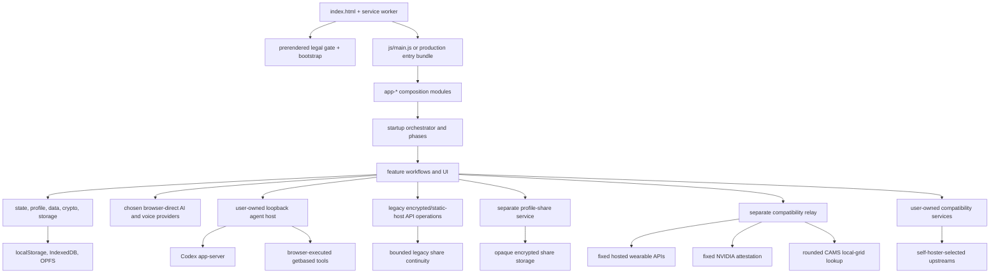

# getbased architecture

This is the human-maintained architecture contract for the getbased codebase.
Use it to decide where a module belongs, which direction dependencies should
flow, and which system boundaries a change must preserve. The generated
[`MODULE_MAP.md`](MODULE_MAP.md) is the file-level companion: it inventories
every first-party runtime module and its direct imports.

Public feature and deployment documentation remains in the separate
[`getbased-docs`](https://github.com/elkimek/getbased-docs) repository. This
file covers code ownership and dependency rules that must change with the app.

## Update contract

- Add, remove, rename, or change imports in `js/`, `api/`, `lib/`, or
  `dev-server.ts`: run
  `npm run architecture:build` and commit the generated map.
- Change a module's responsibility, a major data flow, an entry point, or an
  allowed dependency direction: update this file and the architecture rules.
- Move public behavior or a user-facing contract: update the relevant page in
  `getbased-docs` as well.
- Never hand-edit `MODULE_MAP.md`. CI regenerates it and fails if it is stale.

## TypeScript migration source contract

Canonical `.ts` and `.mts` modules compile with TypeScript 7 to ignored `.js`
and `.mjs` siblings at existing runtime URLs. Run `npm run typescript:build`
after source edits. `npm ci` runs it through `prepare`; the `dev-server`, `test`,
`production:build` and `production:check` npm commands also compile first.
Source inventories prefer the canonical TypeScript file. Project-owned assets in
`vendor/components.json` participate in migration completion; external vendor
bundles remain third-party inputs. The same ownership manifest includes executable
project-owned vendor modules in coverage and affected-test planning. CodeQL excludes
external bundles precisely so owned vendor sources remain scanned. Runtime coverage
uses emitted JavaScript offsets consistently across Node and browsers.

Compiler tooling uses the TypeScript 7 native SDK.
[`scripts/native-typescript-ast.ts`](scripts/native-typescript-ast.ts) owns scoped
parsing sessions: consumers inspect real SDK nodes synchronously and return plain
data, then release the snapshot and compiler process. Production and test
semantic checks use separate strict projects for their actual browser, worker and
Node environments. The default editor, app and server projects use the native
NodeNext resolution, checked index access, exact optional-property types and
erasable/verbatim module rules too. Every native project retains the
previous compiler safety flags. The fixed migration baseline is retained in
[`scripts/typescript-migration-baseline.json`](scripts/typescript-migration-baseline.json);
the completed migration was merged in [PR #1660](https://github.com/elkimek/get-based/pull/1660).

## Styling source contract

Settings navigation/layout, Display, Privacy, Voice, Agent Access, imported records
and AI usage use scoped Tailwind utilities
alongside the remaining native feature styles. `css/settings.base.css` owns the
legacy Settings rules;
`css/ui-tokens.tailwind.css` owns shared semantic palette, typography and surface
aliases. `css/settings-display.tailwind.css` owns source scanning and scoped
Settings/Display/Privacy/Voice/Agent Access/records utilities. `scripts/build-styles.mts` combines them
into ignored `css/settings.css`, retaining the lazy loader and offline asset URL.
Do not edit the generated bundle. `npm run typescript:build` also builds styles,
so existing prepare, development, test and production commands retain their
source-to-runtime contract. `npm run styles:check` verifies reproducible output.

The stylesheet omits Preflight, scans authored components and typed shell
classes, and uses prefixed utilities scoped to the owning Settings surface.
Display, Privacy, Voice and Agent Access remain additionally scoped to their panel IDs. Existing theme
variables remain the authority for colors, fonts and radii. The unlayered scoped
utilities follow legacy rules and use panel specificity rather than `!important`.

The shared health-context catalog is authored in `ContextCardCatalog.svelte`.
`context-card-catalog-presentation.ts` defines its typed view and projects demo
consent copy without inference side effects. `context-cards.ts` preserves the
synchronous HTML contract for dashboard, Insight and Chat consumers through the
compiled Svelte HTML entry. Profile labels, summaries, explanations and notes use
escaped text interpolation. The two raw HTML slots accept only fixed catalog SVG
and escaped diet/nutrition renderer output; they are included in the DOM sink policy.
Scoped utilities in `css/context-catalog.tailwind.css` and
`context-card-catalog-classes.ts` replace static catalog and Chat overrides.
`css/context-profile.base.css` retains native editors, chart tips, supplement-impact
dots; the build combines both sources at the unchanged
context stylesheet URL. The Tailwind source list includes the catalog, notes and
assessment components explicitly.
`context-card-status.ts` publishes typed, profile/data-scoped snapshots for indicator,
reported summary, AI insight and tips slots. `ContextCardStatus.svelte` owns their
markup, accessible text and Tailwind states; `context-card-status-view.ts` hydrates
authored boundaries in every current catalog and disposes retired subscriptions.
Every slot ID includes its catalog render ID. Assessment snapshots carry their
reported-fact fingerprint and route identity; rebuilding after facts, notes or
demographics change cannot revive a previous assessment. Health inference, normalization,
fingerprints, cache and usage remain domain-owned; those services no longer query
or mutate DOM. Existing public facade setters retain synchronous updates.
Recommendation loading captures a presentation ticket and bridge identity before
awaiting its catalog, rejects stale/disabled replies and exposes tips as keyboard
buttons. Delayed tips stylesheet work checks its captured ticket, original control connection
and enabled recommendation setting before opening.
`context-card-tips-presentation.ts` projects card catalog sections, strand-aware
DNA findings and evidence labels, safe study links and the existing latest-assessment
EMF reminder rules. `ContextCardTips.svelte` owns escaped dialog markup and scoped
Tailwind styles. Recommendations retain their public synchronous render contract
through the compiled authored HTML entry; no native tips template remains.
`css/context-editor.css` is generated from `context-editor.base.css` and
`context-editor.tailwind.css` at the existing lazy URL. Its base retains unmigrated
editors and supplement-import controls; tips no longer depend on native rules.
Shared `link-ink` utilities use the theme’s readable accent-light text color;
small helper text stays opaque and status text uses readable theme inks.
Opening tips resets the reused detail modal layout and accessible name. Close and
EMF controls use existing recommendation action services, with proper keyboard buttons.
Insight schedules the same scoped tips loader as Dashboard after inserting its catalog.
`LifestyleContextForm.svelte` owns the Diet, Environment, Light/Circadian, Sleep, Exercise, Stress, Relationships and Interpretive Lens
forms, their drafts, disclosures, pressed states, notes and keyboard actions.
`context-lifestyle-form-model.ts` projects the canonical options, wearable mismatch,
sex-specific concerns, canonical Diet meal times and explicit stored field shapes.
`ContextLightSetupMirror.svelte` renders read-only setup metadata from the typed form model.
Stored skin type is retained separately from the Fitzpatrick display fallback; clearing
circadian habits leaves Light setup intact. Its captured setup action keeps navigation
and refuses a delayed open after a profile or form change. Latitude uses the existing
profile resolver.
Diet keeps unit-aware fluid labels separate from saved metric values, retains legacy
estimates, and preserves typical meal examples while detailed nutrition has priority.
`context-lifestyle-form-view.ts` mounts one live form, captures its profile/view and
completion callback, and disposes retired controls and their modal styles/names when another tool takes over. Public
lifestyle facade URLs remain stable; their delayed opens check profile, request order
and originating view before dispatch.
`ContextEMFLauncher.svelte` owns the Environment assessment launcher and its stable
synchronous HTML adapter. `context-emf-launcher-model.ts` derives assessment counts,
latest dates and severity without reading live state. Saved assessments hide quick
exposure controls while their legacy values remain in the draft and stored profile.
The lazy EMF runtime accepts a caller ownership guard before dispatching a loaded
editor. Failed loads leave the Environment draft editable; retired opens and return
callbacks cannot replace another form or profile. The EMF tool resets its shared
modal name/layout, and delayed returns check the originating modal content.
`context-lifestyle-form-session.ts` records history on an isolated draft and awaits
profile-scoped storage before adoption or success. The storage transaction checks
the observed context field inside its existing lock; concurrent edits cannot silently
overwrite the saved context. Failed drafts stay editable, accepted writes finish on
their originating profile, and unrelated unsaved fields remain live. Presentation
callbacks cannot turn a committed write into a failed save. Scoped Tailwind owns
these forms; their superseded native templates, meal styles and sleep mismatch
rules are removed.
`ContextHealthGoals.svelte` owns incremental goal editing, the original eight
starters, priority sorting and keyboard actions. `health-goals-utils.ts` projects
literal rows with their original storage indices; legacy object goals are displayed
without rewriting storage and retain their metadata on the first accepted edit.
`context-health-goals-view.ts` owns the live dialog, confirmation and retirement.
Sync refreshes saved rows while preserving the draft input, priority and focus;
retired row controls and confirmations cannot edit replacement goals or profiles.
`context-form-dialog.ts` shares modal layout and accessible-name ownership with
the lifestyle forms, preserving a replacement authored dialog during cleanup.
`context-health-goals-session.ts` captures each mutation and its originating profile,
records draft history and awaits the guarded profile transaction before adoption.
The transaction checks the observed goal array as well as scalar context fields.
Failed writes retain editable input, and accepted writes finish on their original
profile after closure. Delete/clear retain tombstones; explicit re-add records a
restore. Array deletion/restore metadata preserves observed intent order when
wall-clock timestamps tie or move backwards, so stale peer deletions cannot erase
an explicitly restored goal.
Interpretive Lens uses the shared form's labeled multiline text field and the
existing trimmed-string/empty-string storage contract, including older profiles
that omit the empty Lens property. Save and Clear use the
same captured history/transaction session as other forms, retaining failed and
conflicted drafts. Its accepted completion updates the chat header and existing
navigation; Cancel and Back do not save a draft. Back captures the originating
profile and modal before returning to the existing Context overview. The Context
facade also rechecks that owner after its lazy module load, so a late reply cannot
open over another profile, view or dialog. Opening Context from mobile navigation
closes the sidebar before opening the overview, keeping Lens controls reachable.
`ContextFoodContaminantsBadge.svelte` owns the synchronous authored catalog badge;
`context-food-contaminants-badge.ts` shares its renderer across the cold facade and
loaded editors, retaining detailed-nutrition precedence. `ContextFoodContaminants.svelte`
owns the read-only dialog and source links. Its pure model preserves the original
scanner output and group ordering while accepting only HTTP/HTTPS source URLs.
`context-food-contaminants-view.ts` captures the profile, diet snapshot and modal,
retires on replacement or sync, and rejects delayed opens over another dialog.
The lifestyle runtime awaits Chat opening and its existing delay before handing
off the original prompt, checking the captured profile, thread, history and caller
ownership at each boundary. Retired controls cannot dispatch into another conversation.
Scoped Tailwind owns both views; duplicate native badge/dialog templates and
superseded contaminant styles are removed. The scanner and source data remain domain services.
`ContextHub.svelte` owns the Context overview's grounding navigation, source
controls, nutrition window and accessible autosave/retry status. Its pure
`context-hub-model.ts` preserves the source ordering, descriptions, availability
and summary metrics; `context-hub-data.ts` reads the existing domain services.
`context-hub-view.ts` owns the captured profile and overlay, preserves focus during
updates and retires stale controls after closure, replacement or profile changes.
`context-hub-session.ts` commits normalized source settings and nutrition windows
through the existing guarded profile transaction before publishing them. Legacy
source choices migrate durably on open. The source registry resolves this tab's
loaded profile before the shared selection, so another tab cannot redirect its
preference reads or migration. Light and wearable settings retain their
score-context mirrors. Failed writes keep the local intent for explicit retry;
peer conflicts expose newer committed settings without overwriting them. Optional
localStorage mirrors cannot silence a committed update. Accepted writes finish on
the originating profile after the dialog closes; unrelated unsaved fields remain
live. The public Context/Personalize AI aliases and source-control keys remain
stable. Scoped Tailwind replaces the overview's native templates, DOM patchers and
styles; the Knowledge Base and data-protection dialogs retain their own owners.
`DataProtectionPicker.svelte` owns the setup cards and configured statuses with
scoped Tailwind at the existing lazy context stylesheet URL.
`data-protection-status.ts` supplies one capability reader to both the dashboard
CTA and picker. `data-protection-picker-view.ts` captures the profile, navigation
surface and setup actions, guards delayed opens, retires stale
controls, and owns focus trapping, dismissal and scroll restoration. Configured
cards close without starting setup; unsupported folder backup stays hidden.
Encryption, sync and folder selection continue through their existing services.
The native picker template and obsolete dashboard picker styles are removed.
`ContextMedicalHistory.svelte` owns the Medical History draft, condition and family
rows, procedures, flags and notes. `context-medical-history-model.ts` preserves
stored metadata, relative ordering and condition suggestions. The shared
`ContextConditionInput.svelte` supports keyboard and pointer suggestions with
combobox semantics. `context-medical-history-view.ts` captures the modal and
profile, guards cold opens and confirmations, and retains failed/conflicted drafts.
The Medical History and lifestyle sessions share `context-field-session.ts`,
which records isolated history and commits through the guarded profile transaction
before publication. The diagnoses conflict check runs inside the same storage lock.
Accepted writes finish on their original profile after closure; retired controls
cannot submit new work. The stable Medical History facade and helper URLs remain;
the native template, suggestion HTML sinks and superseded medical styles are removed.
`ContextNutritionLink.svelte` owns the Diet and Light card links, escaped summary
text, keyboard focus and scoped Tailwind. Their synchronous renderer preserves
its trusted internal delegated-action attribute callback; the authored action slot
is replaced at that boundary. Summary, timeframe and timing calculations remain
unchanged. Native extension markup and CSS are removed.

`NutritionHistory.svelte` owns the Meals timeline, range controls, Trends, coverage,
timing and aggregate AI handoff. `nutrition-history-view.ts` mounts and retires the
captured profile/data/modal owner; delayed stylesheet, storage and focus work cannot
replace another surface. `route-lifecycle.ts` distinguishes real navigation from
same-route DOM refreshes, so asynchronous Body rendering does not cancel a valid
open. `nutrition-history.ts` retains range/view preferences and public navigation
APIs. `nutrition-presentation-model.ts` projects display data
without mutating stored meals or changing domain calculations. Shared authored meal
rows, target rings, goal rows and fuel cards are used by History and the remaining
nutrition renderers through one synchronous `NutritionPresentation.svelte` HTML
entry. This preserves public render contracts without duplicate native templates.
`css/nutrition.base.css` retains shared modal-host sizing, while
`css/nutrition.tailwind.css` provides scoped authored utilities at the unchanged
lazy `css/nutrition.css` URL. Failed stylesheet attempts can be retried. Meal deletion
checks its originating profile/modal after confirmation before starting a write.
`nutrition-store.ts` completes canonical and encrypted cache commits and summary
updates independently of the optional browser storage-persistence permission;
`nutrition-storage-permission.ts` shares a pending request across meal writes.
`NutritionEntry.svelte` mounts the authored `NutritionTargets.svelte` and
`NutritionFluidLog.svelte` forms. They own draft values, native constraints,
keyboard submission and scoped Tailwind controls. `nutrition-entry-model.ts`
projects the weight/nutrient registry and creates the existing reviewed drink
record shape without retaining meal photos or unrelated profile fields.
`nutrition-entry-session.ts` commits settings through the captured profile's
atomic field guard and drinks through the encrypted meal queue. Failures retain
the input; retired forms cannot start writes, while accepted writes finish on their
originating profile. `nutrition-entry-view.ts` owns modal/route retirement and
save navigation. Existing renderer/control exports delegate to this implementation.
`NutritionMealDetail.svelte` and `NutritionMealResponse.svelte` own saved meal
provenance, photos, reviewed portions, nutrient details and optional after-meal
check-ins. `nutrition-meal-detail-model.ts` projects the existing display semantics;
`nutrition-meal-detail-view.ts` retires modal/profile/route owners and guards delayed
stylesheet, read and focus work. `nutrition-meal-detail-session.ts` rejects retired
controls, failed profile reads and a meal changed since opening; accepted encrypted
and canonical writes finish on their captured profile. Failed writes retain choices.
The existing detail renderer and save/clear exports delegate to these authored
components and owner. Superseded native detail/check-in templates and CSS are removed.
`NutritionComparisonResults.svelte` and `NutritionComparisonTable.svelte` own
benchmark result cards and shared accessible nutrient/difference tables.
`nutrition-comparison-results-model.ts` projects existing domain ranking, costs,
zero/unknown values, baseline status and original action indices. The stable
`nutrition-comparison-results.ts` adapter renders authored HTML through the shared
presentation entry; execution, cancellation and encrypted local comparison
persistence remain with `nutrition-comparison-ui.ts` and the store. Scoped Tailwind
owns normal result styling; the benchmark shell owns full-screen workspace
integration. `NutritionBenchmark.svelte` owns the shell, optional known-value
reference forms and stable controller slots. `NutritionComparisonPicker.svelte`
authors the searchable model cards; `NutritionBenchmarkPhoto.svelte` and
`NutritionBenchmarkStatus.svelte` author photo thumbnails, saved-history and
request progress markup. `nutrition-benchmark-model.ts` projects catalog snapshots,
registry reference fields and progress text without executing requests or writing
storage. Refreshes use the same synchronous presentation entry and delegated
controller events. `nutrition-benchmark-workspace.ts` retains object-URL cleanup
and moves the actual editor nodes into a suspended fragment, preserving draft
values and file handles across mode changes. Normal workspace styling uses scoped
Tailwind; the explicit full-screen layout contract lives in
`css/nutrition.tailwind.css` because it spans the shared modal and result children.
`NutritionAnalysisProgress.svelte` owns shared editor and benchmark progress visuals.
Shared modal initial-focus handoffs preserve focus moved after opening, including
already-visible overlays reused by editor/benchmark mode changes.
`NutritionDashboard.svelte` owns the intake and fuel widgets on Dashboard and
Body, including seven-day coverage, selected nutrient rows and the starter/empty
states. `nutrition-dashboard-model.ts` projects canonical registry order and
local calendar days without changing summary calculations or stored profile data.
The existing synchronous widget APIs render this authored component through the
shared presentation entry; `nutrition-render.ts` owns publication into widget hosts.
Shared ring and goal grids use Tailwind utilities; widget layout responds to its
container width.
`NutritionMealEditor.svelte` owns photo/label/manual entry, the nutrient registry
form and review slots. `NutritionMealModelPicker.svelte` authors model choices;
`NutritionMealPhoto.svelte` authors stored and selected previews.
`NutritionEditableIngredients.svelte` and `NutritionEditorFeedback.svelte` own
ingredient editing, historical provenance, corrections, evidence and uncertainty
markup. Pure editor models project text and display choices; `nutrition-review-ui.ts`
retains validation, analysis timers, component baselines and controller updates.
`nutrition.ts` retains analysis requests, nutrient calculations and canonical/encrypted
meal saves. Catalog refreshes retain photo/label purpose; older serving-unit aliases
map to existing controls without rewriting stored source metadata. Photo preview
grids constrain the outer track so percentage-sized thumbnails stay full width.
Stable render/import APIs use the synchronous authored presentation entry.
`NutritionEditorNavigation.svelte` authors tabs and the meal-history handoff directly;
the compatibility enhancer adopts that same markup only for older hosts and preserves
already-authored nodes. Suspension continues to retain actual inputs and file handles.
Scoped Tailwind owns editor styling. Necessary loading animations and cross-modal
benchmark presentation styles are explicitly owned in `css/nutrition.tailwind.css`;
superseded native editor templates and styles are removed.
`context-notes-session.ts` captures accepted text and originating profile/data,
serializes debounced scoped writes and retains retry drafts through catalog rebuilds
and fresh profile reload objects. Failed idle sessions retain draft text without
retaining the full source profile. The per-profile storage queue checks the observed
saved notes atomically before merging a draft, including explicit whole-profile
restores. A conflict exposes the newer saved text; keeping it discards only the
draft without a storage write, while saving the draft requires an explicit retry.
Known persisted baselines isolate the notes/history mutation from unrelated unsaved
fields. Missing baselines retain the storage API's explicit restore semantics.
Successful writes publish status/history only after commit; failed reads block
writes, failures expose a scoped retry, and retired controls cannot submit new edits.
Accepted edits finish for their original profile after the view closes or changes.
`ContextNotes.svelte` owns input, retry, saved-text review and live commit status.
Each notes instance has unique label/hint IDs. An authored Svelte boundary lets
`context-notes-view.ts` hydrate that child in existing synchronous catalog consumers
without replacing its textarea or the surrounding AI/tips slots. Removal and profile
changes unmount the component and dispose its subscription; opaque scope tickets
reject retired controls. The public no-argument debounce helper selects a current
notes owner and retains its contract. The former status/value DOM patcher and
native notes action delegates are removed.
Remaining card editor/action ownership and nutrition fragments are separate from
these authored notes and status lifecycles.

Display settings is the bounded Svelte 5 pilot. `js/settings-display-panel.ts`
reads existing service state into typed snapshots and retains its native runtime
URL; `js/components/DisplaySettings.svelte` owns only the panel contents. Existing
settings delegates own all mutations and persistence. The adapter unmounts before
the legacy shell replaces DOM, synchronously flushes mount/refresh for focus and
receipt rendering, and does not recreate the component on individual actions.
The Settings controller retains panel visibility, domain actions and modal
lifecycle. `SettingsShell.svelte` owns its header, layout and reactive core tab
navigation. `settings-shell.ts` owns component mount/disposal and synchronous
selection updates. The shell provides keyboard navigation appropriate to its
responsive tab orientation. Trusted extension slots retain their existing
contract, and ordinary panel links are not navigation tabs. Legacy panel
renderers remain an explicit incremental boundary until their components migrate.

Privacy uses the same component lifecycle through `settings-privacy-panel.ts`.
`PrivacySettings.svelte` owns status, configuration, consent and analytics views;
`SettingsToggle.svelte` supplies their shared control. `settings-privacy.ts` owns
service snapshots and privacy/consent actions. A typed, cycle-free
`settings-privacy-view.ts` boundary lets providers update presentation without
loading Svelte through the Light/Sun service graph. Status checks and provider
results are guarded against replacement, later requests and edited configuration.
Consent refreshes retain unsaved form drafts. Provider services keep credential
storage, endpoint validation and model eligibility; the public native-form
adapter remains compatible for callers supplying their own provider controls.

Voice uses `settings-voice-component.ts` for mount/disposal and synchronous view
updates. `settings-voice-view.ts` supplies typed snapshots; `VoiceSettings.svelte`
owns fields, connection forms, model feedback and responsive task cards.
`settings-voice-contract.ts` and the cycle-free `settings-voice-view-runtime.ts`
connect catalogue, hardware and model controllers to presentation. Requests are
bound to the mounted view and connection/selection snapshot; remounted panels
hydrate independently and stale replies cannot persist voice choices. Model
operations remain in the controller across remounts, with feedback tied to the
selected model/backend and readiness verified against cache state. Provider
keys, catalogues and audio engines retain their domain-service ownership.

Cross-device Sync settings use `settings-sync-view.ts` for non-secret service
snapshots and `SyncSettings.svelte` for status, identity comparison, recovery-word
controls, relay settings and pending deletion review. `settings-sync-component.ts`
owns one mounted panel, synchronous updates, disposal and secret cleanup. The
existing string-renderer contract returns its component host. Relay and public
identity reads bind to the mounted owner and request sequence; relay replies also
check the originating relay. Identity hashing checks the public owner again after
its asynchronous digest. A resolving identity cannot copy the preceding code.
Identity-change and sync-applied events refresh current service snapshots.
Recovery words stay out of snapshots and are read from the service only for an
explicit reveal or clipboard action. Refresh and disposal remask them. The
controller retains Sync lifecycle, clipboard clearing and domain mutations;
`SyncDialog.svelte` owns setup choices, generated-word acknowledgement, join and
restore forms. Its single lifecycle adapter clears private fields/generated words
on close/replacement, restores focus, contains keyboard navigation and releases
scroll locks. `sync-dialog-controller.ts` captures typed services for operations;
`settings-sync-restore-ui.ts` retains the public entrypoints and progress helpers.
Snapshots carry status only. Exact word counts derive from live fields, and service
submissions stay ephemeral. Pending joins/restores reject duplicate submission,
replacement and dismissal; failures remain retryable. Cancellation during generation
waits for the owned attempt before cleanup. Only a temporary identity created by
that setup may be disabled, and its public owner ID must still match. A configured
identity is retained on cancellation. Async join preflight checks the originating
configured owner; retries may resolve that same owner after an initialization failure.
Successful restore clears form values and locks the reload phase. Error presentation
never copies exception text that could include recovery words. The identity service
checks its captured Evolu runtime after awaited restore/import/seed steps; replaced
runtimes cannot finalize flags, notices or reload. Restore failure logs retain only
a generic status, with no exception or seed text.
Scoped Tailwind utilities at the existing lazy Settings CSS URL own panel styles.

Wearables Settings uses `WearablesSettings.svelte` and a single lifecycle adapter.
`wearables-settings-view.ts` builds explicit provider/account/status/action snapshots;
credential tokens never enter presentation. `wearables-settings-panel.ts` keeps the
published string host, action attributes, consent/withdrawal and domain operations.
Settings close/rebuild disposes the view. Same-profile refresh retains focused controls,
disclosure choices and import feedback; replaced roots/profiles reject old view replies.
Manual counts check both operation sequence and profile/view ownership. Pending row
actions are scoped to their originating profile, and confirmation/OAuth replies cannot
redirect work to a newly active profile. Apple Health captures its profile and data
before parsing, persists connection metadata against a baseline for concurrent-write
merging, and derives summaries or offers cycle review only on that same active owner.
Queued Google Health disconnect checks the initiating profile after acquiring its lock;
sync replies cannot derive or mark credentials on a replacement profile. Scoped
Tailwind at the existing lazy Settings CSS URL owns provider rows and import controls;
shared dashboard/vendor/consent styles retain their existing ownership.

Meal-photo feature-model Settings uses `NutritionAISettings.svelte` with an owned
lifecycle adapter. `nutrition-ai-settings.ts` retains routing, capability evidence,
pricing and its public string-host contract, and supplies credential-free typed
catalog snapshots. Settings mounts/disposes the view and refreshes it in place on
provider, model, CLI and local catalog changes. The selector and disclosure keep
their identity and focus through updates; detached/replaced views reject replies.
Confirmed-image eligibility, automatic fallback and saved-unavailable routes retain
the existing domain rules. Scoped Tailwind at the lazy Settings CSS URL owns styles.

AI feature enablement and provider selection use `AiSettings.svelte`, typed
credential-free snapshots and `ai-settings-component.ts`. The parent owns the
provider buttons, loading/error feedback and pause control. Its stable
`#ai-provider-panel` slot delegates descendants to provider or CLI adapters;
parent updates preserve child fields, drafts and focus. The bridge disposes those
children before closing the parent, checks root/epoch/loading-child identity
around lazy loads and restores CLI selection when provider consent is declined.
Pause uses a shared synchronous domain action with persisted-state feedback;
owned toggles retain their accepted value when persistence fails. Existing
extension action hooks receive the actual provider button before selection;
delayed unhandled hooks cannot supersede a later selection or closed view.
Scoped Tailwind owns the chooser, including container-aware narrow layouts.

OpenRouter Settings uses `OpenRouterSettings.svelte`, a lifecycle adapter and explicit
catalog/status snapshots. The published provider renderer returns its mount host.
Private API-key fields pass through a separate live-field port, clear on disposal,
and never enter display snapshots or serialized markup. Model and pricing refreshes
retain focused controls and manual-model health. `openrouter-key-controller.ts`
adapts the shared `provider-key-controller.ts` save lifecycle, which checks the originating view, provider and credential around validation, consent,
persistence and catalog work; an accepted durable write may finish after close,
while its presentation replies cannot alter a replacement view. Balance and manual
model probes also check request order and their initiating credential. Settings'
lazy provider bridge captures the actual mounted root and invalidates pending
loads on close, rebuild or CLI replacement. Scoped Tailwind owns this provider's
controls through shared `provider-settings-classes.ts`, scoped to each
`data-cloud-provider-settings-view` root. Other provider panels retain their
current ownership until migrated.

Venice uses the same provider save lifecycle and shared controls with
`VeniceSettings.svelte`, `venice-settings-component.ts` and typed nonsecret
catalog/mode/status snapshots. Existing services retain model ranking, regular
and encrypted selection slots, pricing, capability gates and attestation. Catalog
reads reject a replaced initiating credential before writing any cached models,
capabilities, prices or reconciled selection; balance reads also check view,
provider, credential and request order. The component retains focused selectors,
private key drafts and open attestation details through refreshes. A missing or
malformed encrypted catalog preserves the user's encryption preference and shows
an unavailable-catalog explanation rather than turning encryption off during
presentation. Checked-environment copy follows the existing confirmed-model
capability rule; it does not claim completed attestation for a missing catalog.
Saved models absent from a catalog remain explicitly selected as unavailable.
The full TDX/GPU independence, unverified measurements/response source and
provider/proxy metadata disclosures remain visible for confirmed encrypted
models. Transport and attestation verification stay in their domain modules.

PPQ Settings follows the same ownership through `PpqSettings.svelte`, its
lifecycle adapter and the published `provider-ppq-panels.ts` compatibility
facade. OpenRouter, Venice and PPQ share checked catalog projection, model
status types and scoped Tailwind controls. Key validation uses the shared save
controller; account creation and payment polling use separate controllers with
captured view, provider, key, credit ID and request identity. Accepted anonymous
accounts persist even after close, while recovery details appear in private
component state before persistence, catalog or activation work can fail. They never enter
nonsecret snapshots or clipboard action attributes. Invoice text and addresses
also remain in private view ports; only the wallet link and explicit disclosure
expose the payment text needed by the user. Closing or replacing a view scrubs
private fields and cancels invoice countdown, polling and delayed onboarding.
Polling is single-flight; stale invoices, QR results, balance replies and paid
receipts cannot update another account. Catalog hydration preserves focused
credential drafts and existing balance elements, eliminating replacement-only
balance requests. Funded-account removal retains its explicit confirmation and
checks account ownership again after the decision. Existing private transport,
API-listed entitlement, vision gates, gift-card link and persistence services
remain domain-owned. Missing private catalogs retain enabled intent without
presenting regular models as private or claiming confirmed private capability.

Routstr wallet funding uses `WalletFunding.svelte` and private view ports for
invoice identity, payment text and pasted tokens. Its captured controller owns
creation, minimum amounts, duplicate clicks and token imports; QR completion
cannot revive a paid, expired or replaced invoice. The stable wallet facade
mounts the component in the existing wallet slot and guards seed prerequisites
against a closed or replaced Settings view.

`WalletMintPicker.svelte` owns saved balances, optional node mint hints and
mint selection. Saved balances render before node discovery and remain usable
offline. Selection captures the originating view and selected mint; the domain
checks the expected mint under its existing wallet lock before preserving
original-mint proofs and recovery journals. Accepted selection completes after
the picker closes without replacing newer wallet or node recovery controls.

`WalletExport.svelte` uses private token ports and the existing readonly codec.
Its controller captures the mint for locked export and checks it again before
copying. Closing scrubs private fields; clipboard clearing survives closure.
Clipboard failure leaves an accessible manual-copy disclosure. Forced proof
verification also checks the expected mint under the lock and reports failure
without representing saved balances as successfully verified. Ordinary balance
reads retain their offline fallback. `cashu-wallet-mint-requests.ts` owns the
shared durable mint cooldown used by proof, funding and recovery requests.
`WalletWithdraw.svelte` owns Lightning quotes, explicit fee approval, outgoing
Cashu tokens and uncertain-operation recovery. Invoice, quote and token ports
stay private; initiating mints are checked inside the wallet lock before transfer
side effects. Closing scrubs fields without cancelling accepted domain writes.

`WalletNode.svelte` owns discovered node cards, accepted-mint review, node deposits,
explicit session reset and saved refund recovery. Its controller captures the
originating view, node account and mint before preflight; the domain checks the
captured session and mint again inside its wallet lock. Saved refunds retain their
original record generation and account regardless of later sessions. Recovery
ports keep tokens, credentials and generations out of display state and action
attributes; scoped callbacks reject retained controls from a replaced component.
Receipt persistence and token redemption remain in domain services. Accepted
transactions finish after closure without replacing newer controls, and privately
held uncommitted receipts remain available through saved recovery. Superseded
native node/refund rendering and mint chooser CSS have been removed.

Routstr model selection and its private-mode disclosure use
`RoutstrModelSettings.svelte` with checked catalog projection and an owned
lifecycle adapter. Refreshes preserve selector identity and focus. Presentation
keeps unavailable saved models explicit; service catalog reconciliation retains
ownership of default selection. Separate regular/private remembered choices,
pricing, model ranking and transport capability rules remain in domain services.
Malformed or wrong-mode cached rows cannot become private options. A missing
private model preserves the selected private ID and explains the unavailable
catalog without claiming verified capability. The full node metadata and
web-search/image limits remain visible for known private models. Catalog reads
reject replaced node, credential, request order or initiating Settings view
before writing pricing, capabilities, catalogs or selection.

`CliAgentModels.svelte` owns CLI model, reasoning, provider-catalog and execution
pickers, including search and keyboard navigation. The presentation module
projects domain catalogs into labels and selected IDs without connection tokens.
Its lifecycle adapter refreshes controls in place, preserving search and focus,
and rejects retained controls after Settings closes or the provider changes.
CLI discovery and selection capture the originating owner and request order;
late catalogs cannot replace newer choices or write into a reopened panel.
Accepted persistence can finish after closure without updating the next view.
`CliAgentSettings.svelte` owns CLI discovery rows, setup commands, agent toggles,
login/testing/status, disclosure and companion management. A separate typed
presentation projects direct, paused, outdated, linked and embedded management
states without credentials. The lifecycle adapter retains model-slot identity
across rescans and disposes both owners on close or provider switch. Embedded
frame sizing accepts only its bound frame's source and loopback origin; URLs
retain the discovered port and never include credentials.

`cli-agent-settings-controller.ts` keeps a shared single-flight across remounts.
It captures owner, choices, backend and private connection before actions and
rechecks the displayed companion's private identity, discovery authority and
lifecycle before management dispatch. Connection
publication has an optional initiating-owner guard in the domain service; accepted
encrypted writes and companion actions finish after close without publishing to a
new view. An accepted pause returns a still-selected matching host to direct
inference. Bootstrap commands remain pure in `cli-companion-commands.ts`; the
published facade preserves runtime imports and helper names. The outer provider
chooser retains its separate native owner pending migration.

`LocalAiSettings.svelte` owns the Local AI connection fields, status, model
selection, hardware advice, pull-command copy and VRAM override controls. Its
private address/key ports retain drafts and focus during catalog/advisor updates
and scrub on Settings close or provider switch. Checked presentation snapshots
carry derived location, cloud pricing, model labels and hardware assessments;
credentials and raw provider metadata stay outside those snapshots.

`local-ai-settings-controller.ts` single-flights explicit connection tests across
remounts. It captures the draft, stored configuration, selected model, provider,
chat backend and view before preflight/discovery, same-machine VRAM release and
endpoint/model activation. It checks ownership again before persistence; failed
or denied checks preserve the saved connection and selection. Accepted encrypted
configuration writes can finish after closure without updating a replacement view
or returning it to Chat. Passive Settings discovery requests no activation and
rejects stale owners/configurations. Hardware advice also checks request order,
selected model and manual override after detection. Provider lifecycle services
retain unload-before-switch semantics; full vision/reasoning/runtime metadata is
preserved for Chat and Nutrition AI while the advisor uses a checked projection.
The existing PII connection view and its independently stored key remain separate.
Native Local AI/advisor markup and advisor CSS are removed; the shared legacy
status-dot rules still support the public Privacy DOM adapter.

`CustomSettings.svelte` owns OpenAI-compatible endpoint Settings: private URL/key
fields, validation/removal status, model catalog and manual model selection. Its
adapter preserves fields and focus during model refreshes, scopes retained
controls to their originating owner and scrubs private fields on close or provider
switch. Display snapshots contain only connection status and checked model labels.
The injected controller captures candidate endpoint/key and stored connection
before validation and endpoint-specific activation; delayed replies cannot write
into replacement views/accounts. Accepted encrypted writes finish after closure,
without initiating follow-up model requests or notifications for stale owners.

Connection publication awaits encrypted credential persistence before publishing
the endpoint and key cache. Writes serialize; failed endpoint publication restores
the previous credential. Endpoint changes invalidate catalog/vision caches while
retaining the user's selected model ID. Removal clears connection/model metadata
only after credential removal succeeds. Custom catalog requests guard original
stored endpoint/key, latest request and optional originating view before every
cache/capability/selection write. Existing no-argument and explicit-endpoint API
contracts remain; connection probes continue directly from the browser with only
the fixed compatibility payload, and endpoint-specific consent remains required.

`RoutstrSettings.svelte` owns the wallet/node shell, active actions, keyboard
menu and separate recovery notices. Stable slots host the existing wallet and
model components, so balance, seed, model or account refreshes retain focused
controls and private drafts. Parent disposal scrubs its private ports and
only its owned children before removing the shell. Credentials and recovery
tokens never enter display snapshots or action attributes. `RoutstrActions.svelte`
is the single authored wallet/node action and menu implementation. The shell
mounts it directly; published synchronous HTML helpers use its generated
`.svelte.html.js` serializer and hydrate the existing controls through
`routstr-actions-component.ts`. Immediate programmatic clicks dispatch once
before the observer turn, and active updates retain control identity. Detached,
replaced or disposed owners cannot dispatch; retiring an obsolete ancestor does
not dispose a newer child owner. Injected domain callbacks preserve the public
runtime imports without introducing a reverse wallet-panel dependency.

The HTML serializer reads Svelte's synchronous `render(...).body` entirely in
the browser; it needs no rendering backend. Svelte retains an optional dynamic
`node:async_hooks` import for its asynchronous renderer, which this entry never
invokes. Browser acceptance exercises the actual synchronous bundle. The build
rejects static Node imports and any additional Node dependency; static Kit treats
both generated component artifacts as compiled JavaScript. Source inventories
count the authored component once, while runtime coverage accounts for both
artifacts and separates mapped framework functions using their source maps.

`ProviderStatus.svelte` owns wallet, mint, seed and node status text. The shell
uses it directly and `provider-status-component.ts` adapts legacy containers,
preserving public IDs and status root identity across updates. Captured status
ports reject removed/replaced roots, and passive mint labels avoid announcements.
Existing request, provider, node, credential and mint guards remain in the domain
controllers before presentation. Compatibility helpers no longer duplicate
button markup or mutate menu visibility/status text themselves.

Session-key and pasted-token connection use the shell's private credential and
receipt ports, with `routstr-account-controller.ts` owning validation, activation,
single-flight writes, receipt acknowledgement and clipboard feedback. Drafts and
receipt keys never enter display snapshots or HTML attributes; closure scrubs
retained input/textarea fields. Validation and activation recheck the originating view, provider/backend,
selected node, credential and draft before accepting a write. Catalog replies
require that the saved account and originating view still own publication. A successful
conversion reveals its saved session before catalog work; catalog failure keeps
that recovery receipt available. Public save/remove/acknowledge handlers forward
to this owner instead of rebuilding the provider panel.

The existing wallet lock and deposit journal remain the payment boundary.
`createRoutstrAccount` captures the node and expected credential before its lazy
import; optional captured arguments preserve existing callers. Pasted-token
imports reject changed accounts before submission and use the existing
journal-before-HTTP/validated-key commit. Manual save/remove pass the captured
credential to encrypted session storage's compare-and-set guard. Accepted writes
can finish after closure against their original node, while presentation,
notification and catalog publication require the originating account and view.

The renderer now emits only the Routstr host. Discovery belongs to the injected
shell controller and rejects replies after view, provider, selected node or
credential changes before persisting a default node. Header balance reads check
request order, node, credential, provider/backend and originating view. Saved
deposit/outgoing notices occupy separate sections rather than replacing an open
wallet operation. Recovery rechecks the exact saved token before accepting a
receive, single-flights across remounts and awaits domain journal reconciliation.
Accepted domain work and scheduled clipboard clearing finish after closure;
retained private DOM fields clear synchronously. The lazy Settings provider
bridge retains its wallet module for disposal on close or provider switch.

`WalletWithdraw.svelte` owns Lightning invoice/address inputs, fee review, token
amounts, outgoing token disclosure and recovery. Its controller keeps destinations,
quote identifiers and token text in private view ports, binds transactions to the
initiating mint and prevents duplicate financial operations across remounts. Closing
scrubs retained DOM fields while accepted domain operations and clipboard clearing
finish. Quotes and maximum replies check the owner and unchanged draft before
presentation. Expected-mint checks run inside domain wallet locks before quote,
send or payment writes; Lightning-address invoice resolution carries that mint
across its separately locked quote and payment steps. A paid receipt requires an
explicit confirmed result. Copying or rendering never clears outgoing journals;
reclamation clears them only through verified domain reconciliation.

`WalletSeed.svelte` owns device setup, acknowledgement, masked/revealed recovery
words and restoration. `wallet-seed-component.ts` synchronously mounts, updates
and scrubs its private word/draft ports. Words stay absent from generic snapshots
and clipboard/action attributes; masked words are absent from DOM text until an
explicit reveal. `wallet-seed-controller.ts` captures the initiating owner for
seed reads, generation, acknowledgement, restoration and copied feedback.
Continuation requires the originating view's explicit acknowledgement. Duplicate
generation/restore requests share or defer to the accepted operation. Closing the
panel suppresses private presentation without cancelling locked domain restoration
or clipboard clearing. The Cashu domain retains encrypted 12-word seed storage,
proof journals and protection against replacing a funded seed; 24-word Data Sync
recovery remains a separate workflow. Other wallet states retain their existing
owners until their migration is verified.

`cashu-funding-monitor.ts` owns wallet-wide reconciliation, cross-tab leadership,
notifications, backoff and subscriptions independently of presentation. Closing
the funding view scrubs its private fields without stopping accepted quote
recovery. Domain quotes retain the mint returned by locked creation, and manual
and automatic recovery retire matching cached invoices. A cold launch resumes
from durable wallet records; no invoice or token enters shared UI snapshots or
clipboard attributes. The existing Cashu SDK, proof journals, mint-specific
balances, seed encryption and node-session services keep their ownership.

Agent Access remains behind the lazy Sync facade. `settings-agent-access-panel.ts`
owns credential generation, clipboard operations, persistence and domain actions;
`settings-agent-access-contract.ts` supplies readiness/preferences without hidden
credential values. `AgentAccessSettings.svelte` owns setup targets, masked/revealed
credentials and controls. Its adapter mounts during Sync hydration, refreshes
synchronously and disposes before shell replacement. Owner/profile refreshes
remask credentials; disconnected views receive no updates. `SettingsToggle.svelte`
provides the compact, keyboard-accessible switch without depending on Chat styles.
The public string renderer returns a component host so existing runtime callers
retain their contract while Svelte owns its contents.

Agent Access saves use `settings-agent-access-mutation.ts` for per-profile action
ownership. Credential write intent is isolated from live profile state until the
scoped service save commits, so a concurrent notes save cannot include a provisional
credential. An uncommitted legacy migration uses the persisted Agent Access field
baseline; regeneration therefore saves a complete record even when its preceding
migration write fails. Failure rolls back only changed credential/preference fields on the
originating object and retains later edits; pending controls cannot copy provisional
credentials or start an overlapping change. The service supplies an opaque signing
scope that retains the originating profile, relay and copied owner key privately.
Remote revocation uses that scope; context preparation checks it again after awaits.
A relay error after a committed save cannot roll back the stored credentials.
Legacy migration dirty state belongs to each profile object, and a late completion
cannot clear another profile's migration or start its persistence. The existing
one-shot localStorage source retains its original values until a successful
profile save; a non-secret profile binding prevents another profile from consuming
or deleting it. Failed writes and reloads can retry from that source. Newly generated
credentials are never mirrored into plaintext. A durably loaded profile's credentials
or revoke tombstone remain authoritative over a stale source.
`agent-access-legacy-source.ts` owns the storage names and retirement without a
Sync or UI dependency. Explicit profile deletion retires only that profile's bound
source after its databases and canonical blobs have been removed; blocked deletion
retains the source, and orphan discovery includes its non-secret profile binding.

Imported-data entries and AI usage use `settings-records-view.ts` to derive typed
presentation snapshots from existing provenance and usage services.
`DataEntriesSettings.svelte` owns report/manual/legacy rows and their actions;
`AIUsageSettings.svelte` owns profile/global usage summaries. The controller keeps
review/delete/export/reset operations. A lifecycle adapter mounts during Settings
hydration, refreshes without replacing focused controls, and disposes before shell
replacement. Profile/sync refreshes read current snapshots. Derived HOMA-IR and
imported edits remain under their report; mixed imported/manual dates stay locked.
Usage labels select the active record from the canonical profile metadata array.
Each native component uses its own emitted mount/unmount/flush helpers; the static
Kit build shares one Svelte runtime across both components. Necessary public
string-renderer adapters return component hosts without duplicating rendering.

Import Benchmarks uses `import-benchmark-data.ts` for unchanged report identity,
numeric normalization and comparison math. `import-benchmark-presentation.ts`
projects saved runs into typed cards, metric rows and bounded difference lists;
`ImportBenchmarks.svelte` owns the dialog, selection, disclosures and comparison.
`ImportBenchmarkEntry.svelte` owns the Settings entry button and forwards the
actual button to extension hooks. The Settings lifecycle disposes that entry
before replacement or closure, including pending asynchronous extension replies.
`import-benchmark-controller.ts` owns selection and confirmation lifetimes;
`import-benchmark-run.ts` owns accepted background tests independently of a dialog.
Closing a view unsubscribes its progress clock; accepted model tests still finish
and persist through the existing reference-benchmark service. Reopened views see
live progress while retaining their own comparison selection. A delayed deletion
confirmation cannot authorize a replacement view; accepted storage writes may
finish after closure. Locked answer keys cannot enter the deletion port.
`settings-import-benchmark-controller.ts` retains the public modal entry points;
`import-benchmark-facade.ts` retains public renderer/selection helpers using owned
Svelte hosts. `settings-styles.ts` shares the existing lazy stylesheet retry and
cascade contract across Settings and standalone benchmark entry points.

AI import setup and OpenRouter empty-balance notices share
[`AiActionDialog.svelte`](js/components/AiActionDialog.svelte) and typed display
contracts. [`ai-action-dialog-component.ts`](js/ai-action-dialog-component.ts)
owns each named overlay, captured action ports, delayed focus, backdrop handling
and stylesheet retry. The existing public provider/import functions retain their
synchronous controls, contextual copy and extension hooks. An action closes its
originating view before invoking the existing OAuth, Settings, demo or credits
service. Retired controls and stylesheet replies cannot act on another notice.
The owner uses the shared modal lifecycle; `trapModalFocus` returns an optional
idempotent disposer so retained overlays can release listeners and scroll locks
without waiting for DOM removal. External removal or hiding also releases the
owner. Tailwind utilities are scoped to these dialogs independently of Chat;
Chat onboarding and other confirmation dialogs still own their shared styles.

Security and Backup settings use `settings-protection-view.ts` to derive display
snapshots without exposing backup payloads, keys or directory handles.
`EncryptionSettings.svelte`, `BackupSettings.svelte` and
`FolderBackupSettings.svelte` own status, controls and snapshot summaries.
`crypto-ui.ts` and `backup.ts` retain encryption, file, restore and folder-permission
operations through existing delegates. `backup-folder-presentation.ts` publishes
display-only folder updates without a framework import; the standalone folder
renderer loads `backup-folder-component.ts` on demand. `settings-protection-component.ts` owns
mount/disposal and synchronous refresh; asynchronous snapshot reads can update
only their originating mounted view. Encryption changes refresh both status and
backup explanations. Snapshot and file-picker controls use native buttons.
`PassphraseDialog.svelte` owns unlock, enable, change, erasure and reminder
presentation through scoped utilities at the existing lazy data-protection CSS
URL. `passphrase-component.ts` owns one mounted dialog, synchronous initial focus,
keyboard containment, scroll lock, secret cleanup and trigger-focus restoration.
`passphrase-controller.ts` captures typed encryption services for each operation;
late replies cannot update or close a newer dialog. Presentation snapshots contain
only non-secret status. Passwords remain in live controls and ephemeral service
calls. Shared validation rules live in `passphrase-presentation.ts`.

Pending operations reject duplicate submissions. Once encryption initialization
succeeds, a failed storage migration locks the original credentials and cancellation;
Retry completes migration with the initialized key. An incomplete erasure neither
clears the encryption session nor reloads the app. Delayed reminders yield to an
active protection dialog. Privacy review styles remain in
`css/data-protection.base.css`; `scripts/build-styles.mts` combines that base with
`css/data-protection.tailwind.css` into the ignored runtime stylesheet.

`scripts/build-svelte.mts` discovers authored components and compiles each into
an ignored `.svelte.native.js` artifact, loaded through the existing lazy feature
graph. These artifacts retain source maps for ownership and coverage. The native
offline manifest includes the emitted modules;
the production bundler folds it into existing lazy chunks. Component declarations
and a checked tooling contract retain the typed adapter boundary. SvelteKit is
not part of the native build. The static Kit build consumes authored components
directly.

TypeScript 7 remains the application compiler and Svelte diagnostics engine.
The npm workspace `tooling/svelte` isolates TypeScript 6 required by Svelte's
supporting checker tooling; `svelte-check --tsgo --fail-on-warnings` runs during
normal builds. `npm run svelte:check` also verifies reproducible emitted output.
Architecture and affected-test readers include both component script blocks;
coverage inventories count each component once at its emitted URL. Component
source maps separate positively mapped third-party Svelte functions from
first-party compiled functions. Missing maps fail collection, and unmapped
functions remain in the first-party denominator and range diagnostics.

## Static SvelteKit bridge

`scripts/build-sveltekit.mts` assembles an opt-in, self-contained static artifact
with SvelteKit 3 and `adapter-static`. `tooling/svelte` isolates Kit's TypeScript 6
peer alongside the existing checker; application sources still compile with
TypeScript 7. The native production command remains independently available.

`ChatShell.svelte` is the canonical initial Chat structure, with its composer in
`ChatComposer.svelte`. The Kit `/app` page prerenders and hydrates that shared
shell inside its route. For native runtime compatibility, `svelte:build` writes
a bounded generated snapshot into `index.html`; `chat-shell-component.ts`
hydrates it once before startup delegates without replacing controls. The Kit
template removes that snapshot and places its route root in the same document
position, so the two builds each have exactly one Chat shell. Other native
shell areas remain outside the route during migration.
`js/kit/routes/app/+layout.svelte` starts existing services after mount.
The Vite graph compiles authored
components directly and shares one Svelte runtime with Kit. Native CSS,
worker and computed vendor URLs keep their original module-relative meaning.
Kit discovers only canonical `.ts` route modules, excluding emitted siblings.

The static assembler externalizes Kit's classic bootstrap to satisfy the existing
CSP without permitting inline executable scripts. It copies only declared public
assets, retains `/`, `/index.html`, `/app` and `/app/`, and uses the existing
manifest identity, root service worker, update consent and storage services.
Kit worker registration and version polling are disabled. Live documents identify
their build to the worker so previous immutable modules remain available until
old tabs reload or close; unknown legacy documents retain their caches safely.
No rendering server is part of the output. See [static Kit build and acceptance](engineering/static-sveltekit.md).

## Runtime topology

getbased is a static browser application. Local development loads
`js/main.js` and its native ES-module graph directly. Hosted deployments run
the Rolldown production build, which collapses the static startup graph into a
hashed entry bundle and preserves lazy feature chunks. Official Vercel
functions are limited to encrypted operations and public deployment metadata.
An independently deployed Node compatibility relay owns the explicit
plaintext-operation allowlist. AI and voice provider payloads use
browser-direct routes.



The browser remains the authority for stored health data. AI, voice, and custom
provider payloads go directly from the browser to the selected provider; the
getbased-operated proxy rejects arbitrary authenticated or body-bearing
forwarding. Its compatibility allowlist contains only the Oura, Withings,
Polar, and legacy Fitbit requests used by the app, the exact NVIDIA NRAS GPU
attestation endpoint, a privacy-rounded CAMS lookup pinned to the Company-run
service, credential-free public-page reads explicitly marked by
the client, and dedicated configuration/environment helpers. The separate
compatibility relay can read allowed plaintext credentials and provider
responses while relaying them, but does not intentionally log or persist those
payloads. The static Vercel host does not receive these requests. Encrypted
share/sync envelopes remain opaque to the operator. WHOOP,
Ultrahuman, and Google Health are self-host-only and use the deployment owner's
OAuth application. Confidential token exchange and refresh use its same-origin
proxy; WHOOP and Google Health resource requests also transit it, while
Ultrahuman resource data is fetched browser-direct. No client path falls back
to getbased infrastructure. WHOOP and Google Health raw rows are protected by
non-exportable device keys and omitted from portable raw-data backups. WHOOP-
specific profile metadata and derived values use the same device-only boundary
independently of optional profile passphrase protection.

The hosted CAMS operation is the only plaintext location route. The browser
rounds to 0.1° and the compatibility relay repeats that rounding before an
authenticated POST to the fixed `/v1/uv` service. That service performs an
in-memory lookup against its scheduled configured CAMS grid without per-request
Open-Meteo enrichment or coordinate caching. If it fails or returns sparse
fields, the browser contacts Open-Meteo directly with the rounded coordinates.
Self-hosted deployments do not inherit the Company upstream: they must set
`UVDATA_UPSTREAM`. Local development selects the fixed Company service only
when its operator explicitly supplies both that exact URL and
`UVDATA_BEARER`.

## Enforced source boundaries

The architecture checker currently enforces these coarse runtime boundaries:

| Source group | Owns | May import |
| --- | --- | --- |
| `js/` browser | Native browser application | `js/` browser modules |
| `api/` hosted API | Hosted request handlers shared by deployment entry points | `api/` and `lib/` |
| `lib/` server-shared | Node-only policy and transport | `lib/` |
| `server/compat-proxy-server.js` compatibility server | Standalone Node compatibility-relay entry point | `api/` |
| `server/profile-share-server.js` standalone server | Operator-deployed profile-share entry point | `lib/` |
| `dev-server.js` local-server | Local development entry point | `lib/` |
| `service-worker*.ts` | Classic bootstrap, ordered offline manifest and cache-routing runtime; emitted at existing `.js` URLs | service-worker scripts |

Relative ESM imports and classic-worker `importScripts()` dependencies are
tracked. Data files and explicitly vendored browser libraries are recorded as
repository dependencies but remain outside the executable cycle graph.
Tests and tooling may import production modules; production modules must not
import tests or tooling.

The exact rules live in [`scripts/architecture-rules.json`](scripts/architecture-rules.json)
and are enforced by `npm run architecture:check` in local and CI validation.

## Target dependency direction inside `js/`

The desired internal direction is:

```text
entry and composition
        ↓
UI and workflow orchestration
        ↓
feature/domain services
        ↓
foundation, storage adapters, and pure utilities
```

- **Entry and composition** wires the app together and may have broad fan-out.
  It should not contain feature logic.
- **UI and workflows** render, collect user intent, and coordinate services.
  They should receive browser-shell callbacks through explicit configuration
  seams rather than creating reverse imports from lower layers.
- **Feature/domain services** own health calculations, provider contracts,
  normalization, and feature-specific persistence rules.
- **Foundation and adapters** own shared state primitives, encryption,
  serialization, storage access, and dependency-free helpers. They must not
  depend on feature UI.
- `*-runtime.js`, `*-hooks.js`, and configuration functions are dependency
  inversion seams. Keep them narrow; do not turn them into alternate global
  service locators.

This fine-grained direction remains a migration target for coupling cleanup,
but the runtime graph no longer contains strongly connected components. Both
cycle ceilings are fixed at zero, so the checker rejects any new cyclic
dependency.

## Module ownership map

| Area | Typical modules | Responsibility |
| --- | --- | --- |
| Boot and shell | `main.js`, `app-*`, `startup-*`, `nav*`, `views-router*` | Startup ordering, route selection, and shell wiring |
| Foundation | `state.js`, `profile*`, `data*`, `crypto.js`, `blob-storage.js` | Active state, durable profile data, encryption, migration, and storage |
| Labs and genome | `schema*`, `adapters.js`, `marker-*`, `dna*`, `biology-score*` | Marker normalization, reference data, genetics, and deterministic scoring |
| Body | `wearables-*`, `wearable-*`, `cycle*`, `supplements*`, `supplement-*` | Device adapters, local raw rows, synced summaries, cycle context, and period-based therapy/product evidence |
| Light and environment | `light-*`, `sun-*`, `emf*` | Light measurements, spectral/session models, environment and EMF context |
| AI, voice, knowledge, and agents | `api-*`, `provider-*`, `chat-*`, `voice-*`, `lens-*`, `agent-tool-*`, `pii.js` | Provider routing, prompt/context workflows, STT/TTS, RAG, portable agent-tool contracts, transport, and PII controls |
| Sync and Agent Access | `sync-*` | Encrypted CRDT payloads, deltas, relay health, configured/paused identity lifecycle, restore preflight, and agent context |
| Import/export | `pdf-import*`, `import-*`, `export*`, `backup*` | File classification, review/commit, portable report-data snapshots, PDF/agent projections, backups, and restoration |
| Presentation | `dashboard-*`, `context-card-*`, `settings*`, `modal-*` | Views, editing surfaces, settings, accessibility, and interaction lifecycle |
| Hosted and local server runtime | `api/*`, `lib/*`, `dev-server.js` | Server-side validation, proxy transport, sharing, and repository operations |

Names express ownership, not permission to bypass the dependency direction.
When a module spans two rows, split orchestration from domain logic or inject
the higher-layer behavior through a narrow runtime seam.

## State, storage, and privacy boundaries

- `state.js` is shared in-memory session state. Do not treat it as durable
  storage or add feature callbacks to it.
- Lab marker values and ranges remain in their schema-canonical units at rest.
  `unit-profiles.js` resolves the International, Australia/New Zealand, and US
  display projections over the complete schema; conversion happens only in
  active view data and user input is converted back before persistence. See
  [the unit-profile implementation](js/unit-profiles.ts) and its
  [regression tests](tests/unit-profiles.test.ts).
- Profile writes flow through profile/data persistence helpers so migrations,
  encryption, change history, and sync hooks remain consistent.
- Secrets and sensitive rows use the existing encryption and IndexedDB paths.
  Do not introduce plaintext fallbacks for OAuth tokens, AI keys, wallet
  proofs, genetics, or health records.
- Raw wearable and cycle stores remain device-local unless an explicit,
  privacy-reviewed summary surface is added to sync.
- Supplement and medication status is derived from dated periods. Product-label
  facts, a user's regimen, inactive materials, and source quality evidence stay
  separate; AI consumers use the bounded projections in `supplement-context.js`.
- A configured Sync identity may be active or paused. Pause preserves the owner,
  planner state, and dirty edits; disconnect/reset is the explicit cleanup path.
  Restored backups must publish their marked profiles before inbound tombstones
  can apply.
- Network calls use the existing provider, URL-safety, PII, same-origin, and
  proxy-policy boundaries. New direct fetch paths require an explicit review.
- Agent tools expose semantic projections through an explicit catalog. They do
  not grant raw DOM, storage, credential, arbitrary JavaScript, or shell access;
  data mutations require narrow draft/commit tools and explicit approval.
- UI modules render escaped/sanitized values and use the shared modal and
  delegated-action patterns; architecture cleanup must not weaken XSS or
  accessibility guards.

## Adding or changing a module

1. Choose the ownership row above and keep the filename feature-oriented.
2. Import down the target dependency direction. If that is impossible, add a
   narrow injected callback/runtime seam instead of a reverse dependency.
3. Run `npm run architecture:build` after changing the graph.
4. Inspect the `MODULE_MAP.md` diff. A new cycle or source-boundary violation
   is a design failure, not a baseline-update task.
5. Add focused behavior tests, run `npm run architecture:check`, and run the
   normal test suite.
6. Update this file only when responsibilities, boundaries, or major flows
   changed; routine file inventory changes belong only in the generated map.

## Architecture tooling and debt ratchet

- `npm run architecture:build` regenerates `MODULE_MAP.md`.
- `npm run architecture:check` verifies the generated file, resolves every
  relative ESM import, enforces source boundaries, and rejects cycle growth.
- [`scripts/architecture-cycle-baseline.json`](scripts/architecture-cycle-baseline.json)
  fixes both cycle ceilings at zero. Never raise either ceiling merely to pass
  CI; a new cycle is a design failure.

## Cold-load performance budget

`npm run performance:check` measures a fresh mobile returning-user load of
`/app` with the browser cache and service workers disabled. The committed
ceilings in [`scripts/cold-load-budget.json`](scripts/cold-load-budget.json)
cover same-origin application request count, compressed transfer bytes, and
decoded bytes. Runtime `/api/*` calls and cross-origin services are excluded so
the measurement tracks the shipped app graph rather than network availability.

The mandatory Terms/Privacy gate is prerendered at the start of `index.html`.
`legal-consent-bootstrap.js` validates current acceptance and makes a required
gate interactive before the main application graph arrives. Development loads
that bootstrap as a standalone classic script; the production build inlines
the same checked source into the HTML to avoid an extra render-blocking network
round trip. `legal-consent.js` retains the full application integration and
fallback path after startup. Both paths dispatch the same
`legal-consent-accepted` event so changelog, analytics, backup, and deep-link
destinations remain ordered behind acceptance.

The browser check runs in the normal Chromium suite and therefore in CI. Lower
the ceilings as route and feature lazy loading removes startup resources; do
not raise them to absorb an unexplained regression.

Light & Sun keeps only `light-sun-loader.js` and its small persisted-state
checks in the startup graph. The complete context, analysis, route, dashboard,
and shell-hook composition lives behind `app-light-sun-modules.js`. It loads
when the Light route or an optional Light dashboard widget is opened, when a
persisted active session needs its ticker, or alongside Chat when persisted
Light data must be present in AI context. Device preset hydration and stale
Sun-session maintenance import only the implementation needed by profiles that
actually contain those records. Visual entry points use the UI loader, which
waits for the module graph and all seven ordered Light stylesheets before
rendering. An HTML anchor preserves the original cascade position.
Marker-history controls and the context-card Ott badge keep their cross-feature
styles in their eager owning bundles, while the deferred Light stylesheets and
modules remain in the service-worker app shell for offline first use. The
body-region picker illustration and alpha mask are also explicit app-shell
assets, so native and static builds can open the session picker offline.

The Light route shell, session-start actions, empty/loading prompts, UV safety,
methods/source disclosures, compact Light Today strip and dashboard channel pills
are authored in `LightPagePresentation.svelte` and its focused child components.
`light-page-presentation.ts` and `light-today-presentation.ts` project display
fields; `light-page-view.ts` retains orchestration and existing delegate/ticker
contracts. Calculations and writes remain with the Light/Sun services. Literal
profile and device fields use Svelte escaping. The synchronous HTML adapter
preserves callers that compose shared dashboard and route widgets.

`css/light-sun.css` is generated from `light-sun.base.css` and scoped
`light-page.tailwind.css`, at the same lazy URL and cascade position. Superseded
page-owned native templates and ordinary styles are removed. The remaining base
sheet owns separately rendered children, including session/device/setup views.
Leaving Dashboard cancels its pending guided-Chat reservation before the next
route renders, so a stale welcome timer cannot squeeze or reopen over that route.
Explicit HTML slots accept only named existing renderers: shared Lens chrome,
the conditions renderer, channel SVG/details, source controls and Sun/device
widgets. Conditions now has its own authored owner below; the remaining native
child owners remain migration work; the authored page shell does not establish
whole-Light migration or whole-app PWA acceptance.

`LightConditionsPresentation.svelte` composes the current-conditions widget,
slot, full/compact readings, source attribution, event rail and inspection dialog
through five focused children. `light-conditions-presentation.ts` projects display
fields without changing provider classifications, UV interpretation or calculations.
The stable `light-conditions-renderer.ts` facade retains synchronous imports;
`light-conditions-now.ts` retains provider injection, coordinate-keyed cache,
refresh intervals, delegated actions and modal lifecycle. All literal provider,
location, error and raw payload values use Svelte escaping; no raw HTML slot is
needed inside this owner. The actual timeline and payload scroll regions are
named keyboard focus targets. Coarse-pointer refresh/details controls have 44px
minimum targets. Foreground tokens correct theme contrast separately from the
unchanged severity-dot colors.

`light-conditions-classes.ts` owns scoped Tailwind layout, typography, responsive
container rules, severity states and theme surfaces. `css/light-conditions-now.css`
is generated from `light-conditions-now.base.css` and
`light-conditions-now.tailwind.css` at its existing ordered lazy URL. The small
base owns foreground tokens, dashboard-body integration and the shared app-tooltip
overlay/focus rules. Superseded conditions templates and ordinary native styles,
including their global theme selectors, are removed. Other Light data widgets
continue to own their existing provider, persistence and presentation contracts.

`LightSetupPresentation.svelte` composes the setup prompt, saved summary, two-step
editor, location status, action rows and modal. Its child components own escaped
markup and explicit control semantics. `light-setup-presentation.ts` projects
stored defaults, legacy skin fallback, option summaries and temporary-location
copy without changing the domain catalogs or calculations. The stable
`sun-defaults-setup-renderer.ts` facade retains synchronous HTML imports; only
`LightOnboardingAI.svelte` supplies the named onboarding AI slot through its
compiled HTML entry. `light-onboarding-ai-presentation.ts` projects loading,
error, idle and saved-result states; the established `sun-onboarding-ai.ts`
facade retains provider, prompt, engine and refresh ownership. Literal analysis
text and action lists are escaped by Svelte, including cached providerless results.
`sun-defaults-setup-ui.ts` owns delegated input, draft collection and modal/location
lifecycle. `sun-defaults-session.ts` captures the initiating profile and data root,
stages setup defaults and mirrored skin together, and commits them through the
profile transaction with atomic guards on both observed stored fields. Failed,
blocked or conflicting saves publish neither field and keep the dialog draft.
Accepted writes finish on their captured profile; retired dialogs cannot close a
new dialog, navigate or trigger analysis when the earlier write resolves. Rendered
actions carry a profile/root identity ticket invalidated by profile switching.
Location requests refresh only the dialog that initiated them. Tabs expose labelled panels and roving keyboard focus; native
skin buttons keep explicit confirmation and the range has an accessible label.
The shared modal lifecycle guards initial focus. Live tier changes preserve the
utility classes on the existing badge rather than replacing its class list.
`light-setup-classes.ts` owns source-scanned, scoped Tailwind classes, including
responsive, selected and theme states. `css/light-setup.css` is generated at its
unchanged lazy URL from `light-setup.base.css` and `light-setup.tailwind.css`.
The small base retains host integration and the tier animation.
`light-onboarding-ai-classes.ts` owns the onboarding AI utilities under a separate
marker, including reduced motion, touch targets and theme contrast corrections.
Shared native AI selectors explicitly exclude that marker until their remaining
owners migrate. Setup-specific overrides have moved out of the global theme sheets.

The shared `ai-verdict-engine.ts` captures a profile/root identity from
`ai-verdict-owner.ts` for each request and auto-fire retry sequence. In-flight
state is keyed by that identity plus the target ID, so singleton IDs cannot
mark or suppress work in another profile. Context and fingerprint are captured
before the concurrency wait. Delegated controls also carry their render-owner
identity; retained controls cannot initiate work after profile/root/epoch replacement.
The attribute helper and authored onboarding/session controls share that contract. Responses, error sidecars, retries and refreshes
retire when their profile/root or profile-switch epoch changes. A current
response resolves its target again before writing, so removed records are not
revived and replacement objects receive the verdict. The existing stale-input
fingerprint contract remains: later target edits invalidate the cached result.
`ai-verdict-write.ts` stages successful verdicts, provider-error sidecars and
orphan cleanup in private baseline snapshots and uses the captured profile's
scoped storage transaction. No live field is assigned before storage succeeds;
failed, blocked and thrown writes retain the previous live and persisted verdict.
Unrelated unsaved edits remain live and are excluded from the verdict write.
Every feature adapter resolves targets and reads/writes analyses from the supplied
profile root, including singleton and daily-map containers. Session stores accept
an explicit root while retaining their default current-profile import contracts
and existing row normalization. No temporary global-state swap is used.
An accepted write can finish on its captured profile after switching; replacement
profiles receive no result or immediate push. Context notification and extra
immediate sync run only for the still-current request owner. Deferred Sun/Light
refreshes preserve an open mobile sidebar when rebuilding the same route; user
navigation still closes it, including selecting the current route.

`LightSessionAI.svelte` owns the shared Sun/device inline and rich-detail verdict
states, with reusable dot/button components and a pure `light-session-ai-presentation.ts`
projection. Existing adapters retain completeness/provider gates, engine calls,
prompts and saved-data ownership. All literal result/error/target fields are
Svelte-escaped; severity classes are restricted to known dots. Scoped Tailwind
uses distinct foreground and severity-border variables, keyboard focus and coarse
targets; it replaces the two duplicated native renderer implementations. The
standalone native session row style and superseded shared verdict selectors are
removed; session, environment and review verdicts use the authored shared primitives.

`LightEnvironmentAI.svelte` owns measurement, room, screen and audit verdicts,
including the cached audit header dot. Its pure environment projection supplies
literal copy, normalized severity and action identity; the four stable adapters
retain provider gates, fingerprints, prompts and persistence. Authored verdicts
share the typed `VerdictControlView`, dot and button primitives. The existing
`light-env.css` URL is generated from `light-env.base.css` and scoped Tailwind;
superseded verdict templates and their native selectors are removed. Remaining
assessment, room/screen editor and audit-shell presentation stays owned by its
existing modules until migrated.

Room and screen render-time auto-analysis captures `ai-verdict-owner.ts` before
queuing. Both the deduplication key and delayed callback belong to that owner;
profile/root/epoch replacement retires queued work without suppressing the new
owner's same-ID/fingerprint analysis. Request execution and saved results remain
owned by the shared engine.

`LightReviewAI.svelte` composes the Today hero, dashboard verdict, Weekly review
and indoor-burden verdict through small authored child components. The dashboard
providerless fallback shares the authored Today layout and its existing delegated
navigation contract. The pure
`light-review-ai-presentation.ts` projection owns literal copy, normalized severity
and action metadata. Stable adapters retain data/provider gates, fingerprints,
prompts, requests and persistence. `LightWeeklyFallback.svelte` renders the existing
deterministic summary after `light-channel-view.ts` computes it; the Weekly
fallback slot accepts only that existing deterministic renderer, never model HTML.
Scoped Tailwind owns review layout and replaces native verdict and summary styles.
Daily, Weekly and burden render-time requests capture owner identity before
queuing; both deduplication and delayed execution retire across profile/root/epoch
replacement. Today hero and dashboard share one current-owner daily attempt.

`LightChannelDetail.svelte` owns each channel's expanded reading region, with
`LightChannelChart.svelte` and `LightChannelResearch.svelte` for the seven-day
source-separated SVG and research disclosure. `light-channel-presentation.ts`
projects observed chart geometry, real-unit labels, source counts and explanatory
copy without DOM or storage access. `light-channel-content.ts` owns maintained
reading notes and citations. The stable `light-channel-view.ts` adapter gathers
current domain-service values and retains pill toggles, focus, navigation and
quick-log delegates. Scoped Tailwind replaces the detail's native styles; chart
bars remain scaled to the user's own week and never imply biological completion.
`LightChannelPills.svelte` owns the interactive row and its adjacent detail slot.
`LightDashboardPills.svelte` and the row share `LightChannelSparkline.svelte`;
mini charts use typed geometry rather than an HTML slot. Pure projections in
`light-channel-presentation.ts` own the shared channel order, day counts and
source-relative mini bars. `light-channel-pill-classes.ts` owns scoped Tailwind
for compact strips and channel-card contexts, including empty/logged, hover,
expanded, keyboard and responsive states. The stable `_channelSparkline` HTML
export delegates to the same authored component for compatibility. Live refresh
replaces the row and slot together, then restores the one expanded channel.
`LightChannelSection.svelte` composes typed channel pills and `LightLocationHint.svelte`
without raw child HTML. The dashboard uses the same section through an explicit
lazy renderer port; its controller retains the loading gate and session count.
`light-channel-section-classes.ts` and scoped Tailwind own container geometry;
`css/light-channels.css` is an empty compatibility URL for existing lazy imports.

`LightSessionPresentation.svelte` composes the past-Sun and device log forms,
completed Sun/device rows and shared inline/full history. Its pure
`light-session-presentation.ts` projections preserve option selection, source
metadata, mode resolution and safety notices. Existing session controllers own
field binding, precise body-region selection, validation, dose calculations,
canonical writes and modal lifecycle. The only HTML slots accept the separately
owned body-silhouette renderer and assembled authored rows. Literal metadata is
escaped by Svelte. Active cards, rich details and the authored silhouette retain
separate presentation owners.

Completed history rows are native buttons. Document delegates open their
existing details, and the history overlay closes after the generated click;
Space keydown cannot retire the button before keyup. Device-mode radios use
roving focus and arrow/Home/End keys, while distance units use pressed buttons.
Entering a UV mode still requires fresh UV-goggle confirmation, with the same
conservative duration default and save/start validation. Scoped Tailwind shares
the ordered Light stylesheet; setup and illustration styles retain their
separate child ownership.

`LightSessionDetail.svelte` owns one rich Sun/device detail layout, shared
field grids and native channel buttons. `light-session-detail-presentation.ts`
projects literal field/channel metadata, calculation notices and device safety
and light-metric copy. The existing Sun/device controllers retain duration,
body-area weights, spectrum reconstruction, unit conversion, device snapshot
fallback, mode coupling, edits, deletion and sync-refresh ownership. The sole
HTML slot accepts the separately owned session-AI renderer; metadata uses Svelte
escaping. Saved specification links still pass the device controller's HTTP URL
validator. Device channel keydown ignores native buttons, allowing the browser's
single generated click to own activation and modal dismissal.
`DeviceSessionModeForm.svelte` retains the existing coupling-filtered options and
save handler; the canonical device-session store recomputes doses. Native setup
forms and authored body-silhouette rendering remain separate owners. Shared native
section/disclosure rules remain for Conditions and device setup; exclusive detail
layout rules are removed.

`LightActiveSession.svelte` and `LightSessionControls.svelte` own active Sun and
therapy-device cards. The Sun card exposes a native detail button separately
from its controls; action attributes and the existing delegates retain ownership.
`LightLiveReadouts.svelte` and `LightSessionChips.svelte` also render synchronous
fragments for the existing 1Hz ticker. `light-active-session-presentation.ts`
formats already calculated values and literal metadata; integration, paused-time
accounting, IU conversion, safety alerts and stored session writes stay in the
existing Sun/device services. Live patches preserve the readout container and
control nodes, chip expansion and the focused chip/toggle across replacements.
The authored chips show the original first three signals by default. Their
expanded state uses the existing delegate and scoped Tailwind utilities. Active
controls keep visible labels and minimum 45px targets at narrow widths. Obsolete
active-card/readout/chip styles and native templates are removed; setup,
illustration and session-AI styles retain their separate ownership.

The Sun store persists the last `resumedAt` boundary. Cold-client recovery restores
committed dose/SED/ocular totals from saved exposure slices, and starts fresh
integration at that boundary rather than replaying the original session start.
Paused reopening displays those saved totals without requesting weather. Legacy
records with accumulated pause time and no resume boundary retain saved totals
and start a new slice at recovery time; no unknown paused span is treated as
exposure. Manual duration edits retire the resume boundary with the timed slices.
Completed hydration continues to sum modeled slices; the stop clock separately
excludes completed/current pauses. Integration formulas and safety thresholds
remain in their existing services. The stopped session boundary is captured
after committing its final synchronous exposure slice, keeping modeled dose
intervals inside the saved session end.

`SunStartSessionForm.svelte` owns the shared live-start and mid-session coverage
shell. `light-session-presentation.ts` selects the same ordered options and
last-completed-session defaults. The existing active-session and Sun controllers
retain skin/location prerequisites, region binding, clear/empty validation,
glass-to-eye-mode mapping, modal lifecycle and canonical save/coverage handlers.
The silhouette HTML is an explicit slot from `sun-body-silhouette.ts`; its geometry,
selection, overlays and asset ownership remain separate. Start controls and the
glass label retain 45px hit areas; disclosure and region hints work with keyboard
and assistive announcements. Superseded entry templates and exclusive native
form/disclosure styles are removed.

`SunPreflightBanner.svelte` renders literal warning metadata with scoped Tailwind.
`sun-active-session-format.ts` retains preflight visibility/tier thresholds,
base-MED minutes, medication uncertainty and assumption copy. Its stable public
HTML function delegates the final markup to the authored renderer. Formatting,
calculation callbacks and the consolidated start toast keep their existing
contracts; no additional rendering backend or provider request is introduced.

`SunBodyPicker.svelte` owns the two-view SVG, masks, stock images, parametric
fallback, accessible region titles and pressed states. The pure
`sun-body-picker-presentation.ts` projection formats source-cell placement and
literal region metadata. `sun-body-silhouette.ts` retains its public synchronous
HTML/binding contract and owns profile-sex resolution, unchanged region geometry,
canvas pixel lookup/tinting, blob lifecycle and input handling. `SunBodyPickerFrame.svelte`
shares the Tailwind frame across Start, Coverage, Past Session and Device forms;
its sole HTML slot accepts only the authored picker renderer. No native SVG or
frame template remains. Region-map and overlay completion preserve a currently
focused region inside the picker, without stealing focus from another control.
A dashed keyboard focus contour remains visible when the canvas tint is ready.
`css/sun-body-picker.css` owns the SVG-specific state cascade and coarse-pointer
hit halo using Tailwind utilities; geometry presentation, captions and frame
layout use scoped component utilities in the unchanged Light stylesheet.
The licensed stock figure and independent parametric escape hatch remain intact.

Settings and Tweaks are loaded through `settings-loader.js` on their first
shell, startup deep-link, or feature action. Theme-owned accent initialization
stays in `theme.js`, while the Light page imports its Sun data-source renderer
from `settings-privacy.js`; neither path requires the full Settings modal
during normal startup. The loader also fetches `css/settings.css` on first use
and waits for both resources before opening the UI. An HTML anchor preserves
the stylesheet's cascade position, while the shell-owned Settings button rule
stays in `app-shell.css`. The deferred stylesheet remains in the service-worker
app shell for offline first use.

The four optional visual themes share a conditional presentation boundary in
`theme.js`. Default dark and light startup skip `themes-extra.css`; a saved
optional theme inserts the sheet from the head bootstrap before first paint,
while later selections use the same single-flight loader. Failed action loads
restore the core dark theme and retry with a fresh URL later. The sheet remains
in the service-worker app shell for offline first use, and its HTML anchor
preserves the original final cascade position after chat redesign styles.
Cross-theme shell geometry and Sunset Mode rules remain in a final eager
inline block after that anchor, preserving their original cascade while keeping
the deferred sheet scoped to the four optional themes.

Only the persistent Chat launcher, shared closed shell component, nudge state, base
shell styles, and final redesign overrides remain eager. `chat-loader.js`
single-flights the behavior composition on the first shell action, feature
prompt, keyboard shortcut, or startup deep-link. `app-chat-hooks.js` then wires
the loaded Chat graph to host callbacks injected by `app-shell-hooks.js`;
attachment handlers and the rest of the Chat runtime are not initialized
before that boundary. Failed module loads reset the single-flight state and
retry with a fresh URL. The same first action makes `chat-panel.js` load the
personality, messages, composer, onboarding, responsive, actions, and mobile
presentation sheets before opening the panel. Failed links are removed and
cache-busted for group retry, a shared HTML anchor preserves their original
order before redesign overrides, and the service worker keeps the deferred
modules and stylesheets precached for offline first use.

Chat provider onboarding has one presentation owner,
`js/components/ChatProviderSetup.svelte`, sharing `ChatProviderQuiz.svelte`,
`ChatProviderChoice.svelte`, `ChatOnboardingProgress.svelte` and the transcript's
persona label. `chat-onboarding-presentation.ts` projects displayed progress and
backward destinations; connected users skip the provider step in the normal
sequence without losing explicit provider revisits. `chat-provider-setup-component.ts`
retains the mounted view during branch changes, restores keyboard focus and
retires profile/thread/history/root owners and removed branch controls.
`chat-onboarding.ts` keeps navigation, provider selection, OAuth and persistence;
its delayed settings handoffs check their originating owner before opening and
after awaiting Settings. Existing synchronous quiz/progress HTML helpers render
the same authored components. Trusted edition extensions retain the
`provider-quiz` HTML slot and delegated action contract; legacy quiz CSS is
restricted to extension-owned markup. First-party setup uses scoped Tailwind.
`ChatProfileSetup.svelte` owns the basics form and its drafts, focus, native
optional disclosure and save status. `chat-profile-setup-component.ts` retains
that view across repaint and retires it on profile/thread/history/data/root
replacement. `chat-profile-onboarding.ts` adapts the public helpers and each
configured module's callbacks to `chat-profile-onboarding-controller.ts`.
The controller captures values before awaiting writes, serializes saves for the
originating profile and uses explicit profile IDs and a merge baseline for the
IndexedDB profile weight write, followed by the existing manual-measurement
service and summary refresh. This preserves the legacy entry while upserting the
canonical kilogram row even if the one-time legacy migration already ran. Both
legacy migration and new measurements share `weightToKilograms`, including the
form's `lbs` alias. An accepted in-flight write may finish for its original
profile; retirement prevents later writes, publication and navigation. Failed
writes keep the form editable, report failure and roll back only the failed
weight array. Country-only latitude is a local projection without geocoder
requests or a redundant write when the form mounts. Scoped Tailwind owns the
form, including narrow-layout overflow prevention and 44px touch controls.
Shared native input styles remain only for unmigrated cycle/supplement helpers;
context cards and other empty states are separate owners.
`context-card-health-dots.ts` owns context-insight request identity independently
of card DOM lifetime. It captures the profile/data object, demographics, assistant
route, card fingerprints and projected request context. Matching callers share
one pending request; edits or explicit refreshes replace it. Profile switches,
AI settings or companion-route changes and revoked demo consent retire pending
ownership. Late
success, parse failure or provider failure cannot overwrite a replacement view
or cache, and cache fingerprints describe the assessed inputs. Usage remains
attributed to the dispatched provider/model and originating profile even when
presentation expires;
subscription requests stay outside the direct-provider ledger. Shared card
rendering and editor migration remain separate presentation work.
`ChatEmptyState.svelte` owns paused, initial/partial/full context, saved/skipped
handoff, lab-context nudge and general prompt presentation. `chat-empty-presentation.ts`
projects literal copy and action payloads without storage access. The synchronous
HTML entry preserves the established empty-state render/delegation contract;
`chat-empty-state.ts` retains branch decisions, provider/profile routing and service
calls. Context cards render into a reserved slot through their existing catalog
owner, retaining notes sessions and delegated actions. Shared persona and progress
components keep their own presentation contracts. Ordinary empty-state styles are
scoped Tailwind; superseded empty, context-progress and action-layout CSS is removed.
Shared extension/cycle/supplement styles remain scoped to their owners. Shell-owned
import-button rules exclude the migrated empty-state controls; its solid primary
action and secondary greeting text use theme tokens with verified contrast.

`ChatSavedSummaries.svelte`, `ChatSummaryDialog.svelte` and `ChatSummaryPrint.svelte`
own saved rows, the accessible summary dialog and standalone print document.
`chat-summary-presentation.ts` projects literal display fields; their synchronous
`ChatSummaryPresentation.svelte` HTML entry preserves delegated actions and runtime
URLs. `chat-summaries.ts` retains generation, provider attribution, profile/thread
ownership guards, persistence, sync refresh and export dispatch. Markdown passes
only through the shared escaping renderer, including streaming and printing.
Native buttons give saved rows browser keyboard behavior. Dialog focus is trapped,
Escape closes through the controller, and reopening cancels stale removal timers.
Scoped Tailwind owns rows, metadata and actions; shared Markdown formatting stays
in the deferred Chat stylesheet. The standalone print document owns its small
inline stylesheet so synchronous offline printing requires no extra asset request.
Superseded native summary templates and ordinary layout/action CSS are removed.

`ChatOptionalSetup.svelte` owns the add-on task catalog, summaries, DNA import
confirmation and import/re-import controls. `chat-optional-onboarding-presentation.ts`
projects cycle visibility, current versus historical therapies, saved SNP findings,
mtDNA and wearable connection status. `chat-optional-setup-component.ts` retains
focus across repaint and retires profile/thread/history/data/root owners and removed
controls. Shared progress and persona components and scoped Tailwind own its layout;
mobile controls, including Back, provide 44px targets.
DNA and mtDNA services publish a typed `genetics-import-events.ts` notification
after persistence instead of replacing the presentation DOM. Parsing and pending
previews retain their originating profile/data. Confirmation writes a draft through
explicit profile-scoped storage with the service's recorded baseline, preserving
curated calls and concurrent profile changes. It publishes to the current owner
only after a successful save; failed saves keep the preview retryable. A saved
confirmation survives Chat's history remount only while its saved SNP fingerprint
still matches. After publishing committed data, `notifyProfileDataContextChanged`
retains the existing AI context-cache/gateway refresh without scheduling duplicate
profile sync writes or targeting another profile. A successful
write already in flight may finish for its original profile without changing a
replacement profile or opening/closing its presentation.

Conversation navigation has one presentation owner,
`js/components/ChatThreadNavigation.svelte`. `chat-thread-list-view.ts` preserves
the published renderer boundary and projects current profile, sort and thread
metadata through `chat-thread-navigation-presentation.ts`. The component owns
grouped/pinned/project rows, menus, desktop pointer dragging, search progress and
results. `chat-thread-navigation-component.ts` provides synchronous typed view
ports and rejects actions or replies from detached, replaced or retired profile
owners. Reconfiguration updates the existing action port without replacing
focused controls. Thread CRUD, encrypted persistence and project rollback remain
in `chat-threads.ts` and `chat-thread-search.ts`; message search captures profile,
query, input, thread inventory and view lifetime before reading stored content.
Result content prefixes stay in bound callbacks, and animation-frame jumps check
their accepted destination before touching the transcript.

The shared Chat shell keeps stable transcript and summary hosts while those
features retain their own services. Attachment presentation is Svelte-owned. Hydration
does not rerender those live hosts on reopen. `ChatComposer.svelte` owns initial
composer controls and input events; `chat-composer-input-port.ts` connects a
current input to the draft service without installing native input listeners.
`chat-composer.ts` owns per-conversation draft persistence and restore revisions,
including originating input identity and profile/thread checks. Its published
resize/value helpers keep their existing runtime contract. The input, toolbar,
send and tool controls use scoped Tailwind classes and shared theme variables;
attachments and voice presentation retain their separate services.
`ChatDiscussion.svelte` owns participant selection and the active discussion bar,
including usage disclosures, pause/resume/end controls, literal participant text,
keyboard dismissal and focus restoration. `chat-discussion-view.ts` holds a
composer-lifetime presentation port and selection model. Selection and delegated
actions reject retired composer/profile/thread controls; `chat-discussion-picker.ts`
and `chat-discussion-ui.ts` preserve public runtime entry points while publishing
values rather than authoring markup. Existing shell/message action delegates
remain the single discussion action dispatchers. Round execution, provider requests
and thread persistence stay in the discussion services, outside the component.
The round request builder captures persona instructions, tagged history, lab
context and model/search/reasoning selections before asynchronous knowledge
lookup. Direct requests pass the accepted model through every automatic
continuation; CLI dispatch rejects a changed agent, target or model selection.
Cancellation is checked after lookup and provider completion before returning a
response or updating the CLI thread session.
The composer owns discussion help associations and photo-action restrictions.
`chat-composer-input-port.ts` also publishes backend-unavailable placeholders,
so availability refreshes cannot overwrite the discussion prompt. Scoped Tailwind
replaces the picker and continuation CSS; `chat-personality.css` retains its
stable URL as an empty compatibility stylesheet.
`ChatCitations.svelte` and `ChatStoredImages.svelte` own the shared citation and
persisted-image markup. `chat-message-content-contract.ts` projects stored
records and filters thumbnail URLs; `chat-message-content.ts` preserves existing
synchronous string-return contracts through compiled Svelte HTML. These semantic
details contain clicks at their authored component boundary; image buttons use
the existing message action dispatcher. Image previews support native keyboard activation.
`ChatThinkingStatus.svelte` owns rotating phrase and dot presentation;
`chat-thinking-status.ts` retains the element-return and clock APIs, freezes a
stopped visible view, and disposes removed or retired profile/thread owners.
A stopped clock does not retain a removed Svelte root. Shared scoped Tailwind
classes replace the corresponding native citation, image and thinking rules;
the owned dot animation retains its keyframes and respects reduced motion.
`ChatMessageActions.svelte` owns message action bars and context disclosure;
`ChatAgentDraftCards.svelte` owns proposed-change review. Their typed projections
keep literal labels and proposal status separate from domain mutation. Existing
synchronous action-bar and proposal HTML exports use those same authored views.
`chat-message-actions-component.ts` hydrates connected compatibility hosts once;
opaque render tickets prevent old markup from being adopted into another
profile, thread, history or message. `chat-message-actions-view.ts` owns copy
feedback, disclosure state and control lifetimes, rejecting late clipboard
completion and disposing removed views and reset timers. Retry, fork and proposal
claims retain their existing service dispatchers. The nested speech control uses
`chat-speech-view.ts`, sharing one owner and state port with standalone speech.
`ChatMessageEditor.svelte` owns inline edit controls, focus, sizing, keyboard
shortcuts and busy state. `chat-message-editor-component.ts` publishes a conditional editor slot to the
authored message and retires removed or changed conversation owners. Its public
compatibility path can still mount into a caller-owned message host.
`chat-message-edit.ts` retains eligibility, transactional send/rollback and fork
operations; composer edit state flows through `chat-message-editor-view.ts` to
`ChatComposer.svelte`, preserving the separate unsent draft and making the row
inert. Scoped Tailwind replaces native action, proposal, context and editor rules.
`ChatTranscript.svelte` owns nonempty restored history, fork notices, history
window controls and participant labels. `chat-transcript-presentation.ts` projects
stored messages; only the established sanitized Markdown and trusted catalog
section renderer supply HTML. `ChatMessage.svelte` composes the shared body,
attachments, citations, actions, editor, usage and recommendation disclosure.
Keyed messages preserve controls, open citations, editor drafts and selection
through same-conversation refreshes. `chat-transcript-component.ts` unmounts
removed or replaced roots and profile/thread/history owners.
`ChatLiveMessage.svelte` uses the same message component for normal and discussion
streaming and completion. `ChatPersonaLabel.svelte` owns shared participant labels.
`chat-live-message-component.ts` provides synchronous typed text,
completion and reconnect ports; scope checks reject retired generation replies.
The public typewriter can still receive a caller-owned plain-text host, rendered
by `ChatStreamingText.svelte` and disposed on retirement or before a compatibility
caller replaces its contents. `chat-send.ts` keeps provider requests, gates,
usage, attachments and persistence; `chat-render.ts` keeps range and scroll
orchestration. Neither authors normal message body or footer markup.
`ChatRecommendations.svelte` owns disclosure state, new badges and click
containment. It captures the exact profile/thread/history/message before saving
visibility changes. Finite attention runs for newly completed recommendations,
never restored history, and releases its observer/frame/listener on retirement;
reduced motion suppresses the pulse. Catalog card markup, optional context
onboarding and empty-conversation views have separate presentation owners.
Discussion rounds capture profile, thread record and history identity in
`chat-discussion-origin.ts`. Background rounds may persist to their original
conversation; profile/history replacement, deletion or a newer controller retires
the old round. Repainting reconnects its existing authored live view. Request
preparation takes the participant explicitly rather than changing the selected
persona. `chat-discussion-round-state.ts` delegates all body persistence to
`saveChatHistory`, sharing its serialized encrypted writes, exact-byte rollback
and clear/write ordering. Background saves preserve the conversation's persona;
late deletion cannot resurrect its stored body. Public round element helpers in
`chat-discussion-round-view.ts` snapshot the same authored message and label with
no indexed actions, retaining the element API without duplicating markup.
Transcript geometry uses scoped Tailwind. Custom CSS retains the shared
sanitized Markdown renderer classes and avatar pseudo-elements; legacy bubble
rules are restricted to the remaining caller-owned hosts.
`ChatVoiceButton.svelte` and `ChatVoiceStatus.svelte` own the microphone control
and live status. `chat-voice-view.ts` publishes typed capture state and backend
availability, retires composer actions, and cancels capture on owner disposal.
The tiny `voice-loader.ts` retains first-use loading and checks the originating
profile, thread, panel and input before dispatch. `voice-controller.ts` owns
recording/transcription operations and spoken reply orchestration, independent
of presentation. Every capture holds its originating input/profile/thread,
disclosed provider/settings, abort signal and timers; obsolete permission,
privacy and transcription replies cannot start capture or insert into another
draft. Capture and playback cancellation remain separate, so closing Chat
stops dictation while a spoken reply can finish. `voice-capture.ts` releases
late microphone grants before starting a recorder and cleans up startup failures.
`ChatSpeechButton.svelte` is the sole Listen/Stop/preparation/waiting view.
`chat-speech-component.ts` supplies synchronous HTML to existing transcript
callers, hydrates without replacing buttons, and disposes retired owners. Its
typed state updates replace native icon, label and class writers. Transcript
migration can consume the same component; audio engines, provider consent,
progressive streams and local model services remain outside the component.
The controls use scoped Tailwind, shared theme tokens and reduced-motion rules.
`ChatModelPicker.svelte` owns the model menu, search, range preview, selection
buttons and dismiss/focus behavior. `chat-model-picker-view.ts` binds only the
current root and releases provider event subscriptions on disposal.
`chat-model-control-state.ts` reads existing provider and CLI catalogs, ordering
and reasoning capabilities; `chat-model-picker-presentation.ts` projects literal
display metadata without exposing connection credentials.
`chat-model-controls.ts` retains domain actions and captures profile, thread,
backend, target, connection settings and view lifetime before asynchronous work.
Late catalog replies cannot publish across those boundaries, and the latest model
choice wins. Negotiated CLI connection settings are adopted only by the current
request. The picker uses scoped Tailwind; browser-specific range track/thumb
pseudo-elements remain a narrowly owned custom CSS exception.
`ChatPersonalityPicker.svelte` owns builtin/custom options, literal labels,
CRUD controls, dismissal and return focus. `chat-personality-picker-view.ts`
binds the current root; actions capture the rendered profile, thread and version.
`ChatPersonalityEditor.svelte` owns the editor structure and input events, with
its modal adapter explicitly releasing focus traps, listeners, timers and scroll
locks before returning focus. Editor-origin click paths cannot dismiss the
picker reopened by cancellation. Scoped Tailwind replaces persona native CSS.
`chat-personality-policy.ts` owns hosted-use consent; `chat-personality-models.ts`
owns metadata/selection reads and encrypted save integration. The editor workflow
in `chat-personality-editing.ts` guards profile/thread/editor identity and draft
revisions across confirmation, streaming, generation and persistence. Accepted
writes stay with their original profile; edits made during a save remain dirty.
Storage serializes writes per profile and preserves newer optimistic catalogs
across older replies. Sync notifications include the originating profile and
load its durable data when it is inactive. `chat-personalities.ts` retains public
compatibility exports, selection integration and the remaining header status.
`ChatResizeHandle.svelte` owns splitter pointer capture, keyboard resizing and
reset actions. `chat-layout.ts` reads and persists the existing independent
panel/rail preferences; its typed view port publishes geometry to the shell.
The shell renders CSS variables and current ARIA ranges without replacing
conversation controls. Gesture cancellation follows pointer cancellation,
capture loss, blur, owner disposal, Chat closure, fullscreen, rail closure and
mobile resizing. Retired controls cannot change the current preferences.
Splitter styling is scoped Tailwind; the shared body drag state only disables
adjacent shell transitions and selects the resize cursor.

The focusable window splitters and scrollable conversation region intentionally
retain their keyboard semantics; narrowly documented Svelte accessibility
annotations cover its static noninteractive-role classification, with browser
keyboard and geometry assertions retained.

`css/chat-panel-open.base.css` owns the remaining outer Chat shell, shared Markdown and
transcript bridge styles. `css/chat-navigation.tailwind.css` scans only the
navigation, composer, splitter and summary components and their shared typed classes, uses semantic theme tokens,
and omits Preflight. `scripts/build-styles.mts` combines both into ignored
`css/chat-panel-open.css`, preserving the deferred URL and cascade position.
The outer Chat rail and transcript styles and dynamic Chat feature surfaces
retain their separate presentation ownership; navigation does not own their lifecycle.

Voice preserves this Chat boundary. `voice-loader.js` is a small first-use
facade; microphone capture, playback, settings resolution, and provider
selection load only when dictation, Listen, or enabled auto-read is used.
Input and output retain independent provider values internally, while Settings
links them behind one Voice service choice by default and reveals the separate
values only in advanced mode. Provider metadata and capabilities live in the
provider catalog; the provider-neutral Voice service resolves settings into
adapter operations without exposing provider branches to Chat. Browser-local
Whisper and Kokoro run in dedicated module workers and download model assets
only after explicit installation. The local-server adapter calls an
OpenAI-compatible endpoint directly. BYOK cloud adapters also call their fixed
provider endpoints directly from the browser, sending the configured provider
key while omitting browser ambient credentials. As a result, getbased and its
Vercel deployment do not receive provider keys, microphone audio, or speech
text. Custom OpenAI-compatible endpoints use the same browser-direct boundary;
there is no hosted compatibility fallback, and endpoints that do not allow
browser inference fail with a user-facing configuration explanation. The
provider-neutral AI gate stores its first-activation transparency
acknowledgement separately from destination approval while presenting both in
one first-activation decision when a destination needs approval. User-triggered
connection checks can run before activation and must contain no user content;
custom APIs may receive a fixed synthetic compatibility probe. Same-device
inference stops after the AI notice; private-network endpoints require an
origin-scoped confirmation; remote inference requires provider/origin-scoped
sensitive-data approval. The gate is checked before text, automatic insight,
image, and voice requests. Unapproved automatic work fails without opening a
surprise dialog, and remote approval can be withdrawn in Settings. Route classification
uses the inference endpoint and cloud-model metadata, never the frontend host.
Microphone blobs remain ephemeral; dictation only edits
the composer, and chat panel/thread lifecycle callbacks stop tracks, synthesis,
and playback. Portable Voice preferences and cloud keys follow the existing
encrypted settings/sync path, but consent records remain browser-local.
Provider selection, local model/hardware choices, a local voice server URL, and
its optional key remain device-local. Full backups preserve preferences, but
device-key-wrapped credentials are omitted unless passphrase protection makes
them portable. One Voice settings schema owns these scopes so backup and sync
allowlists cannot drift independently.
The service worker precaches worker source but deliberately does not precache
large remote model assets.

`api.js` keeps synchronous provider selection, key state, and model metadata in
the startup graph because dashboards and feature availability checks use them.
Provider transports for Ollama, Venice, OpenRouter, Routstr, PPQ, and custom
OpenAI-compatible endpoints load through cached, retryable dynamic adapters
only when a provider operation is requested. This keeps provider behavior and
the public API facade stable without paying for every transport on a cold
dashboard load.

Wearables presentation is loaded through the single-flight stylesheet boundary
in `wearables-runtime.js` when a biometric detail, inline manual log, or the
Wearables settings tab is opened. The dashboard's compact biometric tiles and
empty manual-card shell retain their small shared rules in
`css/dashboard-data.css`, so the default dashboard paints without
`css/wearables.css`. The deferred sheet stays in the service-worker app shell
for offline first use, and its HTML anchor preserves its original cascade
position between Client List and Light & Sun.

Cycle presentation is loaded through `cycle-runtime.js`. Female Dashboard and
Body routes wait for it before rendering, and editor or import-review actions
share the same single-flight boundary. Profiles that are not female do not pay
for `css/cycle.css` on startup. Failed loads are removed and cache-busted for a
later retry; the deferred sheet stays precached for offline use and its anchor
keeps the original position between Mobile Dashboard and marker-detail styles.

Profile Sharing is loaded through `profile-share-loader.js` when a shell,
Settings, or client-list action opens it, or when startup/hash routing detects
a shared-profile link. The loader owns only lazy loading and route detection;
`profile-share.js` retains link validation, encryption, import, and UI
responsibilities. `export.js` remains shell-owned without a Data I/O
composition wrapper. Official app origins resolve profile-share requests to a
separate getbased-operated service; self-hosted origins retain their same-origin
`/api/share` contract. The shared runtime-neutral handler enforces the envelope,
expiry, size, origin, management-token, and abuse boundaries for both. The
operated service stores only opaque envelopes and minimal TTL/deletion/abuse
metadata in an isolated SQLite database; the password and decrypted profile do
not reach it. New operated-service ids use a non-overlapping `vps1_` namespace.
The Vercel adapter redirects old-client writes, serves legacy Blob reads and
deletions only within a configured window of at most 31 days, and then stops
reading Blob entirely; record migration is not required. The initial SQLite
store has no retained backup so recovery cannot resurrect stopped/expired
links, and the UI discloses that temporary copies can be lost after a service
failure.

Genome and DNA behavior stays module-eager because dashboard summaries,
recommendations, startup catalog hydration, and import routing share it.
`dna-runtime.js` owns the narrower presentation boundary: `css/genetics.css`
loads when the Genome route or a DNA preview/manual-entry surface first opens.
Every styled entry waits for the stylesheet, concurrent calls share one
request, failed links are removed and cache-busted for retry, and route/action
failures remain contained with an explanatory status. An HTML anchor preserves
the original cascade position, while dashboard genome tiles remain in the
eager `dashboard-data.css` bundle. The service-worker app shell retains the
deferred stylesheet for offline first use.

Category, Compare, and Correlations behavior stays module-eager for route
compatibility, but `category-page-runtime.js` loads `css/category-views.css`
when one of those routes first opens. Each route waits for the stylesheet
before rendering, concurrent route entries share one request, failed links are
removed and cache-busted for retry, and an HTML anchor preserves the original
cascade position. Dashboard greeting spacing, alert cards, and date-range
controls remain in eager dashboard bundles because the returning-user dashboard
renders them without entering a category-backed route. The service-worker app
shell retains the deferred stylesheet for offline first use.

Client List remains module-eager because shell, profile, and location actions
use it, but `css/client-list.css` loads only when `openClientList()` is first
called. Opening waits for the stylesheet, concurrent opens share one request,
and a failed request is removed so the next open can retry. An HTML anchor
preserves the stylesheet's cascade position, and the service-worker app shell
retains it for offline first use.

Import review presentation loads through `import-loader.js` on the first file
input/drop interaction, pending-draft restoration, or direct cycle-import
preview. The generic action buttons, header import status, and empty-Labs drop
zone remain in `app-shell.css` because non-import features and startup routes
use them. Concurrent stylesheet requests share one load, failures are removed
for retry, an HTML anchor preserves cascade order, and the service-worker app
shell retains `css/import.css` for offline first use.

Marker detail, manual-entry, and custom-marker presentation remains
module-eager because dashboard, category, Biology Score, and sync refresh paths
share its behavior, but `css/marker-detail-modal.css` loads only when one of
those modal surfaces first opens through its already-eager runtime adapter. The
entry waits for the stylesheet so an unstyled modal is never shown, concurrent
requests share one load, failed links are removed and cache-busted for retry,
and an HTML anchor preserves the original cascade position before
Recommendations. The service-worker app shell retains the stylesheet for
offline first use.

The EMF assessment module and `css/emf.css` load together through
`emf-runtime.js` when an EMF editor entry point is first used. Cross-feature
launchers keep their presentation in their eager owning bundles, so the
deferred stylesheet contains only EMF editor and interpretation UI. Opening
waits for both resources, concurrent stylesheet requests share one load, and a
failed link is removed and cache-busted for retry. An HTML anchor preserves
the original cascade position, and the service-worker app shell retains the
stylesheet for offline first use.

`ChatHeader.svelte` owns header controls, literal perspective/model labels,
context states, summary eligibility, menu dismissal/focus and web-search input.
The context chip occupies its own row so compact screens retain a readable label
without reducing touch targets.
`chat-header-contract.ts` projects title, summary and context values without DOM
access; `chat-header-presentation.ts` reads existing domain services and publishes
through `chat-header-view.ts`. The view accepts only its current component root
and releases provider/receipt subscriptions when disposed. Fullscreen and rail
accessibility follow the shell's existing layout state. Shell action injection
routes component callbacks to existing workflows; document delegates skip the
owned header. Public header refresh entry points retain their previous URLs.

`ChatAttestationBadge.svelte` authors both live header badges and synchronous
transcript compatibility HTML. `chat-attestation-presentation.ts` preserves
receipt tiers and explicit verification limitations; it performs no verification.
`ChatAttestationTooltip.svelte` owns shared hover, focus, Escape, positioning and
receipt-removal behavior. Its adapter adopts one host per document and disposes
removed hosts. Header and attestation styling uses scoped Tailwind utilities,
existing theme variables and contrast-adjusted status colors. The model picker
owns backend availability presentation; obsolete header selector/dot writers are
removed. Transcript rendering and summary generation retain separate domain services;
summary presentation has its own authored components.

`ChatAttachmentPreview.svelte` and `ChatAttachmentMenu.svelte` own ephemeral
image previews, removal, picker inputs and the composer tools disclosure.
`ChatShell.svelte` owns conversation drop events and feedback; `ChatComposer.svelte`
owns paste events. `chat-attachment-view.ts` connects the current component root
to processing callbacks, subscribes to capability changes only during its
lifetime, and projects literal names and supported image URLs. The shared
lightbox component uses `chat-image-lightbox-component.ts` for modal focus,
scroll locks and teardown, including external host removal.

`chat-images.ts` retains image decoding, original bytes, thumbnail generation,
health-file import routing and the public runtime API. OS drop handles are
acquired synchronously before awaiting snapshots. `chat-attachment-drafts.ts`
owns in-memory profile/thread queues and reservations: concurrent reads count
against both limits, retired drafts cannot be revived, and submitted objects
are consumed without losing later additions or valid in-flight reads. Reads
also validate the originating component, conversation and model route before
committing. Original images remain ephemeral; only existing history thumbnails
are persisted. These services do not require a rendering backend.
