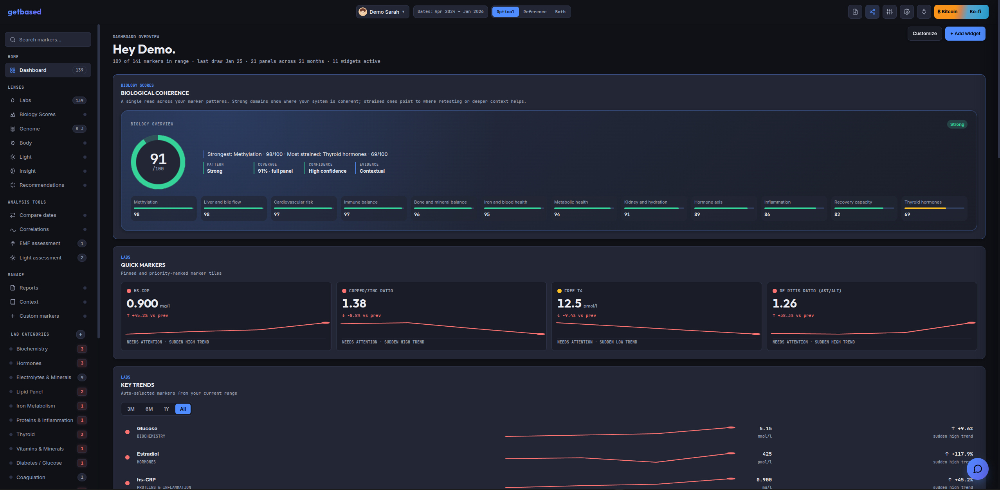

# getbased — personal health intelligence, under your control

**getbased** is an open-source, local-first health dashboard. Bring labs, DNA,
wearables, light exposure, lifestyle context, notes and optional AI analysis into
one browser-based workspace, with no account required.

**[Live app](https://app.getbased.health)** · **[Documentation](https://docs.getbased.health)** · **[Discord](https://discord.gg/zJdVB9zgQB)** · **[Nostr](https://njump.me/npub13xgjkyve82xesxxzvy52vz99z5fcuusda4cytekct2tw800kepas498nt2)**



## What you can do

- Import lab reports and review values, units, ranges and collection details before saving. Explore trends, calculated markers, date comparisons and Biology Scores.
- Add raw DNA, wearable data and manual body measurements. Keep supplement, medication and cycle history alongside your records.
- Track sun exposure, UV, indoor light, devices, room measurements and EMF assessments.
- Record health history, diet, sleep, exercise, goals and notes. Use separate profiles and create tailored reports.
- Ask optional AI questions using selected health context, your documents and interpretive lenses. Voice can run on-device or through a selected service.
- Export backups, optionally protect browser storage with a passphrase, sync encrypted profiles or share a password-protected copy.

The app groups these tools into **Labs**, **Genome**, **Body**, **Light** and
**Insight**. Biology Scores and AI explanations support learning and wellness;
they do not replace medical diagnosis or professional care.

See the [user guides](https://docs.getbased.health) and
[release notes](https://github.com/elkimek/get-based/releases) for details.

## Your data and optional connections

Profile data stays in browser storage by default. Keep backups: local-first
storage does not protect against clearing browser data or losing a device.
The installable PWA supports offline use after its assets are available;
network integrations and initial model downloads still need connectivity.

AI, connected wearables, encrypted sync, sharing, external Knowledge Bases and
Agent Access are optional. Enabling them changes which services receive data.
Remote AI activation identifies its destination and requests approval before
health content is sent; an image import cannot be scrubbed of identifiers.
Sync and profile sharing encrypt profile payloads in the browser. Compatibility
relays can read the credentials and provider responses they forward.

On the hosted app, cookieless anonymous pageview and outbound affiliate-click
counts are enabled by default. They contain no health data and can be disabled
in **Settings → Privacy**. For a strictly local setup, disable analytics, leave
remote features off and use same-device AI if needed.

Read the [optional integration guide](engineering/optional-integrations.md),
[security policy](SECURITY.md) and [architecture contract](ARCHITECTURE.md) for
storage, encryption and network boundaries. Review a selected provider's policies
before connecting it.

## Optional AI and services

Normal tracking works without AI. Supported AI paths include PPQ, Routstr,
OpenRouter, Venice AI, a local OpenAI-compatible server, CLI agents through the
getbased Companion, and a custom API. Availability and privacy depend on the
selected provider and mode; private chat does not automatically make voice private.
The Knowledge Base can index documents locally or connect to an external source.
See [provider, Companion, voice and Agent Access setup](engineering/optional-integrations.md)
for activation requirements and deployment configuration.

The core application needs no rendering backend. Some optional features use
external services or a local companion. Self-hosted deployments retain their own
provider credentials and integration requirements; see the
[compatibility relay](deploy/compat-proxy/README.md),
[profile-share service](deploy/profile-share/README.md) and
[environment example](.env.local.example). Do not put credentials in browser source.

## Run locally

Use **Node.js 24** and a modern browser:

```bash
git clone https://github.com/elkimek/get-based
cd get-based
npm ci
npm run dev-server
```

Open **http://localhost:8000/app**. The root URL may serve the sibling
`get-based-site` landing page when present.

This development server serves the source-compatible app. Edit authored
`.ts`, `.mts`, `.svelte` and Tailwind CSS sources; do not edit generated
`.js`, `.mjs` or CSS outputs. `npm ci` and the standard development, test and
production commands compile first. After edits, run `npm run typescript:build`
before invoking emitted Node entry points or Playwright directly.

## Build and verify

The production app uses **static SvelteKit 3**, **Svelte 5**, **TypeScript 7** and
**Tailwind CSS 4**. Node and npm are build tools; the built core runs on a static
host without a Node rendering server. Optional API/services are separate.

```bash
npm run production:build   # complete static distribution in dist/
npm run production:check   # validate a disposable static build
```

Serve `dist/` with the `/app` document rewrite and the existing CSP and MIME
contracts. Building locally does not publish the app. See
[static distribution and acceptance](engineering/static-sveltekit.md) for hosting,
PWA update/cache behavior and size-measurement boundaries. The source checkout's
`index.html` alone is not the assembled production distribution.

Choose checks relevant to a change:

```bash
npm test -- tests/<relevant-test>.test.ts
npm run typecheck:migration
npm run typecheck:migration-tests
npm run architecture:check
npm run quality
```

`typecheck:migration` checks application and tooling sources with strict
TypeScript options; `typecheck:migration-tests` checks maintained tests.
When runtime modules or imports change, run `npm run architecture:build` and
review the regenerated module map. Use focused headless browser cases for UI
changes; see [Contributing](CONTRIBUTING.md) and the
[testing policy](engineering/testing-policy.md) for commands and coverage rules.
CI verifies the shipping SvelteKit app across browser engines and enforces
startup, first-use and offline-cache budgets. Native compatibility tests and
combined source coverage run separately against the same authored sources.
The exhaustive browser and combined-coverage matrix belongs in CI by default.

## Source and project guides

- [`js/`](js/) — TypeScript application services, projections and Svelte components.
- [`css/`](css/) — authored Tailwind utilities/recipes and necessary custom CSS; build scripts preserve public stylesheet URLs.
- [`tooling/svelte/`](tooling/svelte/) and [`scripts/`](scripts/) — component tooling, static assembly and verification.
- [`tests/`](tests/) — unit, native-contract and browser tests.
- [`api/`](api/), [`server/`](server/) and [`bin/`](bin/) — optional integrations and Companion entry points.
- [Architecture](ARCHITECTURE.md), [generated module map](MODULE_MAP.md), [engineering guidance](engineering/README.md) and [brand guidance](brands/BRAND.md).

Related repositories: [documentation](https://github.com/elkimek/getbased-docs),
[agent skills](https://github.com/elkimek/getbased-agents),
[encrypted sync relay](https://github.com/elkimek/getbased-relay) and
[landing site](https://github.com/elkimek/get-based-site).

## Contributing and license

See [Contributing](CONTRIBUTING.md) for the workflow and
[Security](SECURITY.md) to report a vulnerability privately.

getbased is licensed under **[AGPL-3.0-or-later](LICENSE)**. Modified versions
made available over a network must offer corresponding source as the license
requires. See [third-party notices](THIRD_PARTY_LICENSES.md) for bundled components.
